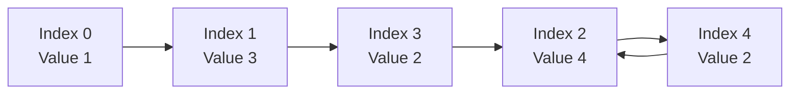

---

[287. Find the Duplicate Number](https://leetcode.com/problems/find-the-duplicate-number/)

For `nums = [1, 3, 4, 2, 2]`, here is the horizontal linked-list diagram showing how the cycle is formed.

The traversal is:

`Index 0 → Index 1 → Index 3 → Index 2 → Index 4 → Index 2 → …`

The cycle is `Index 2 → Index 4 → Index 2 → …`.

Remember: The duplicate value is `2`, which causes both index `3` and index `4` to point to index `2`.

---
