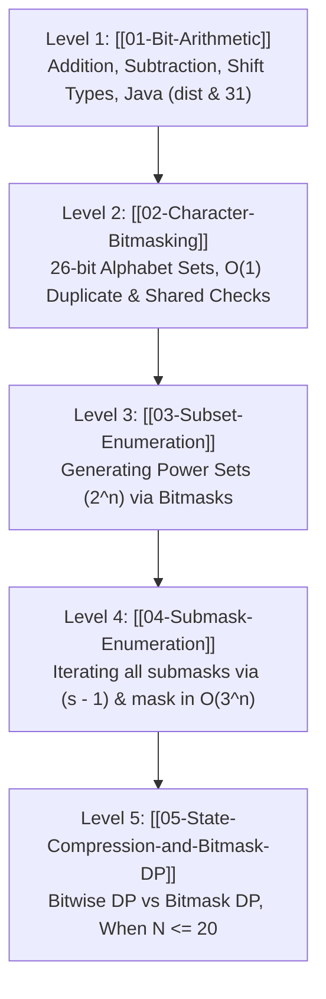

---
aliases:
  - AdvanceBitManipulation
  - AdvanceBitM
tags:
  - dsa
  - bit-manipulation
  - algorithms
  - revision
---

# Advanced Bit Manipulation — Roadmap & Cheat Sheet

> [!NOTE] Purpose of this Module
> While **Basic Bit Manipulation** deals with operators (`&`, `|`, `^`, `~`) and isolated bit twiddling, **Advanced Bit Manipulation** treats numbers as **algebraic processors, sets, and dynamic programming states**.
> 
> Follow this level-by-level guide for quick, structured revision.

---

## 🗺️ The 5-Level Learning Roadmap

---

## 📚 Curriculum Breakdown

| Level | Topic Note | Core Concept | Key Formula / Pattern | LeetCode Target |
| :---: | :--- | :--- | :--- | :--- |
| **01** | [[01-Bit-Arithmetic]] | Half-adder addition, borrow subtraction, shifts & Java shift masking | `sum = a ^ b; carry = (a & b) << 1;` | [371. Sum of Two Integers](https://leetcode.com/problems/sum-of-two-integers/) |
| **02** | [[02-Character-Bitmasking]] | Representing 26 alphabet characters in a single 32-bit `int` | `mask \|= (1 << (ch - 'a'))` | [318. Maximum Product of Word Lengths](https://leetcode.com/problems/maximum-product-of-word-lengths/) |
| **03** | [[03-Subset-Enumeration]] | Generating all $2^n$ subsets of an array iteratively | `for mask = 0 to (1 << n) - 1` | [78. Subsets](https://leetcode.com/problems/subsets/) |
| **04** | [[04-Submask-Enumeration]] | Generating submasks for a mask without checking invalid numbers | `submask = (submask - 1) & mask` | [Partition Subsets](https://leetcode.com/problems/partition-to-k-equal-sum-subsets/) |
| **05** | [[05-State-Compression-and-Bitmask-DP]] | Overview of State Compression & Bitmask DP (When $N \le 20$) | `dp[mask \| (1 << i)]` | [1986. Min Work Sessions](https://leetcode.com/problems/minimum-number-of-work-sessions-to-finish-the-tasks/) |

---

## ⚡ Master Quick-Revision Cheat Sheet

### 1. Fundamental Bit Mask Operations
| Target Operation | Formula (0-indexed from right) | In-place Form |
| :--- | :--- | :--- |
| **Read / Check bit $i$** | `(n & (1 << i)) != 0` | — |
| **Set bit $i$ (turn ON)** | `n \| (1 << i)` | `n \|= (1 << i)` |
| **Clear bit $i$ (turn OFF)** | `n & ~(1 << i)` | `n &= ~(1 << i)` |
| **Toggle bit $i$ (flip)** | `n ^ (1 << i)` | `n ^= (1 << i)` |

### 2. High-Yield Bit Tricks
| Target Operation | Formula | Explanation |
| :--- | :--- | :--- |
| **Check if Odd** | `(n & 1) == 1` | Bit 0 is 1 for odd numbers |
| **Check Power of 2** | `n > 0 && (n & (n - 1)) == 0` | Powers of 2 have exactly one set bit |
| **Remove Lowest Set Bit** | `n & (n - 1)` | Flips the rightmost `1` to `0` |
| **Isolate Lowest Set Bit** | `n & (-n)` | Keeps only the rightmost `1`, zeroes all else |

### 3. Advanced Combinatorial Formulas
| Target Operation | Formula / Loop | Complexity |
| :--- | :--- | :--- |
| **Power Set Iteration** | `for (int m = 0; m < (1 << n); m++)` | $O(n \cdot 2^n)$ |
| **Submask Enumeration** | `for (int s = m; s > 0; s = (s - 1) & m)` | $O(2^k)$ for mask $m$ ($O(3^n)$ total) |
| **No Common Chars** | `(maskA & maskB) == 0` | $O(1)$ check |
| **Palindrome Permutation** | `(mask & (mask - 1)) == 0` | At most 1 odd character frequency |

---

## 🎯 Curated LeetCode Practice Ladder

- **Arithmetic**:
  - [x] [LeetCode 371: Sum of Two Integers](https://leetcode.com/problems/sum-of-two-integers/) — Addition using XOR & Carry.
  - [ ] [LeetCode 29: Divide Two Integers](https://leetcode.com/problems/divide-two-integers/) — Division using shifts & overflow handling.
- **String Masking**:
  - [x] [LeetCode 771: Jewels and Stones](https://leetcode.com/problems/jewels-and-stones/) — Character presence.
  - [ ] [LeetCode 318: Maximum Product of Word Lengths](https://leetcode.com/problems/maximum-product-of-word-lengths/) — Disjoint word masks (`maskA & maskB == 0`).
- **Subsets**:
  - [ ] [LeetCode 78: Subsets](https://leetcode.com/problems/subsets/) — Iterative bitmask subset generation.
  - [ ] [LeetCode 90: Subsets II](https://leetcode.com/problems/subsets-ii/) — Handling duplicate elements.
- **State Compression & DP (For Future Reference)**:
  - [ ] [LeetCode 338: Counting Bits](https://leetcode.com/problems/counting-bits/) — Bitwise DP on numbers.
  - [ ] [LeetCode 1986: Minimum Number of Work Sessions to Finish Tasks](https://leetcode.com/problems/minimum-number-of-work-sessions-to-finish-the-tasks/) — Bitmask DP.
