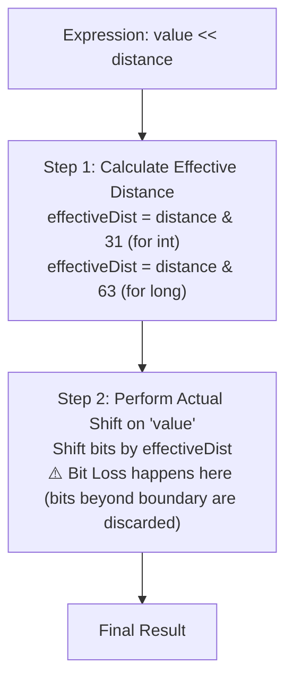

---
aliases:
  - BitArithmetic
tags:
  - dsa
  - bit-manipulation
  - arithmetic
---
# Level 1: Bit Arithmetic & Shift Mechanics

> [!NOTE] ✏️ Overview
> Bit arithmetic implements fundamental arithmetic operations (`+`, `-`, `*`, `/`) using bitwise logic directly. It relies on how digital circuits (half-adders and full-adders) perform computation in hardware using two's complement representation.

---

## 1. Binary Addition without `+` (XOR and AND)

### Rules

| A | B | Sum (`A ^ B`) | Carry (`A & B`) |
| :-: | :-: | :-: | :-: |
| 0 | 0 | 0 | 0 |
| 0 | 1 | 1 | 0 |
| 1 | 0 | 1 | 0 |
| 1 | 1 | 0 | **1** → carry to next bit |

> [!TIP] Short Rule
> Only `1 + 1` is special → sum = `0`, carry = `1` to the left. All other cases are straightforward.

- **XOR (`^`)**: sum bit (ignores carry)
- **AND (`&`)**: where carry is generated (both bits are `1`)
- **`<< 1`**: shifts carry one bit to the left

$$\text{Sum} = a \oplus b$$

$$\text{Carry} = (a \ \& \ b) \ll 1$$

---

### Trace: $5 + 3 = 8$

$$5 = 0101_2, \quad 3 = 0011_2$$

| | Bit 3 | Bit 2 | Bit 1 | Bit 0 |
| :--- | :---: | :---: | :---: | :---: |
| **a (5)** | 0 | 1 | 0 | 1 |
| **b (3)** | 0 | 0 | 1 | 1 |
| **carry in** | ← 1 | ← 1 | ← 1 | 0 |
| **Result** | **1** | **0** | **0** | **0** |

- Bit 0: `1 + 1 = 0`, carry = `1` →
- Bit 1: `0 + 1 + 1(carry) = 0`, carry = `1` →
- Bit 2: `1 + 0 + 1(carry) = 0`, carry = `1` →
- Bit 3: `0 + 0 + 1(carry) = 1`, carry = `0`

**Result = `1000` = 8** ✅

---

### Implementation (Java) — LeetCode 371

```java
class Solution {
    // Iterative
    public int getSum(int a, int b) {
        while (b != 0) {
            int sum = a ^ b;            // Add without carry
            int carry = (a & b) << 1;   // Carry shifted to next position
            a = sum;
            b = carry;
        }
        return a;
    }

    // Recursive one-liner
    public int getSumRecursive(int a, int b) {
        return (b == 0) ? a : getSumRecursive(a ^ b, (a & b) << 1);
    }
}
```

> [!TIP] Negative Numbers Handled Automatically
> Because Java uses **32-bit two's complement**, negative numbers are handled seamlessly by this logic with zero modifications (e.g., `-5 + 3`, `5 + (-3)`).

---

## 2. Binary Subtraction without `-` (XOR and Borrow)

### Rules

| A | B | Difference (`A ^ B`) | Borrow (`~A & B`) |
| :-: | :-: | :-: | :-: |
| 0 | 0 | 0 | 0 |
| 0 | 1 | 1 | **1** → borrow from next bit |
| 1 | 0 | 1 | 0 |
| 1 | 1 | 0 | 0 |

> [!TIP] Short Rule
> Only `0 - 1` is special → result = `1`, borrow = `1` from left (left bit loses `1`, you receive `+2`, so `2 - 1 = 1`).

- **XOR (`^`)**: difference bit (ignores borrow)
- **`~A & B`**: where borrow occurs (`A=0` and `B=1`)
- **`<< 1`**: shifts borrow one bit to the left (left neighbor pays it)

$$\text{Diff} = a \oplus b$$

$$\text{Borrow} = (\sim a \ \& \ b) \ll 1$$

---

### Trace: $7 - 2 = 5$

$$7 = 0111_2, \quad 2 = 0010_2$$

| | Bit 3 | Bit 2 | Bit 1 | Bit 0 |
| :--- | :---: | :---: | :---: | :---: |
| **a (7)** | 0 | 1 | 1 | 1 |
| **b (2)** | 0 | 0 | 1 | 0 |
| **borrow** | 0 | 0 | 0 | 0 |
| **Result** | **0** | **1** | **0** | **1** |

- Bit 0: `1 - 0 = 1`, no borrow
- Bit 1: `1 - 1 = 0`, no borrow
- Bit 2: `1 - 0 = 1`, no borrow
- Bit 3: `0 - 0 = 0`, no borrow

**Result = `0101` = 5** ✅

---

### Trace: $2 - 7 = -5$ (Negative Result)

$$2 = 0000\ 0010_2, \quad 7 = 0000\ 0111_2$$

| | Bit 7 | Bit 6 | Bit 5 | Bit 4 | Bit 3 | Bit 2 | Bit 1 | Bit 0 |
| :--- | :---: | :---: | :---: | :---: | :---: | :---: | :---: | :---: |
| **a (2)** | 0 | 0 | 0 | 0 | 0 | 0 | 1 | 0 |
| **b (7)** | 0 | 0 | 0 | 0 | 0 | 1 | 1 | 1 |
| **borrow** | ← 1 | ← 1 | ← 1 | ← 1 | ← 1 | ← 1 | ← 1 | 0 |
| **Result** | **1** | **1** | **1** | **1** | **1** | **0** | **1** | **1** |

- Bit 0: `0 - 1` → borrow! Bit 1 gives `1`, becomes `0`. Current gets `+2`. `2 - 1 = 1`
- Bit 1: `0 - 1` → borrow cascades up through all zero bits (bits 2–7)
- Bits 2–7: each borrows from the next, flipping all to `1` as the cascade resolves
- Bit 2: `1 - 1 = 0`, borrow stops here

**Result = `1111 1011` = -5 (two's complement)** ✅

---

### Implementation (Java)

```java
public int subtract(int a, int b) {
    while (b != 0) {
        int diff = a ^ b;             // Subtract without borrow
        int borrow = (~a & b) << 1;   // Calculate borrow and shift left
        a = diff;
        b = borrow;
    }
    return a;
}
```

> [!NOTE] Alternative Mathematical View
> $a - b = a + (-b)$. In two's complement, $-b = \sim b + 1$.
> So `subtract(a, b)` can also be computed as `getSum(a, getSum(~b, 1))`.

---

## 3. Multiplication & Division by Powers of 2

In base-2, shifting bits left or right multiplies or divides by powers of 2.

$$
x \times 2^k = x \ll k
$$

$$
x / 2^k = x \gg k \quad (\text{for non-negative } x)
$$

```java
int x = 5;
x << 1;  // 5 * 2^1 = 10
x << 2;  // 5 * 2^2 = 20
x << 3;  // 5 * 2^3 = 40

int y = 40;
y >> 1;  // 40 / 2^1 = 20
y >> 2;  // 40 / 2^2 = 10
y >> 3;  // 40 / 2^3 = 5
```

### The Three Java Shift Operators

| Operator | Name                             | Behavior                                                                                            | Negative Number Example                                         |
| :------- | :------------------------------- | :-------------------------------------------------------------------------------------------------- | :-------------------------------------------------------------- |
| `<<`   | **Signed Left Shift**      | Shifts bits left, fills vacated right bits with `0`.                                              | `5 << 1` $\rightarrow$ `10`                               |
| `>>`   | **Arithmetic Right Shift** | Shifts bits right, **preserves the sign bit** (fills left with 1 if negative, 0 if positive). | `-7 >> 1` $\rightarrow$ `-4` (floors towards $-\infty$) |
| `>>>`  | **Logical Right Shift**    | Shifts bits right, **always fills left with `0`** (treats number as unsigned).              | `-7 >>> 1` $\rightarrow$ `2147483644`                     |

> [!WARNING] ⚠️ Difference between `>> 1` and `/ 2` on Negative Numbers
> - Integer division `/` truncates towards **zero**: `-7 / 2 = -3`.
> - Arithmetic shift `>>` rounds towards **negative infinity**: `-7 >> 1 = -4`.

---

## 4. Integer Overflow & Boundaries

In Java, an `int` is a signed 32-bit integer:

- **Range**: $[-2^{31}, 2^{31} - 1]$
- **Minimum**: `Integer.MIN_VALUE` = $-2,147,483,648$ (`0x80000000`)
- **Maximum**: `Integer.MAX_VALUE` = $2,147,483,647$ (`0x7FFFFFFF`)

### What happens when an integer overflows?

Java does not throw an exception on overflow; it silently wraps around using two's complement modular arithmetic:

```java
int max = Integer.MAX_VALUE; //  2147483647 (0111...1111)
int next = max + 1;          // -2147483648 (1000...0000) -> Wraps to MIN_VALUE!
```

```
               0
        -1           +1
    -2                   +2
       ...           ...
  MIN_VALUE <-----> MAX_VALUE
          (wraps around)
```

### DSA Trap: Type Casting Before Arithmetic

```java
// WRONG: Overflow happens first, then cast to long
long bad = (long) (100000 * 100000); 

// CORRECT: Cast first operand so multiplication occurs in 64-bit space
long good = (long) 100000 * 100000;
```

---

## 5. Crucial Java Shift Distance Rule (`shift & 31`)

### The Big Surprise: What does `1 << 32` evaluate to?

If you have never seen this before, your natural intuition might be:

> *"An `int` has 32 bits. If I shift a bit left by 32 places, it should fall off the left edge completely and become `0`."*

**Try it in Java:**

```java
System.out.println(1 << 32); // Output: 1  (NOT 0!)
System.out.println(5 << 35); // Output: 40 (NOT 0!)
System.out.println(1 << -1); // Output: -2147483648 (shifts by 31!)
```

Why does this happen?

### The 2-Step Mental Model of Bit Shifting

Whenever Java evaluates `result = value << distance`:



1. **Step 1: Distance Normalization (Right-hand operand)**:
   - The CPU/JVM calculates the **effective shift distance** by masking: `effectiveDistance = distance & 31`.
   - The bits of `value` are **not moved yet**.
2. **Step 2: Actual Shift & Bit Loss (Left-hand operand)**:
   - The bits of `value` are moved by `effectiveDistance`.
   - Vacated positions are filled with `0`.
   - **Bit loss happens here**: Any bits pushed past bit position 31 fall off into the void and are permanently lost.

---

### Why the number `31`? Why 5 bits?

Let's connect the math and binary:

1. An `int` has **32 bit positions** (indexed from `0` to `31`).
2. To represent the numbers from `0` to `31`, you need exactly **5 bits** ($2^5 = 32$).
3. The number `31` in binary is:
   $$
   \text{Decimal } 31 = 0001 \ 1111_2 \quad (\text{five } 1\text{s})
   $$
4. Performing `distance & 31` acts as a **filter**: it zeroes out all higher bits and keeps **only the lowest 5 bits**.

```text
Any shift distance 'k' in binary:
  ... [Higher bits ignored] [ b4  b3  b2  b1  b0 ]
& ... [       0000 0000 ] [  1   1   1   1   1  ]  (31)
--------------------------------------------------
=                         [ b4  b3  b2  b1  b0 ]  (Only values 0 to 31!)
```

---

### Step-by-Step Breakdown of Examples

#### Example 1: `1 << 32`

- Binary of $32$: `...0010 0000`
- Take the lowest 5 bits: `00000` = `0`
- Java actually computes:
  $$
  \mathbf{1 \ll 0 = 1}
  $$

#### Example 2: `5 << 35`

- Binary of $35$:
  ```text
    35 in binary:  ... 0010 0011
  & 31 in binary:  ... 0001 1111
  ------------------------------
    Result:        ... 0000 0011  (= 3 in decimal)
  ```
- Java actually computes:
  $$
  \mathbf{5 \ll 3 = 5 \times 2^3 = 5 \times 8 = 40}
  $$

#### Example 3: Negative shift distance `1 << -1`

- In two's complement, $-1$ has all bits set to `1`: `1111...1111`
- Masking with `31`:
  ```text
    -1 in binary:  1111 1111 ... 1111 1111
  & 31 in binary:  0000 0000 ... 0001 1111
  ----------------------------------------
    Result:        0000 0000 ... 0001 1111  (= 31 in decimal)
  ```
- Java actually computes:
  $$
  \mathbf{1 \ll 31 = \text{Integer.MIN\_VALUE} = -2147483648}
  $$

---

### Summary Table for `int` vs `long`

| Data Type          |  Width  |   Bits Kept for Shift   |           Mask Expression           |  Valid Shift Range  |
| :----------------- | :-----: | :---------------------: | :----------------------------------: | :------------------: |
| **`int`**  | 32 bits | **Lowest 5 bits** | `shift & 31` (or `shift & 0x1F`) | $0 \text{ to } 31$ |
| **`long`** | 64 bits | **Lowest 6 bits** | `shift & 63` (or `shift & 0x3F`) | $0 \text{ to } 63$ |

```java
// Example with long:
long val = 1L;
val << 64; // Equivalent to val << (64 & 63) -> val << 0 = 1L !
val << 67; // Equivalent to val << (67 & 63) -> val << 3 = 8L !
```

---

### ⚠️ The #1 Confusion: "Shift Distance Wrapping" vs "Bit Loss"

Do not confuse these two completely different things:

```
  ┌────────────────────────────────────────────────────────┐
  │ 1. Shift Distance Masking (The RHS operand)             │
  │    - Applies to the distance argument k.               │
  │    - k is reduced modulo 32 (k & 31).                  │
  │    - You can NEVER tell Java to shift by 32 in one go. │
  └────────────────────────────────────────────────────────┘
                             vs
  ┌────────────────────────────────────────────────────────┐
  │ 2. Bit Discarding (The LHS operand's data)             │
  │    - Applies to the actual bits of the number.         │
  │    - When a bit moves past position 31, it is LOST.    │
  │    - Java does NOT rotate bits back to position 0!     │
  └────────────────────────────────────────────────────────┘
```

#### Compare these two cases side-by-side:

**Case A: Shifting by 32 in a single instruction**

```java
int x = 1;
int res = x << 32; 
// Step 1: Distance 32 is masked: 32 & 31 = 0
// Step 2: x is shifted left by 0
// res is 1. (No bits moved at all!)
```

**Case B: Shifting in two valid steps**

```java
int x = 1;
x = x << 30; // Bit is now at position 30 (0100...0000)
x = x << 3;  // Shift by 3: bit 30 moves to position 33 -> FALLS OFF!
// x is now 0. (The bit crossed the 32-bit boundary and was discarded!)
```

> [!IMPORTANT] ❗ Takeaway for Interviews
> - Left shift (`<<`) is **NOT** a circular rotation. Bits shifted off the end are permanently destroyed.
> - The shift distance is **always masked with 31** (for `int`) or **63** (for `long`).
> - Why hardware does this: x86 and ARM CPU shift instructions (`SHL`, `SHR`) only accept 5-bit register values for 32-bit operations. Java maps directly to the CPU instruction for speed.

---

## 📝 Practice & Revision Checklist

- [X] Can you explain why XOR is sum and AND is carry?
- [X] Can you write `getSum(a, b)` without looking?
- [X] Do you know why `-7 >> 1` is `-4` while `-7 / 2` is `-3`?
- [X] What is the result of `1 << 32` in Java? *(Answer: `1`, because `32 & 31 == 0`)*.
- [X] [LeetCode 371: Sum of Two Integers](https://leetcode.com/problems/sum-of-two-integers/)
- [X] [LeetCode 29: Divide Two Integers](https://leetcode.com/problems/divide-two-integers/)
