# Kafka KRaft Architecture – Clean Notes

---

## Table of Contents

1. [The Problem KRaft Solves & Cluster Metadata](#1-the-problem-kraft-solves--cluster-metadata)
2. [Why Kafka Used ZooKeeper (and Its Problems)](#2-why-kafka-used-zookeeper-and-its-problems)
3. [What is KRaft?](#3-what-is-kraft)
4. [Roles in a KRaft Cluster: Controllers vs. Brokers](#4-roles-in-a-kraft-cluster-controllers-vs-brokers)
5. [The Metadata Log: `__cluster_metadata` & Storage](#5-the-metadata-log-__cluster_metadata--storage)
6. [Raft Consensus & Quorum Mathematics](#6-raft-consensus--quorum-mathematics)
7. [Step-by-Step Flow: Topic Creation](#7-step-by-step-flow-topic-creation)
8. [Failure Handling: Controller Crash vs. Broker Crash](#8-failure-handling-controller-crash-vs-broker-crash)
9. [Deployment Models: Combined Mode vs. Dedicated Mode](#9-deployment-models-combined-mode-vs-dedicated-mode)
10. [Configuration & Cluster Setup](#10-configuration--cluster-setup)
11. [Corrections to Common Misconceptions](#11-corrections-to-common-misconceptions)
12. [Revision Guide, Syllabus & Cheat Sheet](#12-revision-guide-syllabus--cheat-sheet)

---

## 1. The Problem KRaft Solves & Cluster Metadata

### 1.1 Kafka is a Distributed System
Kafka does not run on just one machine. A production Kafka cluster consists of multiple servers called **brokers** working together.

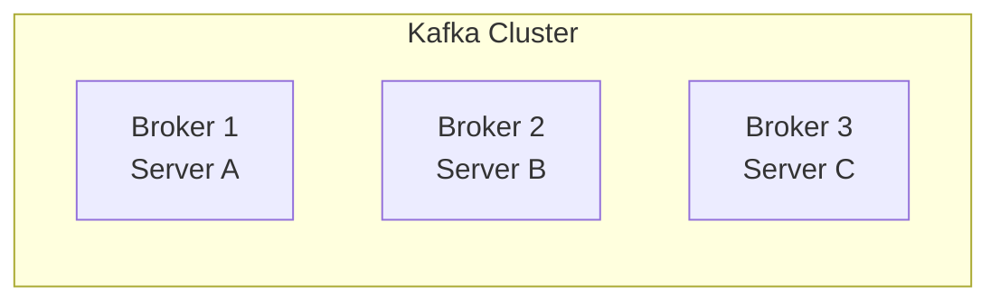

Your applications (such as a Spring Boot microservice) produce and consume events like `OrderCreated`, `PaymentCompleted`, or `OrderShipped`. Kafka stores these events in **topics**, and each topic is split into **partitions** distributed across brokers:

| Topic | Partitions |
| :--- | :--- |
| `orders` | 3 |
| `payments` | 2 |
| `shipments` | 2 |

### 1.2 The Core Problem: Who Coordinates the Cluster?
Because the cluster is distributed across multiple machines, someone must answer critical management questions:
- Which topics exist right now?
- How many partitions does each topic have?
- Which broker is the **leader** responsible for reads and writes on partition `orders-0`?
- What happens if Broker 2 crashes? Who picks the next partition leader?

Kafka needs a **central source of truth** to track this state. This coordination information is called **Cluster Metadata**.

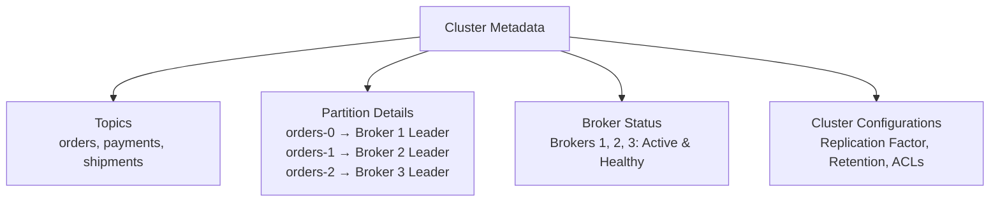

### 1.3 Business Data vs. Cluster Metadata
Never confuse application business data with cluster metadata:

| User / Business Data | Cluster Metadata |
| :--- | :--- |
| `OrderCreated` JSON payload | The topic `orders` exists |
| Customer payment details | `orders` has 3 partitions |
| Shipment tracking updates | Broker 1 is the leader for `orders-0` |
| Messages stored inside partitions | Broker 2 is alive and registered |

- **Brokers** store and serve your actual messages.
- **Controllers** manage the cluster metadata.

---

## 2. Why Kafka Used ZooKeeper (and Its Problems)

Historically, Kafka could not manage its own metadata. It relied on an external distributed coordination system called **Apache ZooKeeper**.

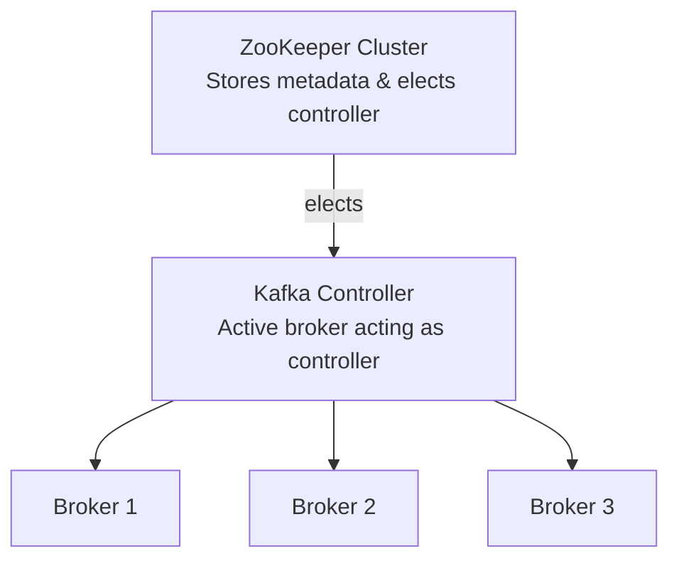

In this old design, ZooKeeper stored cluster metadata and elected one broker to act as the active controller.

### The Problems with ZooKeeper
While ZooKeeper worked, it introduced severe operational and architectural pain points:
1. **Double System Overhead:** Administrators had to configure, secure, monitor, and upgrade two separate distributed systems (ZooKeeper and Kafka) instead of just one.
2. **Dual Security Models:** Security (firewalls, TLS, ACLs) had to be maintained across Kafka and ZooKeeper independently.
3. **Metadata Bottlenecks & Slow Failover:** When the active controller crashed, the newly elected controller had to read all metadata anew from ZooKeeper and load it into memory. For large clusters with hundreds of thousands of partitions, failover took minutes, causing cluster-wide stalls.

Kafka needed to become **self-contained** and manage its own metadata directly. This led to the creation of **KRaft**.

---

## 3. What is KRaft?

**KRaft stands for Kafka Raft.** It is Kafka's built-in metadata management architecture based on the **Raft consensus algorithm**.

> **In Simple English:** KRaft allows Kafka to store, replicate, and manage its cluster metadata internally using its own controller nodes, completely eliminating the need for ZooKeeper.

Key takeaways:
- Metadata changes are recorded as events inside an internal Kafka log.
- A quorum of **Controller nodes** uses the Raft consensus algorithm to safely agree on every metadata change before committing it.

---

## 4. Roles in a KRaft Cluster: Controllers vs. Brokers

A KRaft cluster separates operational responsibilities into two distinct components:

| Responsibility | Controller | Broker |
| :--- | :--- | :--- |
| **Primary Job** | Manages cluster metadata | Stores and serves actual business messages |
| **Consensus Role** | Participates in Raft consensus voting | Does not vote in metadata consensus |
| **Data Handled** | `__cluster_metadata` log | User topic partition logs (`orders`, etc.) |
| **Client Interaction** | Coordinates broker registrations & partition leaders | Handles producer writes and consumer reads |

### 4.1 Controller Quorum Roles
In a controller quorum (e.g., 3 controllers):
- **Active Controller (Raft Leader):** Exactly **one** controller serves as the active Raft leader. It receives metadata requests, appends records to the metadata log, and coordinates replication.
- **Standby Controllers (Raft Followers):** Replicate the metadata log in the background. If the active leader fails, they participate in an election to immediately take over.

### 4.2 Raft Leader vs. Partition Leader
This is one of the most common interview points of confusion:

| Feature | Raft Leader | Partition Leader |
| :--- | :--- | :--- |
| **Scope** | Manages the **metadata consensus** for the whole cluster | Handles **reads and writes** for one specific topic partition |
| **Where it runs** | On a **Controller** node | On a **Broker** node |
| **How many exist?** | Exactly **one** active leader per cluster | **Many** (one per partition, spread across all brokers) |

---

## 5. The Metadata Log: `__cluster_metadata` & Storage

### 5.1 What is `__cluster_metadata`?
Instead of storing metadata in external z-nodes (as ZooKeeper did), KRaft stores all cluster metadata in an internal, append-only Kafka log called **`__cluster_metadata`**.

Think of this log as the **official, immutable event journal** of the cluster:

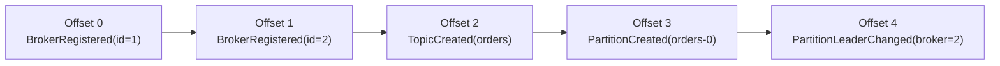

- Every metadata change is an append-only event record with a sequential offset.
- Past records are never edited in place; subsequent state changes append a new event.

### 5.2 Every Controller Maintains a Local Replica
Every controller in the quorum holds its own local copy of `__cluster_metadata`.

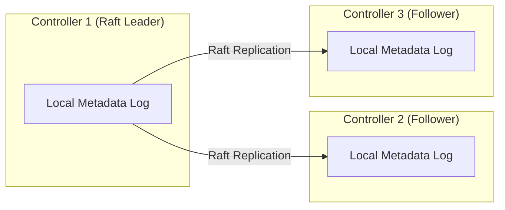

**Why is this a breakthrough?**
In ZooKeeper, when a controller failed, the new controller had to fetch everything over the network. In KRaft, standby controllers are already continuously replicating the log. When Controller 1 crashes, Controller 2 already has the full metadata history locally in memory and disk—enabling **near-instant failover**.

### 5.3 Who Else Receives Metadata?
- **Controller Nodes (Voters):** Replicate the log and cast votes in Raft elections.
- **Broker-Only Nodes (Observers):** Receive metadata updates from the active controller to keep their local caches up to date for client routing, but do **not** participate in Raft voting.
- **Combined Nodes:** Run both broker and controller roles in the same JVM process.

### 5.4 Physical Storage on Disk
`__cluster_metadata` is stored on disk inside log segments and index files:

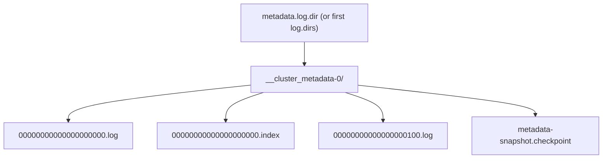

### 5.5 Fast Recovery with Metadata Snapshots
Over months of running, millions of metadata events will accumulate. Replaying millions of records from offset 0 whenever a controller reboots would take far too long.

**The Solution:** Kafka periodically generates a **Metadata Snapshot**—a compacted checkpoint of the current cluster state up to a specific offset.

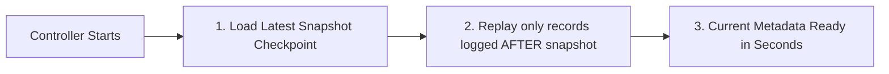

---

## 6. Raft Consensus & Quorum Mathematics

### 6.1 Quorum Formula
To ensure that all decisions are safe and prevent "split-brain" (where two nodes think they are both leader), KRaft requires a **strict majority** for any action.

$$\text{Majority} = \lfloor N / 2 \rfloor + 1$$

Where $N$ is the total number of voting controllers in the quorum.

| Total Controllers ($N$) | Majority Needed | Maximum Failures Tolerated |
| :---: | :---: | :---: |
| 1 | 1 | 0 |
| 3 | 2 | 1 |
| 4 | 3 | 1 |
| **5** | **3** | **2** |
| 7 | 4 | 3 |

### 6.2 Why Quorums Use Odd Numbers (3 or 5)
Notice the comparison between 3 and 4 controllers:
- A cluster of **3 controllers** requires 2 votes to make decisions $\rightarrow$ tolerates **1 failure**.
- A cluster of **4 controllers** requires 3 votes to make decisions $\rightarrow$ still tolerates only **1 failure**.

Adding the 4th controller adds hardware and network overhead without increasing failure tolerance. Therefore, quorums almost always use odd numbers (typically **3** for small-to-medium clusters, and **5** for large production clusters).
*(Note: Kafka does not forbid even numbers; they are simply less cost-effective).*

### 6.3 What Happens if the Quorum is Lost?
If 2 out of 3 controllers crash:
- Only 1 controller remains online.
- It cannot achieve the required majority of 2.
- **Result:** The cluster becomes **read-only for metadata**. Existing topics can still process message traffic through brokers, but no new topics can be created, no partition reassignments can occur, and failed partition leaders cannot be replaced until quorum is restored.

### 6.4 The Two Times Majority is Used
The strict majority rule is required in two distinct scenarios:

1. **Leader Election:** When the active controller fails, a candidate must receive votes from a majority of controllers to become the new leader.
2. **Metadata Commit:** When a metadata event is appended, it is only considered committed once a majority of controllers have persisted it to their local logs.

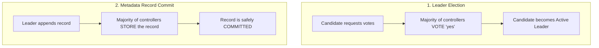

---

## 7. Step-by-Step Flow: Topic Creation

To see how controllers, brokers, and Raft consensus interact, walk through what happens when an administrator creates a topic named `orders` (3 partitions, replication factor 3):

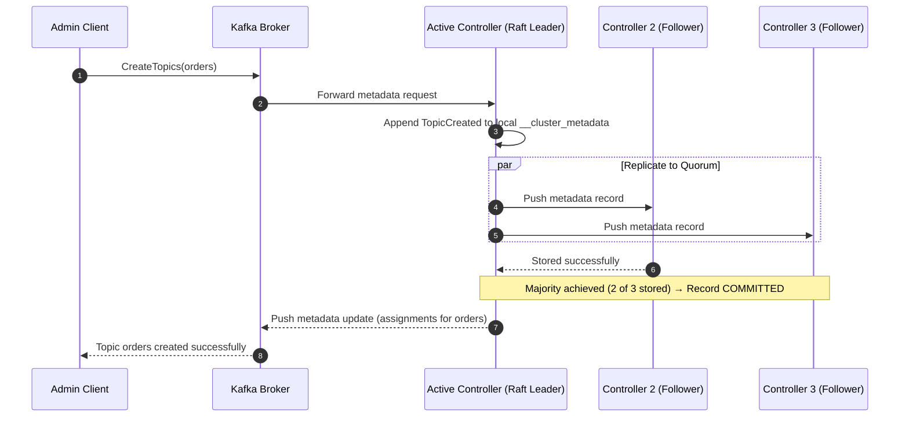

1. **Request:** The client issues `CreateTopics` to any broker.
2. **Forwarding:** The broker forwards the request to the active controller.
3. **Local Append:** The active controller writes a `TopicCreated` record to its local `__cluster_metadata` log.
4. **Replication:** The leader replicates the record to follower controllers via Raft RPCs.
5. **Commitment:** Once Controller 2 acknowledges writing the record, a majority (2 out of 3) is reached, and the record is permanently committed.
6. **Propagation:** The active controller pushes updated metadata to all brokers.
7. **Ready:** Brokers initialize the partitions and begin accepting client traffic.

---

## 8. Failure Handling: Controller Crash vs. Broker Crash

### 8.1 Scenario A: Active Controller Crashes
When Controller 1 (the current Raft leader) crashes:

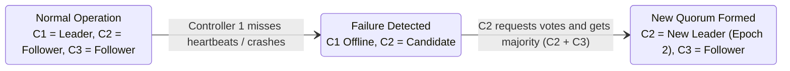

1. Standby controllers detect missing heartbeats.
2. Controller 2 transitions to **candidate** state and requests votes.
3. Controller 3 votes for Controller 2.
4. Having 2 out of 3 votes (a majority), Controller 2 becomes the new active leader.
5. Because Controller 2 already has the replicated `__cluster_metadata` log, it starts serving requests immediately.

### 8.2 Leadership Fencing: The Controller Epoch
To prevent "split-brain" or zombie leaders (for example, if Controller 1 temporarily paused due to a network partition and then comes back), KRaft uses a **Controller Epoch** (generation number):

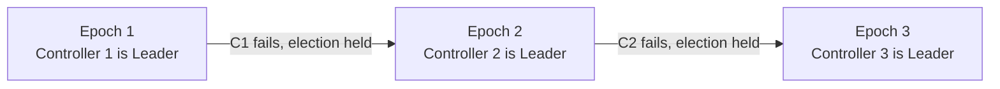

- When a new leader is elected, the epoch increments.
- If Controller 1 wakes up and attempts to issue commands stamped with Epoch 1, other nodes reject them because Epoch 2 is already active. This is called **leadership fencing**.

### 8.3 Scenario B: Broker Crashes
Brokers do not run Raft consensus elections among themselves. When a broker hosting partition leaders crashes:

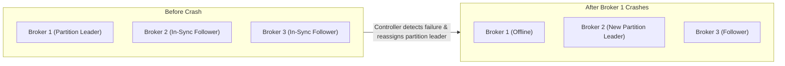

1. The broker fails to send heartbeats to the active controller.
2. The **active controller** detects the failure and inspects the partition's In-Sync Replica (ISR) list.
3. The controller elects an eligible in-sync replica (e.g., Broker 2) as the new partition leader.
4. The controller appends a `PartitionLeaderChanged` record to `__cluster_metadata`, commits it via Raft, and notifies the brokers.

### 8.4 Comparing Failure Types

| Failure Dimension | Controller Failure | Broker Failure |
| :--- | :--- | :--- |
| **Who Crashed?** | A node managing metadata | A node hosting message partitions |
| **Election Type** | **Raft Leader Election** | **Partition Leader Election** |
| **Who Elects?** | The remaining voting controllers | The active **Controller** |
| **Epoch Used** | **Controller Epoch** | **Partition Leader Epoch** |

---

## 9. Deployment Models: Combined Mode vs. Dedicated Mode

Choosing between Combined and Dedicated mode is a **topological hardware decision**, not a change in the Raft consensus protocol.

### 9.1 Combined Mode (Shared Roles)
Each server runs both broker and controller roles within the same JVM process.

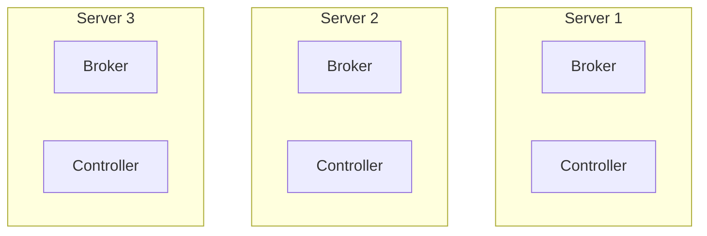

Configuration:
```properties
process.roles=broker,controller
```

- **Pros:** Cost-effective; requires only 3 servers total; simple to manage.
- **Cons:** Shared CPU, RAM, and disk I/O. Heavy client message traffic on a broker can starve the controller of resources, causing heartbeat timeouts and spurious leader re-elections.
- **Best For:** Development, testing, learning, and smaller production workloads.

---

### 9.2 Dedicated Mode (Isolated Roles)
Brokers and controllers run on physically separate machines.

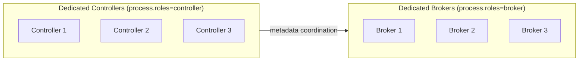

- **Pros:** Complete resource isolation. Controllers are completely unaffected by heavy producer/consumer traffic, large garbage collection pauses, or disk saturation on brokers. You can scale broker capacity independently.
- **Cons:** Requires more hardware (e.g., 3 controller machines + $N$ broker machines = minimum 6 machines for a 3-node broker cluster).
- **Best For:** Large, high-throughput, enterprise production environments.

### 9.3 Deployment Comparison

| Metric | Combined Mode | Dedicated Mode |
| :--- | :--- | :--- |
| `process.roles` | `broker,controller` | `controller` on quorum nodes; `broker` on data nodes |
| Hardware footprint (3 controllers + 3 brokers) | 3 machines | 6 machines |
| Resource isolation | Low (shared CPU, disk, memory) | High (isolated environments) |
| Operational complexity | Low | Moderate |
| Production suitability | Small-to-medium clusters | High-throughput, mission-critical clusters |

---

## 10. Configuration & Cluster Setup

### 10.1 Key KRaft Configuration Properties

| Property | Description |
| :--- | :--- |
| `process.roles` | Specifies the role of the node: `broker`, `controller`, or `broker,controller`. (If omitted, Kafka runs in legacy ZooKeeper mode). |
| `node.id` | A unique integer identifying this node across the cluster (replaces the older `broker.id`). |
| `controller.quorum.voters` | The static list of voting controllers in the format `id@host:port`. |
| `controller.listener.names` | The name of the listener used specifically for controller communication (e.g., `CONTROLLER`). |
| `listeners` | All network addresses and ports the node listens on for client, inter-broker, and controller traffic. |
| `log.dirs` | Storage directories where broker message partitions are persisted. |
| `metadata.log.dir` | Storage directory for the controller metadata log. *(If omitted, Kafka defaults to the first directory specified in `log.dirs`).* |

### 10.2 Decoding `controller.quorum.voters`
A typical configuration looks like:
```properties
controller.quorum.voters=1@ctrl1.example.com:9093,2@ctrl2.example.com:9093,3@ctrl3.example.com:9093
```

Breaking down an individual entry `1@ctrl1.example.com:9093`:
- `1`: Node ID of the controller.
- `ctrl1.example.com`: Hostname or IP address where the controller is reachable.
- `9093`: Network port dedicated to internal controller quorum communication.

> [!NOTE]
> Modern Kafka also supports **Dynamic Controller Quorums**, allowing controllers to be added or removed dynamically without restarting the entire cluster. `controller.quorum.voters` represents the static configuration approach.

### 10.3 Cluster ID & Storage Formatting
Before starting a KRaft cluster for the first time, storage directories must be formatted with a unique **Cluster ID**:
```bash
# Generate a unique Cluster ID
kafka-storage.sh random-cluster-id

# Format storage directories with this Cluster ID
kafka-storage.sh format -t <cluster-id> -c server.properties
```
**Why is this required?**
The Cluster ID prevents nodes belonging to different clusters from accidentally joining or writing into another cluster's metadata logs.

---

## 11. Corrections to Common Misconceptions

| Common Statement / Myth | Accurate Architectural Reality |
| :--- | :--- |
| *"Metadata updates propagate in sub-milliseconds."* | KRaft propagation is fast, but real latency depends on network round-trip time, disk write performance, and current cluster load. There is no guaranteed sub-millisecond SLA. |
| *"Controller failover takes milliseconds."* | While KRaft failover is significantly faster than ZooKeeper (which took minutes on large clusters), election and takeover depend on failure detection timeouts (`controller.quorum.election.timeout.ms`). |
| *"You must never configure an even number of controllers."* | An even quorum works safely, but it is inefficient. For example, 4 controllers tolerate the exact same number of failures (1) as 3 controllers. |
| *"Controllers store metadata only in memory."* | Controllers keep an in-memory metadata image for fast reads, but every change is backed by an append-only, durable log on disk (`__cluster_metadata`). |
| *"ZooKeeper had a hard limit of 200,000 partitions."* | 200k was a recognized operational scalability threshold where controller recovery times became problematic, not a strict software hard limit. |
| *"Dedicated mode is mandatory for production."* | While recommended for heavy enterprise workloads, many stable production environments successfully use combined mode for modest throughput requirements. |
| *"Controller port 9093 is mandatory."* | Port 9093 is an industry convention; you can configure any valid, accessible TCP port in your listener definitions. |

---

## 12. Revision Guide, Syllabus & Cheat Sheet

### 12.1 The Complete Architecture at a Glance

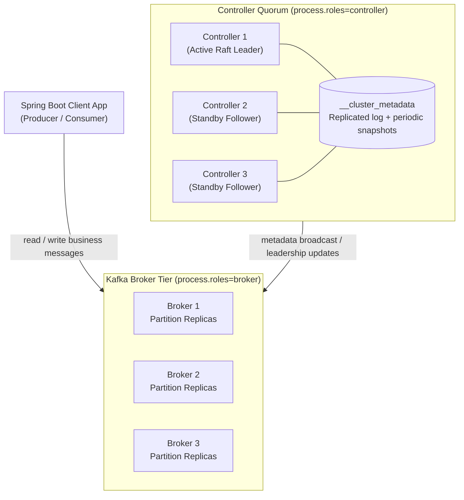

- Applications communicate **only** with brokers.
- Controllers manage metadata consensus using Raft.
- Brokers read and store business data; controllers govern who leads which partition.

### 12.2 Quorum Replication vs. Partition Replication

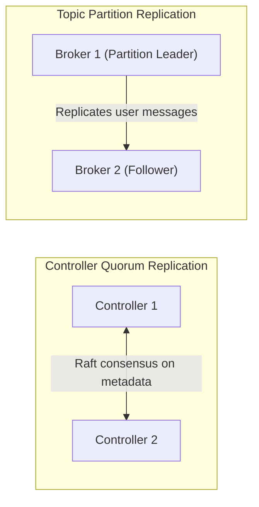

| Dimension | Quorum Replication | Partition Replication |
| :--- | :--- | :--- |
| **What is replicated?** | Cluster metadata (`__cluster_metadata`) | Business messages (`orders`, etc.) |
| **Participants** | Controller nodes | Broker nodes |
| **Consensus Engine** | Built-in Raft consensus | Kafka ISR (In-Sync Replicas) protocol |

### 12.3 Concept Syllabus Tracker

| Concept | Priority | Status |
| :--- | :--- | :--- |
| Cluster Metadata vs. Business Data | Essential | Mastered |
| ZooKeeper Limitations vs. KRaft Solution | Essential | Mastered |
| Controller vs. Broker Roles | Essential | Mastered |
| Raft Leader vs. Partition Leader | Essential | Mastered |
| `__cluster_metadata` Log & Local Copies | Essential | Mastered |
| Quorum Mathematics & Majority Rule | Essential | Mastered |
| Failover & Epoch Fencing | Essential | Mastered |
| Combined vs. Dedicated Deployment | Essential | Mastered |
| Metadata Snapshots & Log Compaction | Important | Mastered |
| Storage Formatting & Node ID Configuration | Important | Mastered |
| Partition Leader Reassignment Flow | Important | Mastered |
| `metadata.version` Feature Flags | Important | Next to explore |
| Dynamic Controller Quorum Expansion | Advanced | Next to explore |
| KRaft Metrics & Quorum Monitoring | Advanced | Next to explore |
| Migrating Legacy ZooKeeper to KRaft | Historical / Advanced | Next to explore |

### 12.4 The 5 Foundation Questions
If you can clearly answer these 5 questions without referencing notes, you have mastered the KRaft core:
1. **Why does Kafka need a controller?** (To serve as the single source of truth for cluster metadata, broker states, and partition leadership assignments).
2. **Why do we need a controller quorum instead of one controller?** (To eliminate the single point of failure so another node can take over immediately if the leader crashes).
3. **What is Raft consensus in KRaft?** (The consensus algorithm controllers use to elect a leader and commit metadata log entries by strict majority agreement).
4. **What happens when the active controller crashes?** (Standby controllers detect missed heartbeats, hold an election, vote by majority for a candidate stamped with a higher epoch, and take over without re-fetching metadata).
5. **What is the difference between Raft leader election and Partition leader election?** (Raft leader election is held among controllers to elect the metadata leader; Partition leader election is performed by the active controller to choose which broker serves reads/writes for a topic partition).

---

## One-Page Cheat Sheet

| Component / Term | Core Fact to Remember |
| :--- | :--- |
| **Metadata** | Cluster state data (topics, partition leaders, configs); **never** application payloads. |
| **KRaft** | Kafka Raft metadata architecture that completely replaces external ZooKeeper. |
| **Controller** | Manages metadata, runs Raft consensus; exactly one is the active Raft leader. |
| **Broker** | Stores and serves actual client messages; hosts partition leaders/followers. |
| **`__cluster_metadata`** | Internal append-only metadata log replicated to all controllers. |
| **Snapshot** | Periodic point-in-time state checkpoint; enables near-instant controller boot/recovery. |
| **Majority Rule** | $\lfloor N / 2 \rfloor + 1$; required both to **elect a leader** and to **commit a metadata record**. |
| **Quorum Sizing** | Use odd numbers (3 or 5); adding a 4th controller adds overhead without improving failure tolerance. |
| **Epoch** | Leadership generation number that acts as a fence to reject stale/zombie leaders. |
| **Combined Mode** | `process.roles=broker,controller` on the same machine; economical, ideal for dev/testing. |
| **Dedicated Mode** | Separate controller and broker hardware; isolated resources, ideal for production. |
| **Controller Crash** | Quorum holds a Raft election to pick a new active controller. |
| **Broker Crash** | Active controller assigns an in-sync replica broker to become the new partition leader. |
