# Kafka KRaft Architecture – Clean Notes

---

## Table of Contents

1. [The Problem KRaft Solves](#1-the-problem-kraft-solves)
2. [Cluster Metadata](#2-cluster-metadata)
3. [Why Kafka Used ZooKeeper (and its problems)](#3-why-kafka-used-zookeeper-and-its-problems)
4. [What is KRaft?](#4-what-is-kraft)
5. [Raft Consensus](#5-raft-consensus)
6. [Controller vs Broker](#6-controller-vs-broker)
7. [Metadata Log `__cluster_metadata`](#7-metadata-log-__cluster_metadata)
8. [How KRaft Works – Topic Creation Flow](#8-how-kraft-works--topic-creation-flow)
9. [Failures: Controller Crash vs Broker Crash](#9-failures-controller-crash-vs-broker-crash)
10. [Quorum Mathematics](#10-quorum-mathematics)
11. [Combined Mode vs Dedicated Mode](#11-combined-mode-vs-dedicated-mode)
12. [Other Important Concepts](#12-other-important-concepts)
13. [Corrections to Common Statements](#13-corrections-to-common-statements)
14. [Configuration Properties](#14-configuration-properties)
15. [Revision: Overview, Syllabus, Final Advice](#15-revision-overview-syllabus-final-advice)

---

## 1. The Problem KRaft Solves

**Key idea:** Kafka is a **distributed system**. It does not necessarily run on one server. A Kafka cluster can have many servers, called **brokers**.

Example: 3 brokers on 3 independent machines, working together as one Kafka cluster.

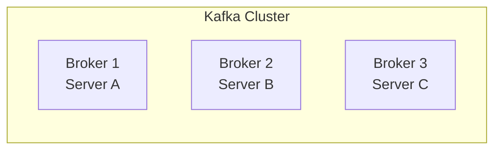

Your Spring Boot app sends events:

- `OrderCreated`
- `PaymentCompleted`
- `OrderShipped`

Kafka stores events in **topics**. Topics are divided into **partitions**.

| Topic     | Partitions |
| --------- | ---------- |
| orders    | 3          |
| payments  | 2          |
| shipments | 2          |

### The important question

**Who manages the whole cluster?** For example:

- Who knows which topics exist?
- Who knows how many partitions a topic has?
- Which broker is responsible for a particular partition?
- Which broker is the **leader** of a partition?
- What happens if Broker 2 crashes?
- Who decides the new partition leader?

Kafka needs a **central source of truth** for this information. This information is called **Cluster Metadata**.

---

## 2. Cluster Metadata

**Definition:** Metadata is the configuration and management information of your Kafka cluster.

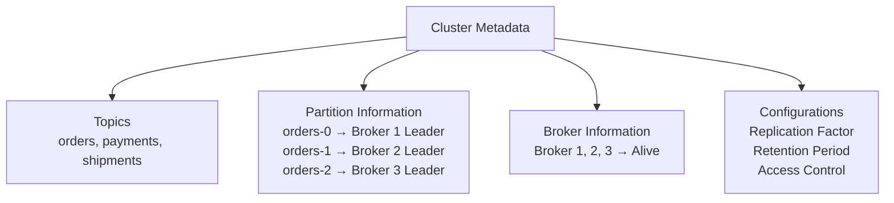

### Metadata is NOT your business data

| User Data (business data)         | Metadata                     |
| --------------------------------- | ---------------------------- |
| OrderCreated event                | orders topic exists          |
| PaymentCompleted event            | orders has 3 partitions      |
| Customer information in a message | Broker 1 is partition leader |
| Shipment event                    | Broker 2 is alive            |

- **Brokers** store and serve your actual messages.
- **Controller** manages cluster metadata.

> **Key point:** This distinction (data vs metadata) is the foundation of KRaft.

---

## 3. Why Kafka Used ZooKeeper (and its problems)

Initially, Kafka did **not** use the modern KRaft architecture. It depended on another distributed system called **Apache ZooKeeper**.

Kafka has 3 brokers, but needs something to manage their metadata. So it used an external system: ZooKeeper.

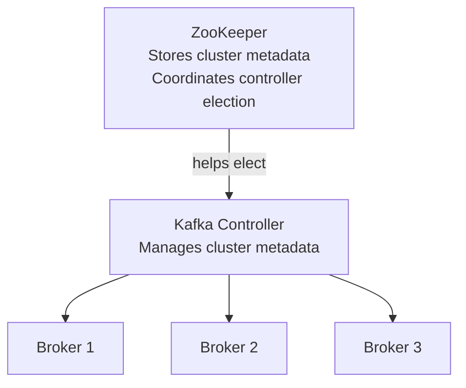

### What was the problem?

ZooKeeper worked, but it added **operational complexity**.

Imagine you are a DevOps engineer running Kafka in production. You must manage:

- Kafka itself
- ZooKeeper separately
- ZooKeeper monitoring
- ZooKeeper security
- ZooKeeper upgrades
- Communication between Kafka and ZooKeeper

**You manage two distributed systems instead of one.**

There were also **metadata scalability** and **controller recovery** challenges.

Kafka developers wanted Kafka to manage its own metadata **without an external ZooKeeper cluster**. That is why KRaft was created.

---

## 4. What is KRaft?

**KRaft = Kafka Raft.**

KRaft is Kafka's **internal metadata management architecture**, based on the **Raft consensus algorithm**.

> **In simple English:** KRaft lets Kafka store, replicate, and manage its cluster metadata using Kafka's own **controller nodes**, instead of depending on ZooKeeper.

Two important things:

1. Kafka has **Controller nodes** that manage metadata.
2. Controller nodes use the **Raft algorithm** to agree on metadata changes.

---

## 5. Raft Consensus

This is the most important concept to understand before moving forward.

### 5.1 What is the problem?

Suppose you have 3 controller nodes: Controller 1, 2, 3. All three keep information about the Kafka cluster.

An admin creates a new topic called `orders`. **Who decides whether this change is accepted and recorded?**

The controllers must **agree** on the change. This agreement is called **Distributed Consensus**

### 5.3 Why do we need multiple controllers?

If we had only **one** controller and it crashed, nobody could manage metadata changes until it recovered. That is a **single point of failure**.

With three controllers (a **Controller Quorum**):

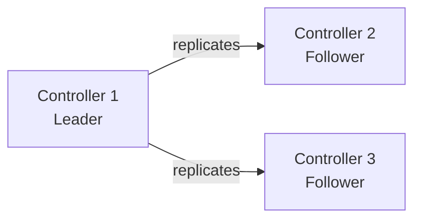

- One controller becomes the **Raft leader**.
- The other controllers become **followers**.
- The leader coordinates metadata changes.
- Followers replicate the metadata log.
- If the leader fails, the remaining controllers can elect a new leader.

> **Quorum** = a group of controllers that must reach a **majority** to make progress.

---

## 6. Controller vs Broker

A KRaft cluster has two responsibilities, handled by different components:

1. Managing metadata → **Controller**
2. Storing and serving actual messages → **Broker**

| Controller                               | Broker                                 |
| ---------------------------------------- | -------------------------------------- |
| Manages cluster metadata                 | Stores actual Kafka messages           |
| Participates in Raft consensus           | Handles producer and consumer requests |
| Manages partition leadership assignments | Hosts partition replicas               |
| Coordinates broker registration          | Serves partition data                  |
| Maintains cluster metadata state         | Maintains user data                    |

###

### 6.1 Controller roles (in a 3-controller cluster)

- **Active Controller (Raft Leader):** Only **one** controller is the active Raft leader at a time. It coordinates metadata changes and replication.
- **Standby Controllers (Raft Followers):** They replicate the metadata log and stay ready to take part in a new election.

> They are **not** three independent active leaders.

---

## 7. Metadata Log `__cluster_metadata`

Kafka keeps an internal metadata log called **`__cluster_metadata`**. Think of it as the **official history book** of your Kafka cluster. Whenever an important metadata change happens, Kafka records an event in this log.

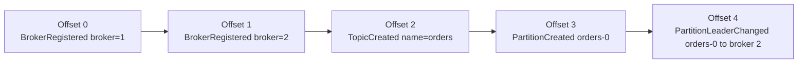

Meaning:

- Offset 0: Broker 1 joined the cluster.
- Offset 1: Broker 2 joined the cluster.
- Offset 2: Someone created the `orders` topic.
- Offset 3: A partition was created.
- Offset 4: Its leader assignment changed.

> **Important:** `__cluster_metadata` is **not** your `orders` topic. It is Kafka's **internal** metadata log, not a topic for business events.

### 7.1 Append-only log

**Append-only** = new records are added at the **end** of the log. Existing committed records are not normally overwritten in place.

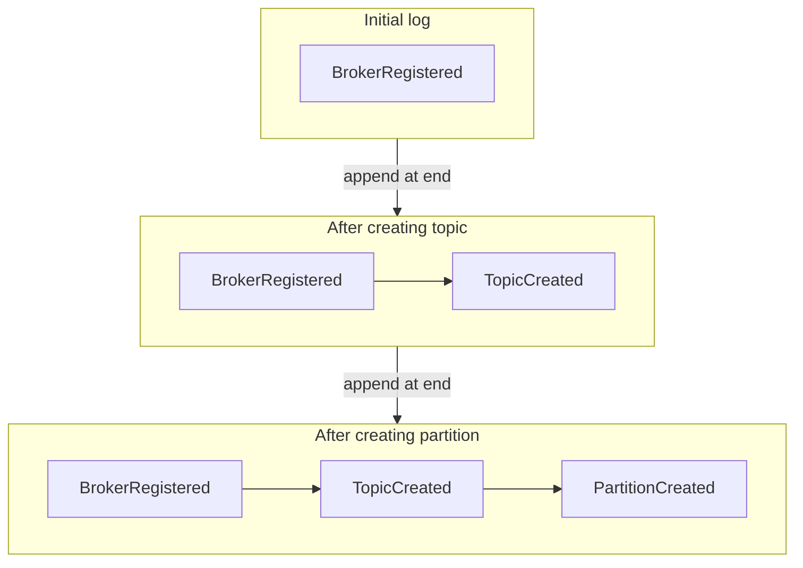

This gives controllers an **ordered history** of cluster changes.

### 7.2 Does every controller have its own copy?

**Yes.** Every controller keeps its **own local copy** of the `__cluster_metadata` log.

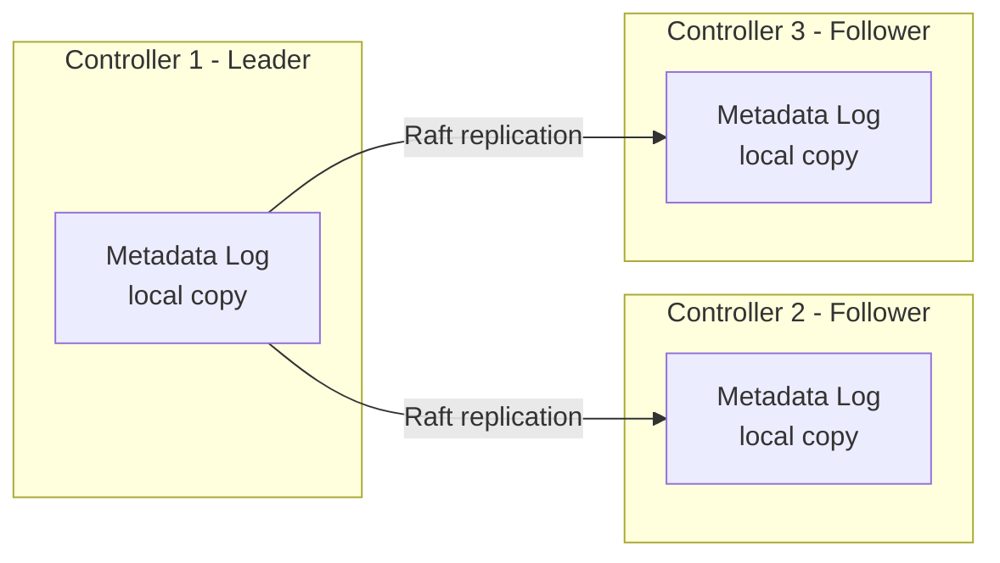

Example records:

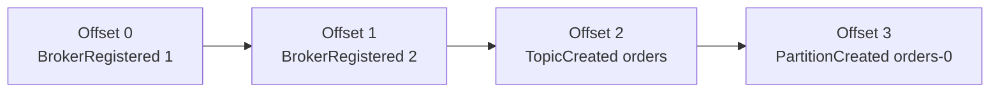

| Metadata record  | Controller 1 | Controller 2 | Controller 3 |
| ---------------- | ------------ | ------------ | ------------ |
| BrokerRegistered | Yes          | Yes          | Yes          |
| TopicCreated     | Yes          | Yes          | Yes          |
| PartitionCreated | Yes          | Yes          | Yes          |

Committed records are kept consistent. A follower can **temporarily lag** while replication is happening.

**Why does every controller need its own copy?**

1. Controller 1 is the leader. Controllers 2 and 3 are followers.
2. Controller 1 crashes.
3. Controller 2 can become the new leader, because it **already has** the replicated metadata history.
4. It does **not** need to ask the crashed Controller 1 for metadata.

This is one of the main benefits of KRaft.

### 7.3 Is `__cluster_metadata` an actual file?

It is the **name of an internal metadata log**, not necessarily one physical file. On disk, Kafka stores log segments and metadata snapshots in a directory:

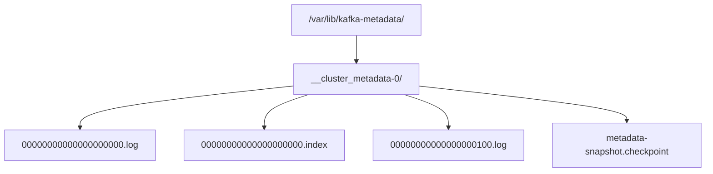

The exact files and names depend on the log and snapshot state.

### 7.4 Who else keeps metadata?

| Node type        | What it does with metadata                                            |
| ---------------- | --------------------------------------------------------------------- |
| Controller       | Keeps a replica of the metadata log and **votes** in the Raft quorum  |
| Broker-only node | Also keeps metadata locally as an **observer**, but does **not vote** |
| Combined node    | Does both broker and controller work                                  |

> **One line to remember:** Every controller has its own local replica of `__cluster_metadata`. The active controller coordinates metadata changes, and followers replicate them so another controller can take over when needed.

---

## 8. How KRaft Works – Topic Creation Flow

Setup: 3 brokers + 3 controllers. We want to create:

```
Topic: orders
Partitions: 3
Replication Factor: 3
```

### Step by step

1. **Administrator creates a topic.** An admin tool sends a `CreateTopics` request to a Kafka broker.
2. **Broker forwards the metadata operation.** The broker talks to the active controller.
3. **Controller appends a metadata record.** The active controller appends the topic creation event to `__cluster_metadata`.
4. **Raft replication.** The active controller replicates the record to the follower controllers.
5. **Majority commits the record.** Once a strict majority has replicated the record, it is **committed**.
6. **Metadata reaches brokers.** Brokers receive the updated metadata and update their local metadata state.
7. **Topic is ready.** Brokers can now serve requests based on the topic's partition assignments.

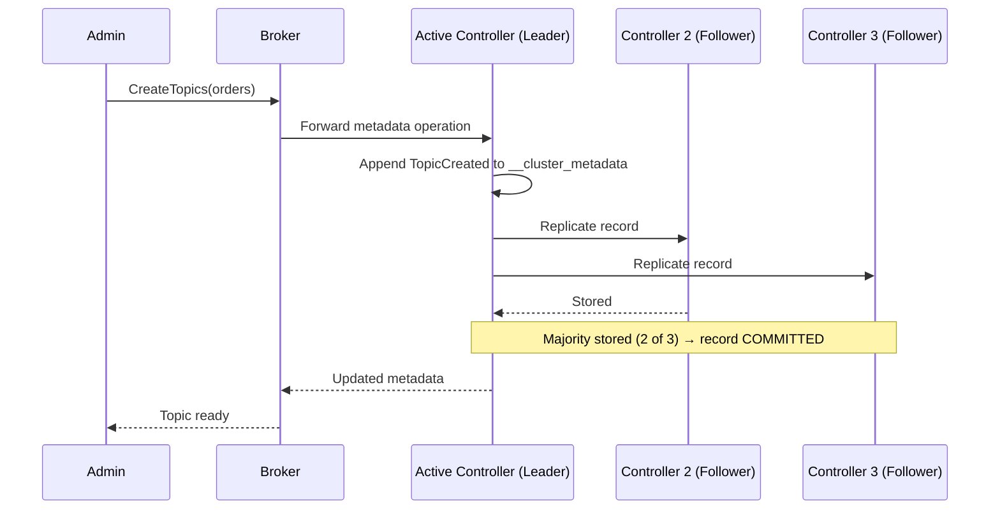

### 8.1 Raft leader vs Partition leader (very common interview question)

| Leadership       | Responsibility                                 |
| ---------------- | ---------------------------------------------- |
| Raft leader      | Manages **metadata consensus**                 |
| Partition leader | Handles **reads and writes** for one partition |

A Kafka cluster has **one** active Raft leader, but **many** partition leaders spread across brokers.

### 8.2 Majority is used in TWO situations

Majority is not performed only once. It is used **whenever needed**.

**A) Metadata record commit** (admin creates `orders` topic)

1. Controller 1 (leader) appends the record to its local log.
2. It replicates the record to Controller 2 and 3.
3. Once a **majority** has stored the record, it can be **committed**.

| Controller              | Metadata record stored? |
| ----------------------- | ----------------------- |
| Controller 1 (Leader)   | Yes                     |
| Controller 2 (Follower) | Yes                     |
| Controller 3 (Follower) | No                      |

2 out of 3 → majority → record can be committed.

**B) New leader election** (Controller 1 crashes)

1. Controller 2 becomes a candidate.
2. Controller 2 requests votes.
3. Controller 3 votes for Controller 2.
4. Controller 2 has two votes (including its own vote).

2 out of 3 → majority → Controller 2 becomes the new leader.

| Operation       | What does majority mean?                                    |
| --------------- | ----------------------------------------------------------- |
| Metadata commit | Majority of controllers have **stored** the metadata record |
| Leader election | Majority of controllers have **voted** for a candidate      |

> **Easy memory trick:**
>
> - Metadata commit = majority must **store** the record.
> - Leader election = majority must **vote** for the candidate.
>
> Same majority principle, different problems.

---

## 9. Failures: Controller Crash vs Broker Crash

### 9.1 Active controller crashes

Setup: Controller 1 = Raft Leader, Controllers 2 and 3 = Followers. Now Controller 1 crashes.

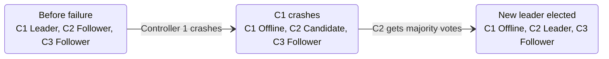

Process:

1. Remaining controllers notice the leader is not responding.
2. They start an **election**.
3. A candidate requests votes.
4. A candidate must get a **majority**.
5. The elected controller becomes the new Raft leader.

With 3 controllers, **2 votes** are required.

### 9.2 What is an Epoch?

An **epoch** is a **generation number** for the current leadership.

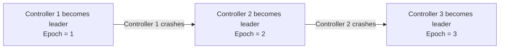

**Why needed?** If Controller 1 crashes and later comes back, it must **not** assume it is still the leader. The newer epoch helps Kafka detect **stale leadership** and stops an old leader from deciding using outdated information.

> **Remember:** Epoch is a leadership generation / **fencing** mechanism. It is **not** just a counter of how many times a controller crashed.

### 9.3 Broker crashes

Example: partition `orders-0` has replicas on 3 brokers.

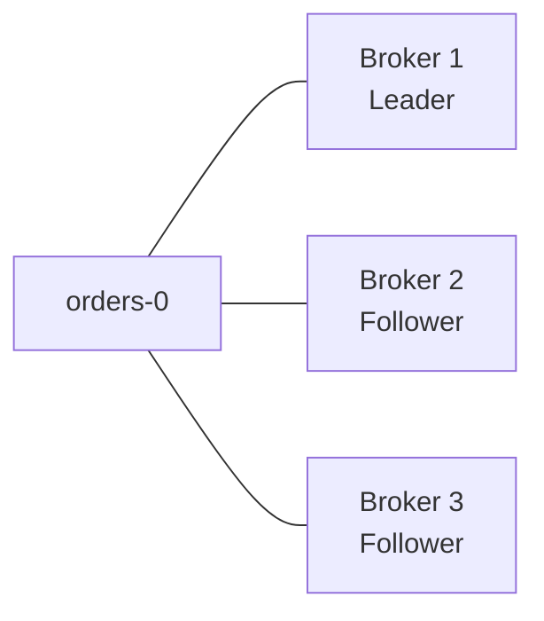

Broker 1 crashes. Kafka needs another broker to become partition leader. The **controller manages this change**, using available replica and in-sync replica (ISR) information.

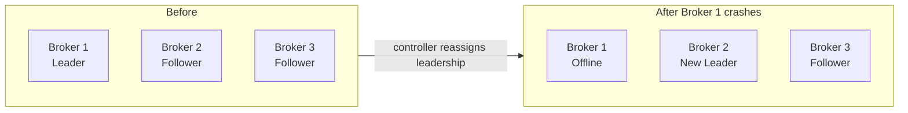

### 9.4 Do not confuse these two

| Failure            | What happens                                 |
| ------------------ | -------------------------------------------- |
| Controller failure | **Raft leader election** (among controllers) |
| Broker failure     | **Partition leader** reassignment/election   |

> Also: partition leader failover depends on replica availability and configuration. **Not every follower can immediately become leader.**

### 9.5 Controller Epoch vs Partition Leader Epoch (advanced)

Kafka uses epochs to protect against stale leadership, but they do not all mean the same thing.

- Controller / metadata leadership uses epochs to identify the current leader.
- **Partition leader epochs** track leadership changes for each individual partition.

Example: `orders-0` can have a different partition leader epoch from `payments-0`. Learn the details later when studying Kafka replication and recovery.

---

## 10. Quorum Mathematics

**Formula:**

```
Majority = floor(N / 2) + 1
```

`N` = total number of controllers.

| Controllers | Majority needed | Failures tolerated |
| ----------- | --------------- | ------------------ |
| 1           | 1               | 0                  |
| 3           | 2               | 1                  |
| 4           | 3               | 1                  |
| 5           | 3               | 2                  |
| 7           | 4               | 3                  |

### 10.1 Why do we usually use an odd number?

- 3 controllers need 2 votes.
- 4 controllers need 3 votes.
- Both tolerate only **1** failure.

So adding a 4th controller does **not** improve failure tolerance. That is why **3 or 5** controllers are common.

> Kafka does **not** technically forbid an even-sized quorum. Odd numbers are just more efficient for fault tolerance per controller.

### 10.2 What if 2 of 3 controllers crash?

- Only one controller remains.
- It cannot get 2 votes, so it **cannot form a majority**.
- **Result:** the cluster **cannot commit new metadata changes** until a quorum is restored.

---

## 11. Combined Mode vs Dedicated Mode

This is a **deployment decision**, not a different consensus algorithm. It decides where brokers and controllers physically run.

### 11.1 Combined Mode

The **same Kafka process** does both jobs.

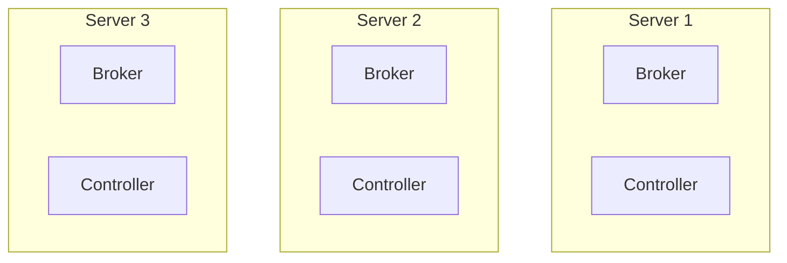

Each server runs both roles. All three take part in the controller quorum.

```
process.roles=broker,controller
```

**Advantages**

- Simple deployment
- Fewer machines
- Good for learning and development

**Disadvantage**

If Broker 1 is processing millions of messages and using lots of CPU and disk, the controller on the same machine may also feel the pressure. This can affect metadata operations.

### 11.2 Dedicated Mode

Broker and controller roles run on **separate machines**.

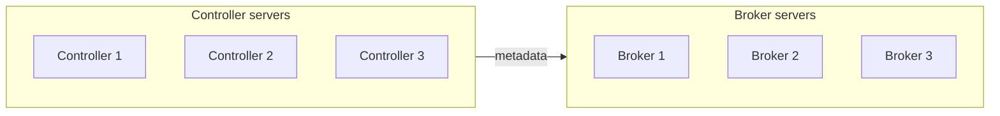

Controller config:

```
process.roles=controller
```

Broker config:

```
process.roles=broker
```

**Advantages**

- Resource isolation
- Controller performance is less affected by heavy message traffic
- Easier to scale broker capacity independently
- Better for large production clusters

For 3 dedicated controllers + 3 brokers, you need **6 machines**.

> **Industry view:** Dedicated controllers are **not required** for every production Kafka cluster. The choice depends on workload, availability needs, and operational scale.

### 11.3 Quick comparison

| Point           | Combined mode                | Dedicated mode                |
| --------------- | ---------------------------- | ----------------------------- |
| `process.roles` | `broker,controller`          | `controller` or `broker`      |
| Machines (3+3)  | 3                            | 6                             |
| Isolation       | Low                          | High                          |
| Best for        | Learning, development, small | Large or demanding production |

---

## 12. Other Important Concepts

### 12.1 Metadata Snapshot

**Problem:** After 6 months, the metadata log may have thousands or millions of records.

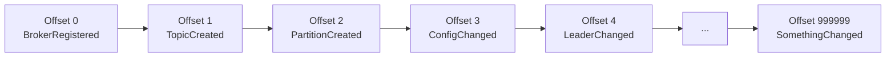

If a controller restarts, should it replay **every** event from the start? That would be slow.

**Solution:** Kafka periodically creates a **Metadata Snapshot** = a saved copy of the **current cluster state** at a point in time.

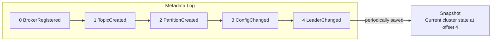

When a controller restarts:

1. Load the **latest snapshot**.
2. Replay only the records **after** the snapshot.
3. Rebuild the latest metadata state.

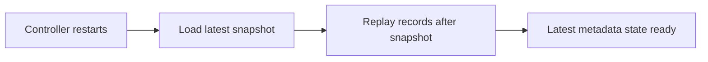

Result: faster recovery.

### 12.2 Controller Quorum Replication vs Partition Replication

Both involve replication, but solve **different problems**.

**Controller Quorum Replication**

- Replicates **cluster metadata** between **controllers**.
- Purpose: protect metadata and maintain consensus.

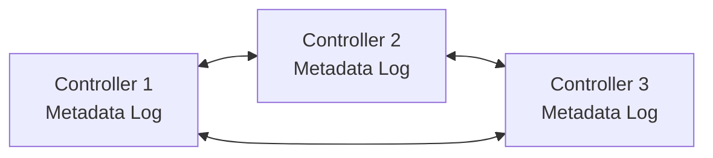

**Partition Replication**

- Replicates **actual topic data** between **brokers**.
- Purpose: protect business messages against broker failures.

```mermaid
flowchart LR
    T["Topic orders<br/>Partition orders-0"]
    T --- B1["Broker 1<br/>Leader"]
    B1 -->|"replicates"| B2["Broker 2<br/>Follower"]
    B1 -->|"replicates"| B3["Broker 3<br/>Follower"]
```

| Concept                     | What is replicated? | Between     |
| --------------------------- | ------------------- | ----------- |
| KRaft replication           | Cluster metadata    | Controllers |
| Kafka partition replication | Actual messages     | Brokers     |

> Particularly important for interviews.

### 12.3 Cluster ID and Node ID

**Cluster ID** identifies the Kafka cluster.

```
Cluster ID = ABC123XYZ
```

All nodes in that cluster must use the right cluster identity.

**Node ID** identifies one Kafka node. Each node needs a **unique** ID in the cluster.

| Node         | Node ID |
| ------------ | ------- |
| Controller 1 | 1       |
| Controller 2 | 2       |
| Controller 3 | 3       |
| Broker 1     | 4       |
| Broker 2     | 5       |
| Broker 3     | 6       |

In configuration:

```
node.id=1
```

This means the node is identified as node 1.

### 12.4 Controller Quorum Voters

```
controller.quorum.voters=1@ctrl1:9093,2@ctrl2:9093,3@ctrl3:9093
```

Decode one entry:

```
1@ctrl1:9093
```

- `1` = controller node ID
- `ctrl1` = controller hostname
- `9093` = controller communication port

This property tells Kafka which controller nodes are in the quorum in the **static quorum** setup.

> There are also newer **dynamic quorum** configurations where membership can be managed dynamically. You don't need to master this now, but know that `controller.quorum.voters` is **not the only** quorum configuration approach in modern Kafka.

---

## 13. Corrections to Common Statements

Some statements in simple notes are over-simplified. Use the more accurate version.

| Common statement                                 | More accurate understanding                                                                                      |
| ------------------------------------------------ | ---------------------------------------------------------------------------------------------------------------- |
| Metadata updates propagate in sub-milliseconds   | Propagation depends on network, load, and cluster conditions. It is **not a guaranteed latency**.                |
| Failover takes milliseconds                      | Failover is generally faster than the old architecture, but election time depends on timeouts and conditions.    |
| Never configure an even number of controllers    | Odd numbers are generally more efficient. Even numbers are possible, just less efficient for fault tolerance.    |
| Controllers have synchronized metadata in memory | Controllers keep an **in-memory metadata image**, backed by the replicated metadata log on persistent storage.   |
| ZooKeeper struggled above 200,000 partitions     | A historical scalability limitation discussed in Kafka's architecture evolution, **not a universal hard limit**. |
| Dedicated mode is standard for production        | A common choice for larger or demanding production environments, **not mandatory** for every deployment.         |
| Port 9093 is compulsory                          | 9093 is only a **common convention** for the controller listener. You can configure different ports.             |

---

## 14. Configuration Properties

Don't memorize every property. **Understand the purpose** of the important ones.

| Property                    | Purpose                                                                                        |
| --------------------------- | ---------------------------------------------------------------------------------------------- |
| `process.roles`             | Defines whether the node runs as broker, controller, or both                                   |
| `node.id`                   | Unique identifier for the node                                                                 |
| `controller.quorum.voters`  | Defines static controller quorum members                                                       |
| `controller.listener.names` | Identifies the controller communication listener                                               |
| `listeners`                 | Defines the network listeners used by the node                                                 |
| `log.dirs`                  | Defines storage directories for Kafka data; metadata storage can also be configured separately |

**Production detail:**

- Controller metadata storage is commonly set with `metadata.log.dir`.
- If it is not set, Kafka uses the **first directory in `log.dirs`** for metadata.

**Cluster initialization:** it involves **formatting storage with a cluster ID**. Understand _why_ this happens, not just the commands.

---

## 15. Revision: Overview, Syllabus, Final Advice

### 15.1 Complete KRaft architecture in one diagram

```mermaid
flowchart TB
    App["Spring Boot Application<br/>Producer / Consumer"]
    subgraph Brokers["Kafka Brokers"]
        B1["Broker 1<br/>Partition replicas"]
        B2["Broker 2<br/>Partition replicas"]
        B3["Broker 3<br/>Partition replicas"]
    end
    subgraph Quorum["Controller Quorum"]
        C1["C1<br/>Raft Leader"]
        C2["C2<br/>Follower"]
        C3["C3<br/>Follower"]
        ML[("__cluster_metadata<br/>Replicated metadata log + snapshots")]
    end
    App -->|"produce / consume"| Brokers
    C1 --- ML
    C2 --- ML
    C3 --- ML
    Quorum -->|"metadata updates"| Brokers
```

- Controllers agree on metadata changes through **Raft consensus**.
- Brokers keep metadata locally and store/serve actual topic messages.
- The Spring Boot app talks to **brokers**, not directly to controllers.

### 15.2 Syllabus tracker

| Concept                               | Priority              | Status               |
| ------------------------------------- | --------------------- | -------------------- |
| Cluster Metadata                      | Essential             | Covered              |
| ZooKeeper vs KRaft                    | Essential             | Covered              |
| Raft Consensus                        | Essential             | Covered              |
| Controller and Broker                 | Essential             | Covered              |
| Active and Standby Controllers        | Essential             | Covered              |
| Metadata Log                          | Essential             | Covered              |
| Quorum and Majority                   | Essential             | Covered              |
| Controller Failover and Epoch         | Essential             | Covered              |
| Combined vs Dedicated Mode            | Essential             | Covered              |
| Metadata Snapshots                    | Important             | Covered              |
| Cluster ID and Node ID                | Important             | Covered              |
| Controller Quorum Voters              | Important             | Covered              |
| Partition Leader Election             | Important             | Introduction only    |
| Metadata Version (`metadata.version`) | Important             | To learn             |
| Dynamic Controller Quorum             | Advanced              | To learn             |
| KRaft Monitoring and Troubleshooting  | Advanced              | To learn             |
| ZooKeeper-to-KRaft Migration          | Advanced / Historical | To learn if relevant |

### 15.3 Recommendation

Don't jump into advanced KRaft topics yet. First, make sure you can answer these **5 questions without looking at notes**:

1. Why does Kafka need a controller?
2. Why does Kafka need multiple controllers?
3. What is Raft consensus?
4. What happens when the active controller crashes?
5. What is the difference between controller leader election and partition leader election?

If you can, you understand the **foundation of KRaft**.

### 15.4 Final advice

Understand KRaft as **Kafka's internal management and coordination system**. Don't try to memorize all configuration properties. First understand:

1. The architecture
2. The flow of metadata
3. What happens during failures

That is the knowledge you will actually use when working with Kafka in Spring Boot projects. A short daily KRaft quiz also helps reinforce these concepts.

---

## One-Page Cheat Sheet

| Topic                | Remember this                                                               |
| -------------------- | --------------------------------------------------------------------------- |
| Metadata             | Info about the cluster (topics, partitions, leaders), **not** business data |
| KRaft                | Kafka's own metadata system using Raft, replaces ZooKeeper                  |
| Controller           | Manages metadata, takes part in Raft                                        |
| Broker               | Stores and serves actual messages                                           |
| Raft leader          | One active controller that coordinates metadata changes                     |
| Partition leader     | A broker that handles reads/writes for one partition (many exist)           |
| `__cluster_metadata` | Internal append-only metadata log, each controller has its own replica      |
| Commit               | Majority of controllers have stored the record                              |
| Election             | Majority of controllers vote for the candidate                              |
| Majority formula     | `floor(N/2) + 1`                                                            |
| Epoch                | Leadership generation number, protects against stale leaders                |
| Snapshot             | Saved cluster state, makes controller restart faster                        |
| Combined mode        | `broker,controller` on same process, simple, for learning                   |
| Dedicated mode       | Separate controller and broker machines, better isolation                   |
| Controller crash     | Raft leader election                                                        |
| Broker crash         | Partition leader re-election                                                |
