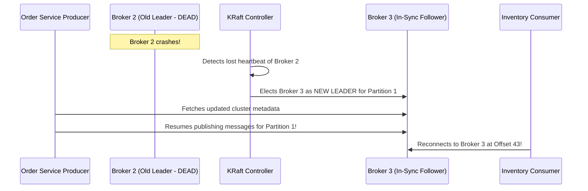

# 009. End-to-End Industrial Microservices Walkthrough

---

## 1. The Industrial Scenario: E-Commerce System

### Business Requirements:
A customer places an order on our e-commerce platform. Our system must:
1. Publish the order event immediately without blocking the user.
2. Distribute load across partitions for high concurrency.
3. Keep all subsequent events for that order strictly in sequence.
4. Allow independent downstream services (Inventory, Payment, Notification) to consume the event.
5. Guarantee zero data loss and continuous availability even if a Kafka server physically dies.

---

## 2. Industrial Cluster Architecture Diagram

```text
                     Spring Boot Order Service
                                |
                                v
                         Kafka Producer
                                |
                                | Key = orderId ("ORD-101")
                                v
                     Topic: orders (3 Partitions, RF = 3)
                                |
             +------------------+------------------+
             |                  |                  |
             v                  v                  v
       Partition 0        Partition 1        Partition 2
       (Leader: B1)       (Leader: B2)       (Leader: B3)
             |                  |                  |
             |                  |                  |
   +---------+------------------+------------------+---------+
   | Replicas distributed across 3 Brokers:                  |
   |   Broker 1: P0 (Leader),   P1 (Follower), P2 (Follower) |
   |   Broker 2: P1 (Leader),   P0 (Follower), P2 (Follower) |
   |   Broker 3: P2 (Leader),   P0 (Follower), P1 (Follower) |
   +---------------------------------------------------------+
                                |
             +------------------+------------------+
             |                  |                  |
             v                  v                  v
     Consumer Group:     Consumer Group:     Consumer Group:
     "inventory-group"   "payment-group"     "notification-group"
```

---

## 3. Step-by-Step Message Lifecycle

Let's trace message `ORD-101` from the customer's click to final delivery:

1. **Order Creation:** Customer clicks "Buy Now". Spring Boot Order Service saves the order in its DB with status `PENDING`.
2. **Event Dispatch:** Order Service creates an `OrderCreatedEvent` payload and calls `kafkaTemplate.send("orders", "ORD-101", event)`.
3. **Partition Routing:** The producer client serializes `"ORD-101"`, calculates `Murmur2("ORD-101") % 3`, which resolves to **Partition 1**.
4. **Leader Write:** The producer transmits the batch over TCP to **Broker 2** (the Leader of Partition 1).
5. **Disk Commit:** Broker 2 appends the record to `orders-1` log at **Offset 42** in the OS page cache.
6. **Replication Sync:** Follower brokers (Broker 1 and Broker 3) fetch offset 42 from Broker 2 and write it to their local logs.
7. **Producer Acknowledgment:** Once in-sync replicas acknowledge, Broker 2 returns a successful `RecordMetadata` ack to the Order Service.
8. **Independent Consumer Ingestion:**
   - **Payment Consumer Group:** Consumes Offset 42 from Partition 1. Charges the customer's credit card. Emits `PaymentCompletedEvent`.
   - **Inventory Consumer Group:** Consumes Offset 42 from Partition 1. Reserves stock in the warehouse database.
   - **Notification Consumer Group:** Consumes Offset 42 from Partition 1. Sends an order confirmation SMS.
9. **Offset Commits:** Each consumer service independently commits Offset 42 to `__consumer_offsets`.

---

## 4. Disaster Recovery Walkthrough

### Scenario A: What Happens If Broker 2 Hard Crashes?
*Broker 2 (hosting the Leader of Partition 1) suddenly loses power.*


- **Zero Data Loss:** Broker 3 was an active member of the ISR set, meaning it had already copied Offset 42.
- **Uninterrupted Flow:** Clients refresh metadata within hundreds of milliseconds and resume traffic without manual intervention.

---

### Scenario B: What Happens If an Inventory Consumer Instance Dies?

Suppose `inventory-group` has 3 consumer instances (`C1`, `C2`, `C3`).
- `C2` was actively reading **Partition 1**.
- `C2` suddenly suffers an Out-Of-Memory (OOM) error and dies.

1. **Heartbeat Timeout:** The group coordinator detects that `C2` stopped sending heartbeats.
2. **Consumer Rebalance Triggered:** Kafka pauses consumption briefly and triggers a **Consumer Rebalance**.
3. **Partition Reassignment:** Partition 1 is reassigned to surviving consumer `C1` or `C3`.
4. **Resuming from Offset:** The newly assigned consumer queries `__consumer_offsets`, retrieves the last committed offset (Offset 42), and starts processing immediately from **Offset 43**!

---

## 5. The 3 Golden Questions for Any Kafka Architecture

Whenever you design, review, or debug a distributed Kafka pipeline, always ask:

1. **"Which service is the Producer and which is the Consumer?"**
   - Keeps service boundaries and ownership crystal clear.
2. **"What happens if a Consumer service is down for 6 hours?"**
   - Validates that your topic retention policy (`retention.ms`) is long enough so unread messages won't be pruned before the consumer recovers.
3. **"What is the Partition Key and how is ordering preserved?"**
   - Prevents race conditions by ensuring related entity events land on the exact same partition.

---

