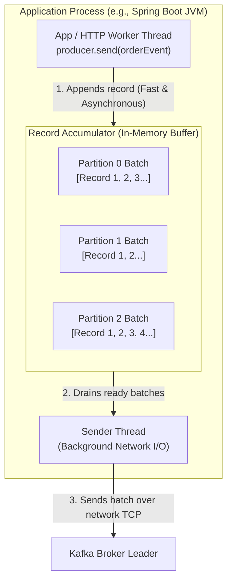
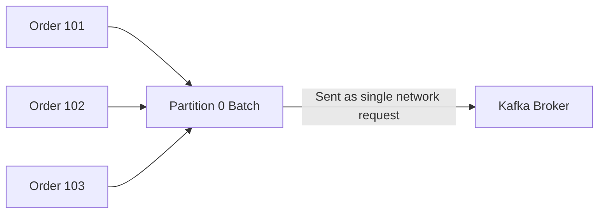
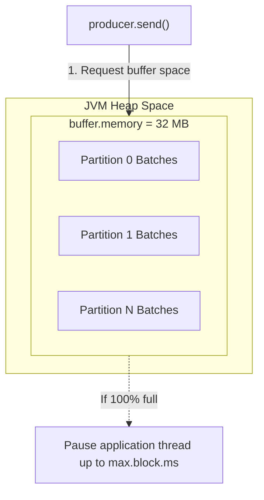

# 013: Producer Architecture and Batching

> [!abstract] Module 07: Producer Internals (Part 1)
> **Focus:** Two-threaded producer architecture, Record Accumulator, batching mechanics (`batch.size`, `linger.ms`), and JVM memory safety (`buffer.memory`, `max.block.ms`).
> **Prerequisites:** Topic and partition foundations.

---

## 1. High-Level Producer Architecture

A Kafka producer is the client application that creates records and sends them to Kafka. It does far more than just dispatching a message over a socket: it handles serialization, partition routing, metadata discovery, batch accumulation, and background I/O.

### The Problem
If a producer opened a synchronous network connection and waited for the Kafka broker on every single message:
- Your application threads (e.g., Tomcat HTTP threads) would freeze waiting on network round-trips.
- Throughput would drop to a few hundred messages per second.
- Any network blip or broker lag would cause upstream timeouts and crash your web application.

### The Solution: The Two-Threaded Producer Model
Kafka decouples **message creation** from **message transmission** inside your application using two separate threads and an in-memory buffer called the **Record Accumulator**.



### End-to-End Execution Flow
1. **Application Call:** Your code calls `producer.send(topic, key, value)`.
2. **Serialization:** Key and value are serialized into byte arrays via configured serializers.
3. **Partitioning:** The target partition is selected (via custom partitioner, murmur2 key hash, or round-robin).
4. **Metadata Lookup:** The producer confirms which broker is the leader for that partition.
5. **Accumulation:** The record is appended to that specific partition's batch in the **Record Accumulator**. Control immediately returns to your application thread.
6. **Network Transmission:** A background **Sender thread** drains complete batches from the accumulator and transmits them over network TCP to the broker leaders.
7. **Broker Processing:** The broker appends the record to disk, replicates to in-sync replicas (ISR), and sends back an acknowledgement.

---

## 2. Batching Mechanics: `batch.size` and `linger.ms`

### The Problem
Sending records one-by-one creates massive network overhead: every single TCP packet has header bytes, IP routing overhead, and ACK round-trips.

### The Solution
Kafka groups records destined for the **same topic-partition** into batches.



- Batches are maintained **per topic-partition** (Partition 0 has its own batch, Partition 1 has its own).
- Records for different partitions are never mixed into the same batch.

### Configuration Controls

#### 1. `batch.size` (Default: `16384` bytes / 16 KB)
* Represents the maximum memory allocated for **a single batch destined for a single partition**.
* When incoming records fill this 16 KB batch, it is closed immediately and queued for the Sender thread to dispatch.
* *Note:* This is not a limit on message size or whole requests, just the target batch container.

#### 2. `linger.ms` (Default: `0` ms)
* Represents the **maximum artificial delay** the producer is willing to wait to let more records join an unfilled batch before sending it.
* **If `linger.ms = 0` (default):** As soon as the Sender thread is ready, it dispatches the batch immediately, even if it contains only 1 record.
* **If `linger.ms = 10`:** The producer pauses up to 10 milliseconds. If the batch fills to 16 KB before 10 ms, it ships immediately. If 10 ms passes and the batch is only partially full, it ships anyway.

```text
Is batch filled to 16 KB? ------(YES)-----> Ship immediately
         |
        (NO)
         |
Has linger.ms elapsed? --------(YES)-----> Ship partial batch
```

> [!TIP]
> In high-throughput microservices, setting `linger.ms=5` or `linger.ms=10` can increase throughput by 300%–500% with virtually zero perceptible latency cost.

---

## 3. Buffer Memory & Blocking: `buffer.memory` and `max.block.ms`

### The Problem
What happens when your application produces messages at **10 MB/sec**, but the network or Kafka brokers can only drain **2 MB/sec**?

If memory were unlimited, messages would pile up in RAM until your application crashed with a fatal `java.lang.OutOfMemoryError: Java heap space`.

### The Solution: A Fixed Safety Buffer
Kafka caps the total RAM that the Record Accumulator can occupy inside your JVM heap using **`buffer.memory`**.

```properties
buffer.memory=33554432   # (32 MB default)
max.block.ms=60000        # (60 seconds default)
```



### What Happens When the Buffer Fills Up?
1. If all 32 MB of buffer space is full of pending batches, `producer.send()` **blocks** (pauses your application's worker thread).
2. It waits up to `max.block.ms` (60 seconds by default) for the Sender thread to deliver batches, receive ACKs from brokers, and free up memory.
3. **If space frees up:** The call unblocks and continues normally.
4. **If 60 seconds expire with no space available:** Kafka throws:
   ```text
   org.apache.kafka.common.errors.TimeoutException: 
   Failed to allocate memory within the configured max blocking time (60000 ms).
   ```

> **Production Insight:**  
> `buffer.memory` acts as a **circuit breaker** for JVM RAM. It ensures the Kafka producer client never consumes more heap space than you budgeted, protecting your service from an `OutOfMemoryError`.

---

## 4. Key Configuration Summary

| Property | Default Value | Production Recommended | Description |
| :--- | :--- | :--- | :--- |
| **`batch.size`** | `16384` (16 KB) | `32768` - `65536` (32 KB - 64 KB) | Target batch capacity for each partition. |
| **`linger.ms`** | `0` ms | `5` - `20` ms | Maximum wait time to bundle incoming messages into batches. |
| **`buffer.memory`** | `33554432` (32 MB) | `67108864` (64 MB) | Total JVM heap reserved for all pending batches across all partitions. |
| **`max.block.ms`** | `60000` (60 sec) | `60000` (60 sec) | Max time `producer.send()` freezes when buffer is full before failing. |
