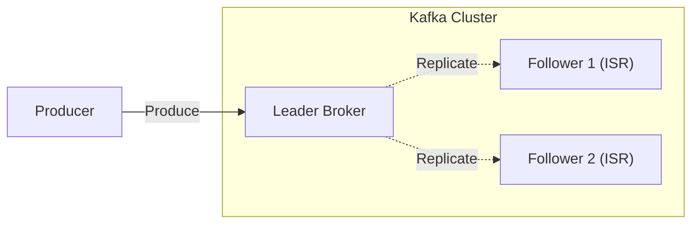
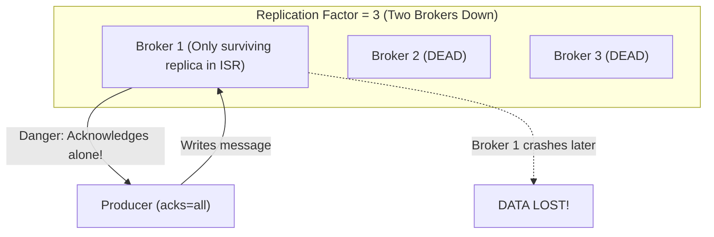
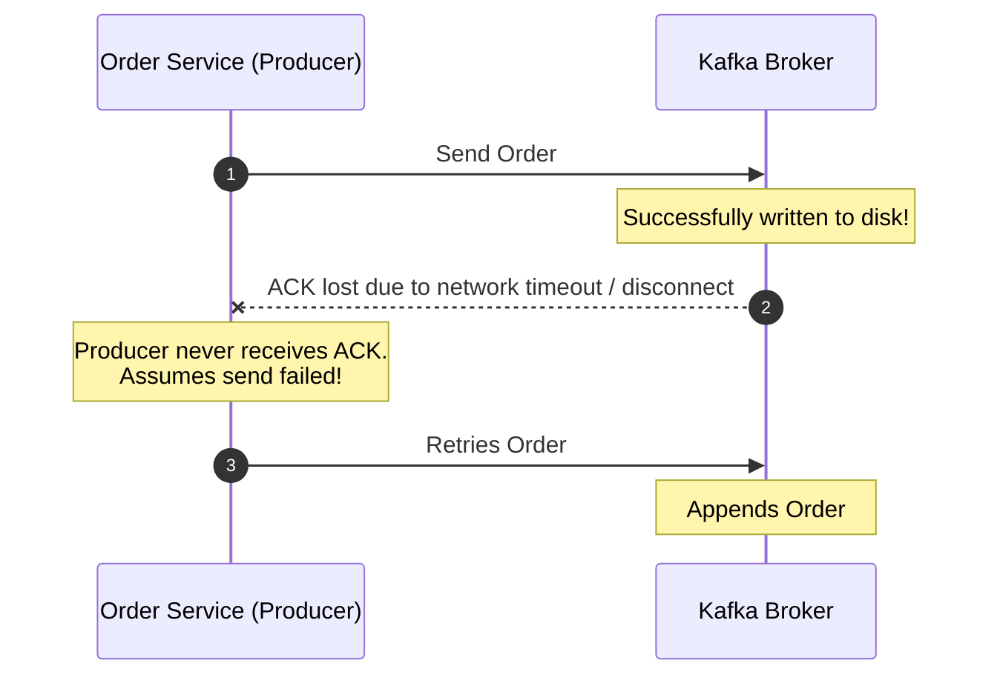
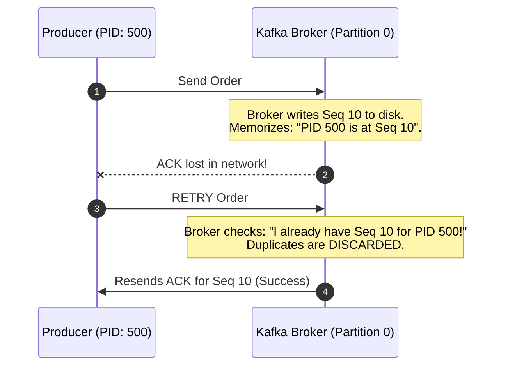
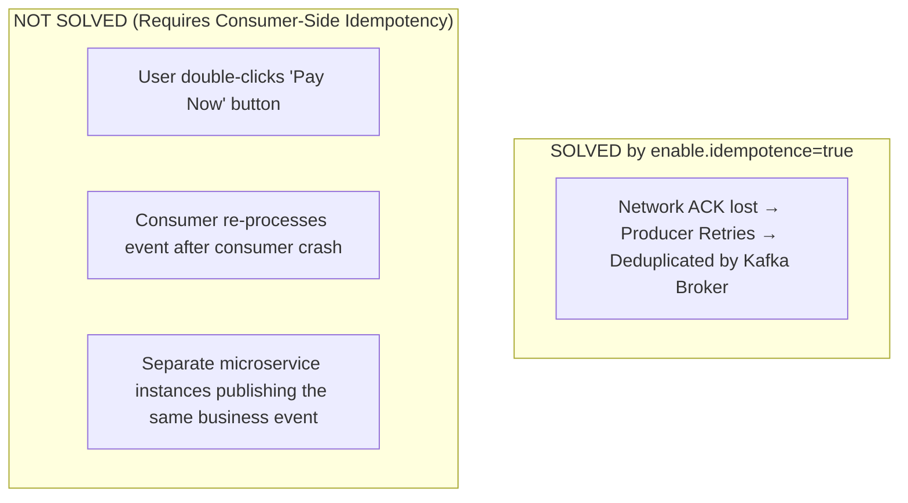

# 014: Delivery Guarantees and Idempotence

> [!abstract] Module 07: Producer Internals (Part 2)
> **Focus:** Producer reliability, durability modes (`acks`, `min.insync.replicas`), network retry failures, and exactly-once deduplication via Idempotent Producer (`enable.idempotence=true`).
> **Prerequisites:** `013-Producer_Architecture_and_Batching.md`.

---

## 1. Durability & Acknowledgements: `acks` & `min.insync.replicas`

### The Problem
When the background Sender thread transmits a batch of messages to the partition leader broker over the network, how sure do you need to be that the message is safely saved on disk before considering it sent?

### The Acknowledgement Modes (`acks`)



| Setting | How It Works | Durability vs Latency Trade-Off | Production Use Case |
| :--- | :--- | :--- | :--- |
| **`acks=0`** | Fire-and-forget. Producer never waits for a broker response. | **High data loss risk.** If the broker is down, messages are lost silently without error. | Metrics, clickstreams, telemetry where occasional dropped packets don't matter. |
| **`acks=1`** | Leader acknowledges as soon as it appends the record to its local log. | Moderate durability. If leader crashes before followers replicate, data is lost upon failover. | Non-critical event notifications. |
| **`acks=all`** (or `-1`) | Leader waits until **all in-sync replicas (ISR)** write the record before returning ACK. | Strongest durability, slight latency overhead. | Orders, payments, inventory, financial transactions. |

---

### The Vital Partner: `min.insync.replicas`
`acks=all` alone cannot guarantee safety if replicas go offline.

Consider this failure scenario:
1. You have a topic with **Replication Factor = 3** (`Broker 1`, `Broker 2`, `Broker 3`).
2. Brokers 2 and 3 crash. The In-Sync Replica (ISR) list drops from 3 to 1 (only `Broker 1` remains).
3. With `acks=all`, `Broker 1` checks its current ISR: it sees that it is the *only* replica in the ISR.
4. It writes the message locally and immediately sends back a success ACK!
5. If `Broker 1` now crashes before Brokers 2 and 3 recover, **your data is lost forever**, even though you configured `acks=all`!



**The Fix:** Configure `min.insync.replicas=2` on the broker/topic:
```properties
# Topic / Broker configuration
min.insync.replicas=2

# Producer configuration
acks=all
```
If the number of active in-sync replicas falls below 2, the leader **refuses writes** with `NotEnoughReplicasException`, ensuring your durability contract is never silently breached.

---

## 2. The Network Failure Dilemma: Retries & Duplicates

### The Problem
Distributed networks are unreliable. What happens when a message is safely stored, but the confirmation ACK gets lost?



1. Order Service sends `Order #101`.
2. Kafka broker writes it to disk at **Offset 50**.
3. The broker sends an ACK back, but a network blip drops the packet.
4. The producer reaches a timeout, assumes the message failed, and **retries**.
5. Kafka receives the retry and appends `Order #101` again at **Offset 51**.

**Result:** A duplicate record exists in Kafka! Downstream payment services charge the customer twice.

---

## 3. The Solution: The Idempotent Producer

To eliminate duplicate records from retries, Kafka introduced the **Idempotent Producer**.

### How to Enable It
```properties
enable.idempotence=true
```
*(Note: Enabled by default since Apache Kafka 3.0).*

### Under the Hood: PID and Sequence Numbers
When idempotence is enabled, Kafka tracks message identity using two internal counters:

1. **Producer ID (PID):** A unique 64-bit ID assigned automatically to the producer instance by the broker during initialization (`InitProducerId`).
2. **Sequence Number:** A monotonic 0-indexed counter incremented by the producer for **each partition** it sends to (`0, 1, 2, 3...`).



### Broker Deduplication Logic
When the broker receives a record with a given PID and Sequence Number:
- **`Incoming Seq == Expected Seq`:** Record is accepted, written to the log, and ACKed.
- **`Incoming Seq < Expected Seq`:** Broker recognizes an in-flight retry duplicate. **It ignores the payload and avoids appending to the log**, but sends back a success ACK so the producer stops retrying.
- **`Incoming Seq > Expected Seq`:** Broker detects that an intermediate message was skipped (out-of-order). It rejects the write with `OutOfOrderSequenceException` to prevent partition corruption.

### Comparing Standard vs. Idempotent Producer

| Feature | Standard Producer with Retries | Idempotent Producer |
| :--- | :--- | :--- |
| **`enable.idempotence`** | `false` | `true` |
| **Retries Requests** | Yes | Yes |
| **Duplicate Protection** | No (duplicates stored on retries) | **Yes (network retry duplicates discarded)** |
| **Producer ID (PID)** | Not used for deduplication | Automatically assigned and tracked |
| **Sequence Number** | Not maintained per partition | Maintained and validated per partition |
| **Partition Ordering** | Can get scrambled if in-flight > 1 | **Strict ordering guaranteed** (up to 5 in-flight) |

---

## 4. What Producer Idempotence Does NOT Guarantee

This is a critical distinction for production architectures:

> [!WARNING]
> Producer idempotence only deduplicates **network-level retries produced by the same producer session**.

It does **NOT** protect against:
1. **Application-level duplicates:** If a user clicks "Submit Order" twice, your Spring Boot app creates two distinct events with two distinct sequence numbers. Kafka will store both.
2. **Producer restarts:** If your producer application restarts, it gets a **brand-new PID**. The broker cannot correlate sequence numbers across different PIDs.
3. **Consumer duplicate processing:** If a consumer crashes after processing an event but before committing its offset, it will re-read and re-process that message upon recovery.


