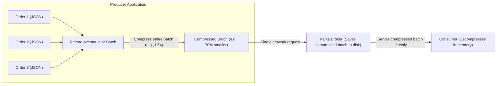
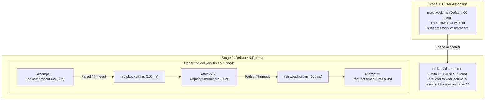
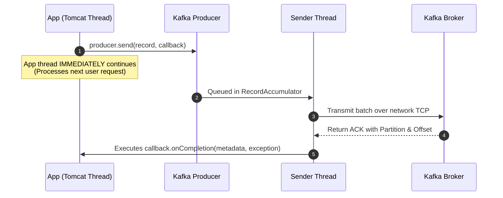

# 015: Compression, Timeouts, and Callbacks

> [!abstract] Module 07: Producer Internals (Part 3)
> **Focus:** Message compression algorithms (`lz4`, `snappy`, `gzip`, `zstd`), timeout hierarchy (`delivery.timeout.ms`, `request.timeout.ms`, `max.block.ms`), and asynchronous callbacks with error handling in Java and Spring Boot.
> **Prerequisites:** `013-Producer_Architecture_and_Batching.md` and `014-Delivery_Guarantees_and_Idempotence.md`.

---

## 1. Producer Message Compression (`compression.type`)

### The Problem
When producing millions of JSON or Avro events per second (e.g., e-commerce orders, IoT metrics, or clickstreams):
1. **Network Bandwidth Bottleneck:** Sending raw, uncompressed text floods internal network switches and saturates 1 Gbps / 10 Gbps cards.
2. **Disk Storage Cost:** Raw JSON consumes massive disk space on broker log segments.
3. **Broker Page Cache Pressure:** Uncompressed data forces Linux to flush OS page caches sooner, degrading consumer read speeds.

### How Kafka Compression Works
Compression in Kafka happens **at the batch level, on the producer side**:



1. The producer accumulates records into a batch (`batch.size`).
2. Before the Sender thread ships the batch, it compresses the **entire batch together** (not record-by-record).
3. The broker receives the compressed payload and **writes it directly to disk without decompressing it** (saving broker CPU).
4. The consumer fetches the compressed batch and decompresses it in its own memory.

---

### The Four Compression Algorithms

```properties
compression.type=snappy   # options: none, gzip, snappy, lz4, zstd
```

#### 1. `lz4` (Industry Standard / Default Recommendation)
* **Design Goal:** Extreme compression and decompression speed with low CPU overhead.
* **Best For:** High-throughput microservices where low latency and low CPU utilization are the highest priorities.
* **Trade-off:** Slightly lower compression ratio than Gzip, but lightning fast.

#### 2. `snappy` (Invented by Google)
* **Design Goal:** Similar to LZ4; balanced CPU usage and reasonable compression.
* **Best For:** General enterprise workloads containing structured text (JSON, CSV).
* **Trade-off:** Very similar performance profile to LZ4.

#### 3. `gzip`
* **Design Goal:** Maximum compression ratio (makes data as tiny as possible).
* **Best For:** Bandwidth-constrained networks (e.g., cross-region / WAN links) or long-term cold storage.
* **Trade-off:** **Heavy CPU penalty.** High producer CPU consumption and higher latency during compression/decompression.

#### 4. `zstd` (Zstandard, by Facebook/Meta)
* **Design Goal:** The best of both worlds. Provides Gzip-level compression ratios with LZ4-level decompression speeds.
* **Best For:** Large enterprise Kafka pipelines with enterprise-grade multi-core CPUs.
* **Trade-off:** Uses slightly more CPU than LZ4 on write, but decompresses extremely fast.

---

### Industrial Comparison Table

| Algorithm | Compression Ratio | CPU Usage (Producer) | Decompression Speed | Recommended Production Scenario |
| :--- | :--- | :--- | :--- | :--- |
| **`none`** | None (1.0x) | 0% | Instant | Localhost dev/testing only. |
| **`lz4`** | Good (~2.5x) | **Ultra Low** | **Ultra Fast** | **Standard recommendation for 90% of microservices.** |
| **`snappy`** | Good (~2.2x) | Low | Fast | Great for JSON/log streams. |
| **`gzip`** | **Highest (~4.5x)** | **Very High** | Moderate | WAN links, cross-region replication, extreme bandwidth limits. |
| **`zstd`** | **Very High (~4.0x)** | Moderate | **Fast** | Modern high-volume pipelines; excellent cost savings for AWS/GCP data transfer. |

---

## 2. Producer Timeout Hierarchy

### The Problem
When a producer sends a record, failure can happen at multiple stages:
1. Can the message even fit into the local buffer?
2. How long should we wait for an individual network TCP round-trip?
3. How long should the producer keep retrying across multiple network glitches before giving up permanently?

Kafka coordinates these stages using a strict **timeout hierarchy**.



---

### Breakdown of the Three Timeouts

#### 1. `max.block.ms` (Default: `60000` ms / 60 seconds)
* **Scope:** Local client JVM memory and metadata discovery.
* **What it governs:** How long `producer.send()` is allowed to freeze (block) the calling application thread when:
  1. `buffer.memory` (32 MB) is 100% full.
  2. The producer doesn't know the partition leader metadata yet and is waiting for a metadata response.
* **When it fires:** Throws `TimeoutException: Failed to allocate memory within the configured max blocking time`.

#### 2. `request.timeout.ms` (Default: `30000` ms / 30 seconds)
* **Scope:** A single network request.
* **What it governs:** The maximum time the Sender thread will wait for the broker to acknowledge **one individual network attempt**.
* **When it fires:** If the broker doesn't answer within 30 seconds, the client marks this individual request as failed and triggers a retry.

#### 3. `delivery.timeout.ms` (Default: `120000` ms / 2 minutes)
* **Scope:** The complete end-to-end lifecycle of the message.
* **What it governs:** The **absolute upper bound** of time between when `producer.send()` places the record into the accumulator and when the broker successfully acknowledges it (including all retries and linger delays).
* **When it fires:** If retries continue failing and 2 minutes elapse, Kafka completely stops retrying and reports a final failure to the application callback.

---

### The Mathematical Rule for Timeouts

Kafka enforces the following configuration validation rule:

$$\text{delivery.timeout.ms} \ge \text{linger.ms} + \text{request.timeout.ms}$$

If `delivery.timeout.ms` were smaller than `request.timeout.ms`, your request would be aborted by the delivery timer before a single network attempt even had time to finish.

---

## 3. Producer Callbacks and Asynchronous Handling

### Anti-Pattern 1: Synchronous Blocking (`.get()`)
```java
// ❌ NEVER DO THIS IN HIGH-THROUGHPUT PRODUCTION:
RecordMetadata metadata = producer.send(record).get(); // Blocks Tomcat thread!
```
Calling `.get()` forces the application thread to wait for the entire network round-trip. Your throughput plummets from 50,000 req/sec to ~200 req/sec.

### Anti-Pattern 2: Fire-and-Forget
```java
// ❌ DANGEROUS:
producer.send(record); // Ignores return value completely
```
If the broker rejects the message (e.g., authorization error, topic deleted, payload too large), your application has no idea the message was lost.

---

### The Industrial Solution: Asynchronous Callbacks

Calling `producer.send()` accepts an asynchronous callback interface. The Sender thread executes this callback as soon as the broker responds with success or failure.



---

### Code Example 1: Pure Java Producer Callback

```java
import org.apache.kafka.clients.producer.*;
import org.slf4j.Logger;
import org.slf4j.LoggerFactory;

public class OrderProducer {
    private static final Logger log = LoggerFactory.getLogger(OrderProducer.class);

    public void sendOrder(KafkaProducer<String, String> producer, String orderId, String jsonPayload) {
        ProducerRecord<String, String> record = new ProducerRecord<>("orders", orderId, jsonPayload);

        // Non-blocking asynchronous send with Callback
        producer.send(record, new Callback() {
            @Override
            public void onCompletion(RecordMetadata metadata, Exception exception) {
                if (exception == null) {
                    // SUCCESS CASE:
                    log.info("Order {} written to Partition: {} at Offset: {} with Timestamp: {}",
                            orderId,
                            metadata.partition(),
                            metadata.offset(),
                            metadata.timestamp());
                } else {
                    // FAILURE CASE:
                    log.error("Failed to deliver Order {} after all retries exhausted!", orderId, exception);
                    // Route to Dead Letter Queue (DLQ), alert PagerDuty, or write to fallback DB
                    saveToFallbackDatabase(orderId, jsonPayload, exception);
                }
            }
        });
    }

    private void saveToFallbackDatabase(String orderId, String payload, Exception ex) {
        // Fallback persistence logic
    }
}
```

---

### Code Example 2: Modern Spring Boot (`CompletableFuture`)

In modern Spring Boot 3+ (`KafkaTemplate`), sends return a `CompletableFuture<SendResult<K, V>>`:

```java
import org.springframework.kafka.core.KafkaTemplate;
import org.springframework.kafka.support.SendResult;
import org.springframework.stereotype.Service;
import lombok.extern.slf4j.Slf4j;
import java.util.concurrent.CompletableFuture;

@Service
@Slf4j
public class OrderEventService {

    private final KafkaTemplate<String, String> kafkaTemplate;

    public OrderEventService(KafkaTemplate<String, String> kafkaTemplate) {
        this.kafkaTemplate = kafkaTemplate;
    }

    public void publishOrderCreated(String orderId, String orderJson) {
        CompletableFuture<SendResult<String, String>> future = 
                kafkaTemplate.send("orders", orderId, orderJson);

        // Non-blocking reactive style callback
        future.whenComplete((result, ex) -> {
            if (ex == null) {
                log.info("Published order {} to topic {} partition {} at offset {}",
                        orderId,
                        result.getRecordMetadata().topic(),
                        result.getRecordMetadata().partition(),
                        result.getRecordMetadata().offset());
            } else {
                log.error("Unable to publish order {} to Kafka", orderId, ex);
                handlePublishFailure(orderId, orderJson, ex);
            }
        });
    }

    private void handlePublishFailure(String orderId, String json, Throwable ex) {
        // Industrial resiliency: write to database table for scheduled retry
    }
}
```

---

### What Does `RecordMetadata` Contain?

When the callback succeeds, `metadata` gives you crucial telemetry:
- **`metadata.topic()`:** The topic name.
- **`metadata.partition()`:** The exact partition integer (e.g., `2`).
- **`metadata.offset()`:** The sequential log offset assigned by the broker (e.g., `104859`).
- **`metadata.timestamp()`:** The timestamp assigned to the record.
