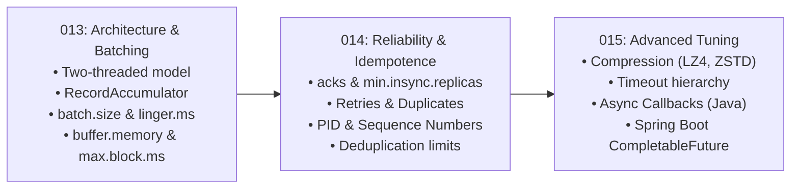

# Module 07: Producer Internals (Map of Content)

> [!abstract] Module Overview
> The Kafka Producer is not a simple HTTP client—it is a sophisticated, asynchronous distributed client engine.
> This module explores how records are buffered in JVM memory, grouped into batches, protected against data loss and network duplicates, compressed, and transmitted reliably across distributed brokers.

---

## Module Index & Reading Order



### [013: Producer Architecture and Batching](file:///c:/Users/siddhesh.pawar/Desktop/Workspace/Obsidian-Vault/Inbox/Kafka_Obsidian_Organized/07%20-%20Producer%20Internals/013-Producer_Architecture_and_Batching.md)
* **Two-Threaded Architecture:** Application thread vs. background `Sender` thread.
* **The Record Accumulator:** In-memory queue holding per-partition batches.
* **Batching Mechanics:** `batch.size` (16 KB) and `linger.ms` (throughput vs. latency trade-off).
* **RAM Protection:** `buffer.memory` (32 MB) as a JVM circuit breaker, buffer exhaustion, and `max.block.ms`.

### [014: Delivery Guarantees and Idempotence](file:///c:/Users/siddhesh.pawar/Desktop/Workspace/Obsidian-Vault/Inbox/Kafka_Obsidian_Organized/07%20-%20Producer%20Internals/014-Delivery_Guarantees_and_Idempotence.md)
* **Durability Levels:** `acks=0`, `acks=1`, and `acks=all` paired with `min.insync.replicas`.
* **The Network Failure Dilemma:** Why unacknowledged retries produce duplicate offset records.
* **The Idempotent Producer:** `enable.idempotence=true`, Producer ID (PID), sequence numbers per partition, and broker deduplication logic.
* **Production Boundaries:** What producer idempotence does NOT solve (application double-clicks, consumer-side idempotency).

### [015: Compression, Timeouts, and Callbacks](file:///c:/Users/siddhesh.pawar/Desktop/Workspace/Obsidian-Vault/Inbox/Kafka_Obsidian_Organized/07%20-%20Producer%20Internals/015-Compression_Timeouts_and_Callbacks.md)
* **Compression Algorithms:** Deep dive into `lz4`, `snappy`, `gzip`, and `zstd` with CPU vs. ratio trade-offs.
* **The Timeout Hierarchy:** The relationship and math between `delivery.timeout.ms`, `request.timeout.ms`, and `max.block.ms`.
* **Async Result Handling:**
  * Pure Java Producer `Callback` (`onCompletion(metadata, exception)`).
  * Spring Boot 3 `CompletableFuture<SendResult>` reactive handling.
  * Inspecting `RecordMetadata` (topic, partition, offset, timestamp).

---

## Master Producer Configuration Reference

| Property | Default Value | Production Recommended | Primary Responsibility |
| :--- | :--- | :--- | :--- |
| **`bootstrap.servers`** | - | `broker1:9092,broker2:9092...` | Initial cluster discovery endpoints. |
| **`key.serializer`** | - | `StringSerializer` / Avro | Serializer for the record key. |
| **`value.serializer`** | - | `StringSerializer` / Avro | Serializer for the record payload. |
| **`acks`** | `all` (since 3.0) | `all` | Durability contract with broker replicas. |
| **`min.insync.replicas`** | `1` (broker/topic) | `2` | Minimum healthy replicas required for `acks=all` writes. |
| **`enable.idempotence`** | `true` (since 3.0)| `true` | Eliminates retry duplicates via PID and sequence numbers. |
| **`retries`** | `2147483647` | `2147483647` | Maximum retry attempts (bounded by `delivery.timeout.ms`). |
| **`max.in.flight.requests...`**| `5` | `5` (with idempotence) | Concurrent in-flight batches per broker connection. |
| **`batch.size`** | `16384` (16 KB) | `32768` (32 KB) - `65536` | Target batch size per partition. |
| **`linger.ms`** | `0` ms | `5` - `20` ms | Artificial wait window to accumulate larger batches. |
| **`buffer.memory`** | `33554432` (32 MB)| `67108864` (64 MB) | Total JVM heap reserved for the Record Accumulator. |
| **`max.block.ms`** | `60000` (60s) | `60000` (60s) | Max time to freeze `send()` when buffer is full. |
| **`request.timeout.ms`** | `30000` (30s) | `30000` (30s) | Max wait time for a single network attempt. |
| **`delivery.timeout.ms`** | `120000` (2m) | `120000` (2m) | Max total time allowed for complete message delivery. |
| **`compression.type`** | `none` | `lz4` (or `zstd`) | Batch compression algorithm. |

---

## Production Spring Boot Template (`application.yml`)

```yaml
spring:
  kafka:
    producer:
      bootstrap-servers:
        - kafka-1.prod.internal:9092
        - kafka-2.prod.internal:9092
        - kafka-3.prod.internal:9092
      key-serializer: org.apache.kafka.common.serialization.StringSerializer
      value-serializer: org.apache.kafka.common.serialization.StringSerializer
      acks: all
      retries: 2147483647
      properties:
        # Zero-data-loss & deduplication
        enable.idempotence: true
        max.in.flight.requests.per.connection: 5

        # Throughput & Batching
        batch.size: 32768          # 32 KB
        linger.ms: 10              # 10 ms wait window
        compression.type: lz4      # Ultra-fast CPU-friendly compression

        # Memory & Safety
        buffer.memory: 67108864    # 64 MB heap allocation
        max.block.ms: 60000        # 60s max blocking threshold

        # Timeouts
        request.timeout.ms: 30000  # 30s per network attempt
        delivery.timeout.ms: 120000 # 2m total retry window
```

---

## Module 07 Syllabus Checklist

- [x] High-level Producer Architecture (Two threads, Record Accumulator)
- [x] Batching mechanics (`batch.size`, `linger.ms`)
- [x] Buffer Memory Management (`buffer.memory`, `max.block.ms`)
- [x] Durability guarantees (`acks=0, 1, all`, `min.insync.replicas`)
- [x] Network retry failure dilemma & duplicate delivery
- [x] Idempotent Producer (`enable.idempotence=true`, PID, Sequence Numbers)
- [x] Producer idempotence vs Consumer-side idempotency
- [x] Compression algorithms (`lz4`, `snappy`, `gzip`, `zstd`)
- [x] Timeout hierarchy (`max.block.ms`, `request.timeout.ms`, `delivery.timeout.ms`)
- [x] Asynchronous send result handling with Java Callbacks & Spring Boot `CompletableFuture`
