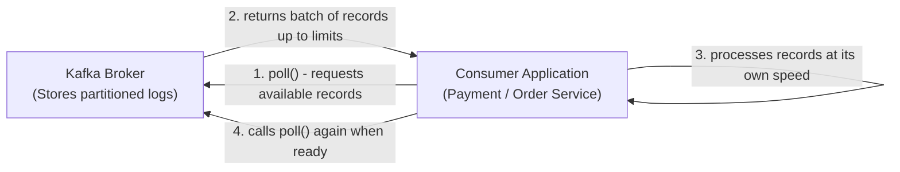
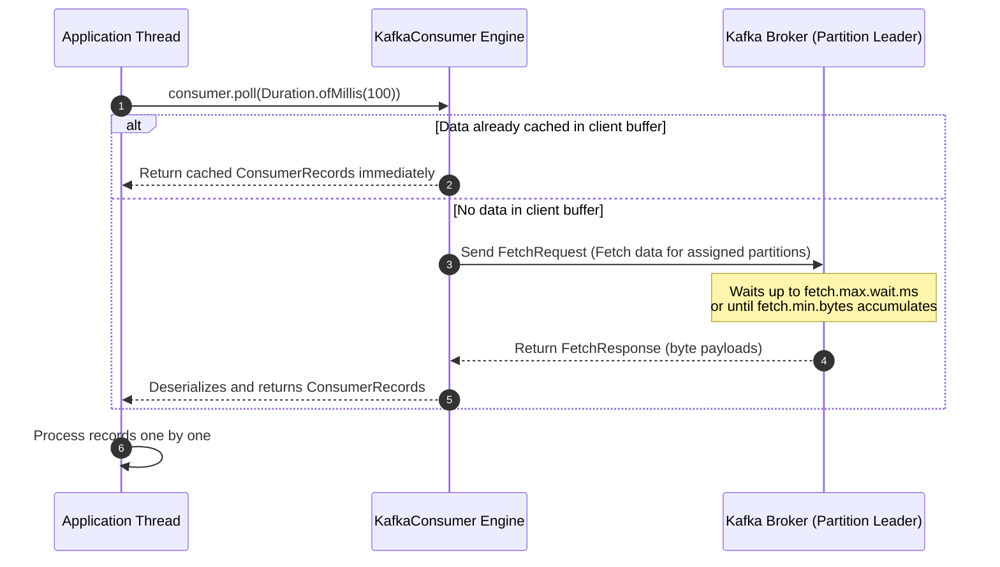
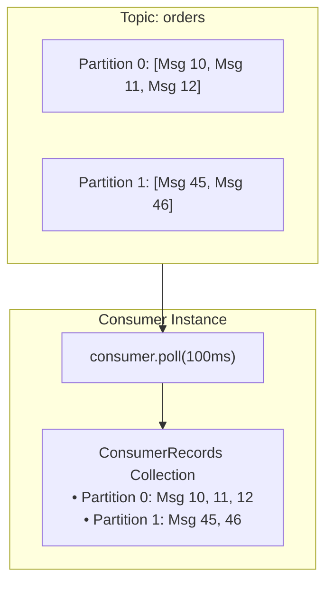
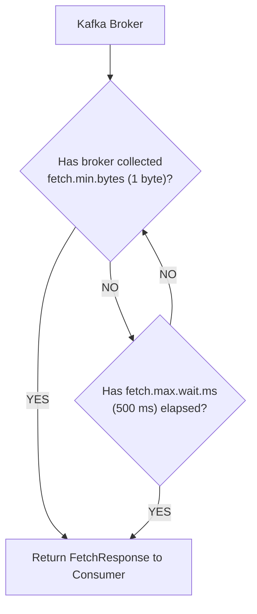

# 016: Consumer Polling and Fetch Internals

> [!abstract] Module 08: Consumer Internals (Part 1)
> **Focus:** The consumer pull model, the internal `poll()` loop, batch retrieval mechanics, memory management with `max.poll.records`, and deep fetch tuning (`fetch.min.bytes`, `fetch.max.wait.ms`).
> **Prerequisites:** Topic and partition foundations.

---

## 1. The Pull Model vs. Push Model

Distributed message brokers typically follow one of two paradigms: **Push** (broker pushes data to consumers) or **Pull** (consumer requests data from broker). Kafka is built fundamentally on the **Pull Model**.

### The Problem with Push Systems
In a push system (like RabbitMQ or traditional JMS):
- The broker decides the rate of message transmission.
- If a consumer performs slow, CPU-intensive work (e.g., complex business logic, database transactions, third-party API calls), the broker can easily overwhelm the consumer.
- The consumer's RAM exhausts, buffers fill up, and the service crashes (backpressure problem).

### The Solution: Kafka's Pull Model
In Kafka, the **consumer pulls records at its own pace**.



**Key Advantages:**
1. **Natural Backpressure:** A slow consumer simply delays its next `poll()` request; it can never be flooded with more messages than it can handle.
2. **Aggressive Batching:** The consumer can pull thousands of messages in a single network round-trip, maximizing throughput.
3. **Independent Pacing:** Fast consumers read ahead quickly; slow consumers proceed deliberately without affecting each other.

---

## 2. The Consumer Polling Lifecycle

### The Java Consumer Loop
At the core of every Kafka consumer (including Spring Boot's `@KafkaListener` under the hood) is an infinite polling loop:

```java
Properties props = new Properties();
props.put(ConsumerConfig.BOOTSTRAP_SERVERS_CONFIG, "localhost:9092");
props.put(ConsumerConfig.GROUP_ID_CONFIG, "payment-service-group");
props.put(ConsumerConfig.KEY_DESERIALIZER_CLASS_CONFIG, StringDeserializer.class.getName());
props.put(ConsumerConfig.VALUE_DESERIALIZER_CLASS_CONFIG, StringDeserializer.class.getName());

KafkaConsumer<String, String> consumer = new KafkaConsumer<>(props);
consumer.subscribe(Collections.singletonList("orders"));

try {
    while (true) {
        // Poll Kafka broker with a timeout
        ConsumerRecords<String, String> records = consumer.poll(Duration.ofMillis(100));

        // Iterate through the received batch
        for (ConsumerRecord<String, String> record : records) {
            log.info("Received Order: Key={}, Value={}, Partition={}, Offset={}",
                    record.key(), record.value(), record.partition(), record.offset());
            
            processOrder(record.value());
        }
    }
} finally {
    consumer.close();
}
```

### Breakdown of the Polling Flow



1. **`consumer.poll(Duration timeout)`:** Requests records from Kafka.
   - If records are already buffered locally in client memory, it returns them immediately.
   - If no records are buffered, it waits up to the specified `timeout` (e.g., 100 ms) for the broker to answer.
2. **`ConsumerRecords<K, V>`:** An iterable container holding records across all topic-partitions assigned to this consumer.
3. **`ConsumerRecord<K, V>`:** Represents an individual message containing topic, partition, offset, key, value, headers, and timestamp.

---

## 3. How `poll()` Retrieves Multi-Partition Batches

A consumer is frequently assigned **multiple partitions**. For example, a single instance of `payment-service` might be assigned Partitions 0 and 1 of the `orders` topic.



When you invoke `poll()`:
- Kafka returns records from **all assigned partitions** in a single combined `ConsumerRecords` batch.
- You can iterate through all records sequentially, or group them per partition using `records.records(new TopicPartition("orders", 0))`.

---

## 4. Controlling Batch Size: `max.poll.records`

### The Problem
Imagine your topic has 100,000 unread messages (e.g., after a weekend downtime or promotional launch). If `poll()` pulled all 100,000 records into JVM RAM at once:
- The JVM would suffer severe memory pressure or crash with `OutOfMemoryError`.
- Processing 100,000 records could take 20 minutes, causing Kafka to think the consumer died and triggering an unwanted consumer group rebalance.

### The Solution: `max.poll.records`
```properties
max.poll.records=500   # (Default: 500 records)
```

`max.poll.records` sets a **hard ceiling** on the total number of records returned by a single invocation of `poll()`.

| Available Messages on Broker | `max.poll.records` Setting | Messages Returned by Single `poll()` |
| :---: | :---: | :---: |
| 50 | 500 | 50 |
| 500 | 500 | 500 |
| 2,000 | 500 | 500 |
| 100,000 | 500 | 500 |

> [!IMPORTANT]
> `max.poll.records` is **not** a per-partition limit—it is the total limit across all assigned partitions combined for that poll call. It is also an upper bound, not a guarantee that Kafka always waits to return exactly that count.

---

## 5. Deep Fetch Tuning: Latency vs. Throughput

While `max.poll.records` governs the number of *deserialized Java objects* returned to your loop, lower-level broker communication is governed by **Fetch Requests**.



### 1. `fetch.min.bytes` (Default: `1` byte)
* The minimum volume of data the broker should accumulate before answering the consumer's fetch request.
* **Default (1 byte):** The broker responds immediately when even a single byte is available (optimizes for ultra-low latency).
* **High-Throughput Tuning (e.g., 65536 = 64 KB):** Forces the broker to wait until a larger batch accumulates, reducing CPU overhead and network packet thrashing.

### 2. `fetch.max.wait.ms` (Default: `500` ms)
* The maximum time the broker will wait for `fetch.min.bytes` to accumulate before responding anyway.
* Works in tandem with `fetch.min.bytes` to ensure consumers do not wait indefinitely if traffic drops.

### 3. `max.partition.fetch.bytes` (Default: `1048576` bytes / 1 MB)
* The maximum amount of data the broker will return **per partition** in a single fetch request.
* Protects the consumer from pulling multi-megabyte payloads for a single partition.

### 4. `fetch.max.bytes` (Default: `57671680` bytes / 55 MB)
* The global ceiling on data returned in one fetch across **all partitions**.
* Ensures that consumer network buffers never exceed budgeted memory.

---

## 6. The Golden Rule of Batch Processing Duration

Kafka mandates that your application must process the polled batch and call `poll()` again before **`max.poll.interval.ms`** expires (default: 5 minutes / 300,000 ms).

$$\text{Processing Time per Batch} = \text{max.poll.records} \times \text{Avg Processing Time per Record}$$

$$\text{Processing Time per Batch} \ll \text{max.poll.interval.ms}$$

### Industrial Sizing Example
Suppose your service calls an external payment gateway taking **100 ms per order**:
- With default `max.poll.records = 500`:
  $$500 \text{ records} \times 100 \text{ ms} = 50,000 \text{ ms} = 50 \text{ seconds}$$
  This safely fits within the 300-second `max.poll.interval.ms` limit.
- If your external payment gateway experiences latency spikes to **1,000 ms per order**:
  $$500 \text{ records} \times 1,000 \text{ ms} = 500,000 \text{ ms} = 500 \text{ seconds} \ (8.3 \text{ minutes})$$
  Because $500 \text{ s} > 300 \text{ s}$, Kafka assumes the consumer has crashed or frozen, evicts it from the group, and triggers an aggressive **rebalance**!

> [!TIP]
> If your record processing involves slow external API calls or database writes, either **decrease `max.poll.records`** (e.g., to 50 or 100) or **increase `max.poll.interval.ms`** to prevent catastrophic rebalance loops.

---

## 7. Key Configuration Summary

| Configuration Property | Default Value | Production Value | Purpose & Architectural Impact |
| :--- | :--- | :--- | :--- |
| **`max.poll.records`** | `500` | `100` - `500` | Limits batch size returned by `poll()`; bounds loop processing time. |
| **`fetch.min.bytes`** | `1` byte | `1` (latency) or `65536` (throughput) | Minimum data broker must accumulate before returning fetch response. |
| **`fetch.max.wait.ms`** | `500` ms | `500` ms | Maximum wait timeout for `fetch.min.bytes` threshold. |
| **`max.partition.fetch.bytes`** | `1048576` (1 MB) | `1048576` (1 MB) | Max bytes returned per partition per fetch request. |
| **`fetch.max.bytes`** | `57671680` (55 MB) | `57671680` (55 MB) | Total maximum bytes returned per fetch across all partitions. |
| **`max.poll.interval.ms`** | `300000` (5 min) | `300000` (5 min) | Maximum allowed gap between successive calls to `poll()`. |
