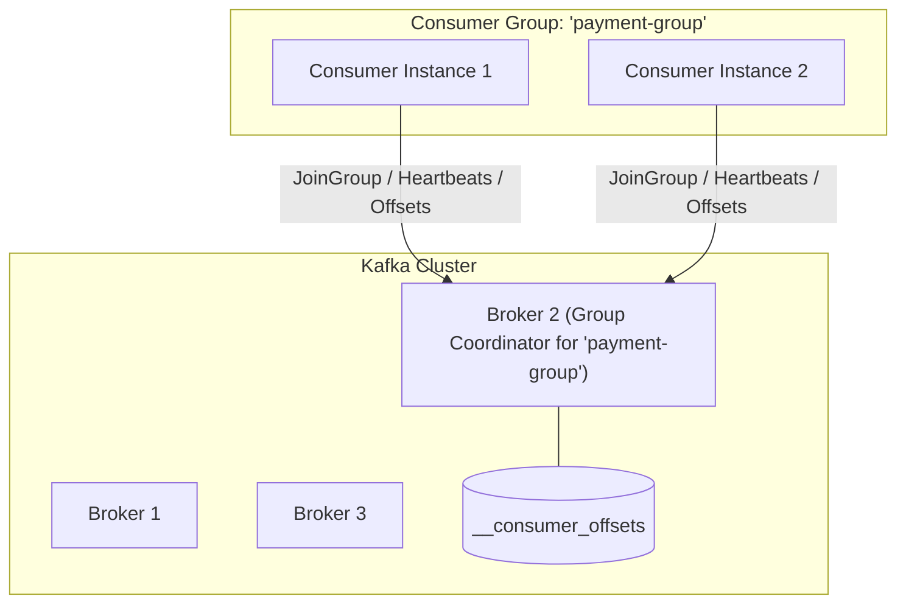
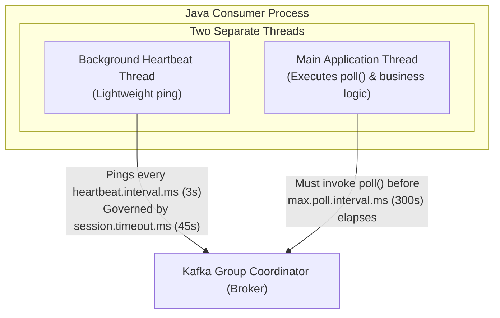
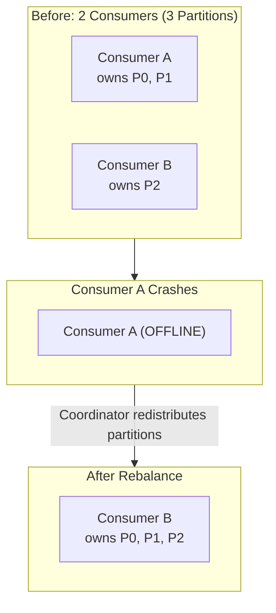
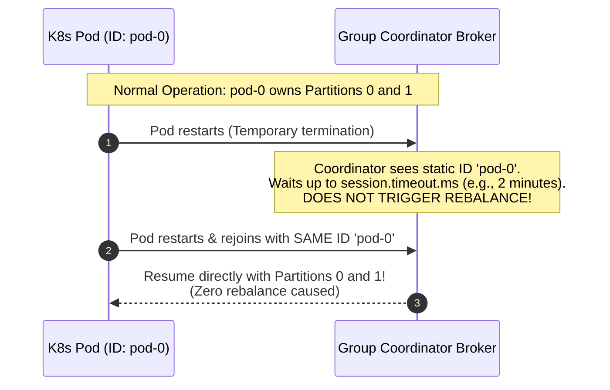

# 017: Consumer Rebalancing and Liveness

> [!abstract] Module 08: Consumer Internals (Part 2)
> **Focus:** The Group Coordinator, consumer liveness detection (`heartbeat.interval.ms`, `session.timeout.ms`, `max.poll.interval.ms`), rebalancing triggers and protocols (Eager vs. Cooperative Sticky), partition assignment strategies, and static membership with `group.instance.id`.
> **Prerequisites:** `016-Consumer_Polling_and_Fetch_Internals.md`.

---

## 1. The Group Coordinator

In a Kafka cluster, multiple consumers sharing the same `group.id` collaborate to consume topic partitions. Someone must coordinate who owns which partition, monitor member health, and manage group state. That coordinator is one of the Kafka brokers, known as the **Group Coordinator**.



### How Kafka Selects the Group Coordinator
1. Kafka hashes the consumer group ID: `Math.abs(groupId.hashCode()) % offsetsTopicPartitionCount` (default 50 partitions of `__consumer_offsets`).
2. This identifies the specific partition of `__consumer_offsets` that stores the group's metadata (e.g., partition 14).
3. The **broker that is the leader of partition 14** becomes the **Group Coordinator** for that entire consumer group.

---

## 2. Consumer Liveness: Heartbeats vs. Polling

A consumer can fail in two completely different ways:
1. **Hard Failure (Crash):** The JVM process is killed, the server loses power, or the network cable is severed.
2. **Soft Failure (Livelock / Hang):** The process is still alive, but the application code is stuck in an infinite loop, blocked on a database lock, or processing too slowly to make forward progress.

To detect both failure modes independently, Kafka employs a **two-tiered liveness mechanism**.



---

### The Three Liveness Settings

#### 1. `heartbeat.interval.ms` (Default: `3000` ms / 3 seconds)
* How frequently the background heartbeat thread sends a lightweight "I am alive" ping to the Group Coordinator.
* **Rule:** Must be set to no more than one-third of `session.timeout.ms`.

#### 2. `session.timeout.ms` (Default: `45000` ms / 45 seconds in modern Kafka)
* The maximum time the coordinator will wait without hearing a heartbeat before concluding the consumer has crashed or experienced a hard failure.
* **If it expires:** The coordinator removes the consumer from the group and triggers a rebalance.

#### 3. `max.poll.interval.ms` (Default: `300000` ms / 5 minutes)
* The maximum time allowed between successive calls to `poll()` by the application thread.
* **What it detects:** If your application thread gets stuck processing records or blocked on a slow database query, the heartbeat thread may keep pinging, but no progress is being made.
* **If it expires:** The client proactively sends a `LeaveGroup` request to the coordinator, abandons its partitions, and triggers a rebalance.

---

### The Crucial Difference: `session.timeout.ms` vs. `max.poll.interval.ms`

| Dimension | `session.timeout.ms` | `max.poll.interval.ms` |
| :--- | :--- | :--- |
| **Monitored Component** | Background Heartbeat Thread | Main Application Thread (`poll()` loop) |
| **Detects What?** | Hard crashes, OOM, network disconnections | Hangs, deadlocks, slow batch processing |
| **Default Window** | 45 seconds | 5 minutes |
| **Symptom in Logs** | `Member ... has left group or been kicked out due to session timeout` | `Max poll interval exceeded, committing offsets and leaving group` |
| **Remedy** | Check network stability, JVM GC pauses, pod health | Reduce `max.poll.records`, optimize processing code |

---

## 3. Consumer Rebalancing Demystified

### What is a Rebalance?
**Rebalancing** is the process where the Group Coordinator reassigns topic partitions among the healthy members of a consumer group.



### The 5 Triggers of a Rebalance
1. **A consumer joins the group:** (e.g., scaling up pods from 2 to 4).
2. **A consumer leaves gracefully:** (e.g., application shutdown / SIGTERM).
3. **A consumer crashes (hard failure):** `session.timeout.ms` expires without heartbeats.
4. **A consumer hangs (soft failure):** Application loop exceeds `max.poll.interval.ms`.
5. **Topic metadata changes:** Partitions are added to a subscribed topic, or a new topic matching a wildcard regex is created.

---

### What Happens to Messages During a Rebalance?
Rebalancing is not free. When partition ownership shifts:
1. **Processing pauses:** The group must coordinate the handover.
2. **Potential duplicate processing:** If Consumer A processed 5 out of 10 records and a rebalance occurs before it commits its offsets, Consumer B inherits the partition and re-processes all 10 records from the last committed offset!

> [!CAUTION]
> **Rebalance Storms:** If `max.poll.records` is set too high and your processing takes 5 minutes and 1 second, the consumer gets kicked out. Its partitions are given to Consumer B. Now Consumer B has double the workload, takes 6 minutes, and also gets kicked out! This vicious cycle is known as a **rebalance storm**.

---

## 4. Rebalance Protocols: Eager vs. Cooperative

Historically, Kafka used a destructive rebalance protocol. Modern Kafka introduced incremental rebalancing to eliminate downtime.

```mermaid
flowchart TD
    subgraph Eager["Legacy Eager Protocol (Stop-The-World)"]
        E1["1. Event occurs (e.g., Pod joins)"] --> E2["2. ALL consumers revoke ALL partitions"]
        E2 --> E3["3. Entire consumer group STOPS processing"]
        E3 --> E4["4. Partitions reassigned from scratch"]
        E4 --> E5["5. Processing resumes (High Latency Spike)"]
    end

    subgraph Cooperative["Modern Cooperative Sticky Protocol"]
        C1["1. Event occurs (e.g., Pod joins)"] --> C2["2. Consumers KEEP unaffected partitions"]
        C2 --> C3["3. ONLY moving partitions are revoked & reassigned"]
        C3 --> C4["4. Zero downtime for unchanged partitions"]
    end
```



### 1. Eager Rebalancing (Legacy / Default in older clients)
- "Stop-the-world" approach.
- Every consumer in the group gives up its partitions and stops processing while the group reforms.
- Causes latency spikes and pipeline pauses.

### 2. Cooperative Sticky Rebalancing (Modern Default)
- Incremental approach.
- Consumers continue reading from partitions that don't need to move.
- Only the specific partitions moving to a new member are paused, revoked, and reassigned.
- Enabled via:
  ```properties
  partition.assignment.strategy=org.apache.kafka.clients.consumer.CooperativeStickyAssignor
  ```

---

## 5. Partition Assignment Strategies

### 5.1 What Problem Are We Solving?
Imagine you have:
* **2 Topics:** `orders` (3 partitions: 0, 1, 2) and `payments` (3 partitions: 0, 1, 2) $\rightarrow$ **6 partitions total**.
* **2 Consumers in your group:** `Consumer 1` and `Consumer 2`.

**The Question:**  
How should Kafka divide these 6 partitions between the 2 consumers?

The rule or algorithm used to divide partitions is called the **Partition Assignment Strategy** (`partition.assignment.strategy`).

```text
6 Partitions: orders (0, 1, 2) and payments (0, 1, 2)
                         |
               [ Assignment Strategy ]
                         |
            +------------+------------+
            |                         |
            v                         v
        Consumer 1                Consumer 2
```

Here are the 4 main strategies explained in simple English.

---

### 5.2 Strategy 1: `RangeAssignor` (Topic-by-Topic)

This was the old default in Kafka.

#### How It Works
It looks at **one topic at a time**, completely on its own:
1. It takes Topic 1, divides its partitions between consumers.
2. Then it takes Topic 2, divides its partitions between consumers.

#### Example
* `orders` has 3 partitions: `0, 1, 2`
* `payments` has 3 partitions: `0, 1, 2`
* Consumers: `Consumer 1` and `Consumer 2`

* **For `orders`:**
  * Consumer 1 gets: `orders-0`, `orders-1` (2 partitions)
  * Consumer 2 gets: `orders-2` (1 partition)
* **For `payments`:**
  * Consumer 1 gets: `payments-0`, `payments-1` (2 partitions)
  * Consumer 2 gets: `payments-2` (1 partition)

#### The Big Problem: Unfair Workload
Look at the final count:
* **Consumer 1 gets 4 partitions:** `orders-0`, `orders-1`, `payments-0`, `payments-1`
* **Consumer 2 gets only 2 partitions:** `orders-2`, `payments-2`

Consumer 1 is doing **double the work** of Consumer 2! If you have 10 topics with 3 partitions each, Consumer 1 could end up with 20 partitions while Consumer 2 gets only 10.

---

### 5.3 Strategy 2: `RoundRobinAssignor` (Dealing Playing Cards)

#### How It Works
Instead of looking at topics one-by-one, it lines up **all partitions from all topics into one single line** and deals them out one by one, like dealing a deck of playing cards:

```text
[ orders-0, orders-1, orders-2, payments-0, payments-1, payments-2 ]
     |          |         |           |           |           |
    C1         C2        C1          C2          C1          C2
```

#### The Result
* **Consumer 1:** `orders-0`, `orders-2`, `payments-1` (3 partitions)
* **Consumer 2:** `orders-1`, `payments-0`, `payments-2` (3 partitions)

* **Advantage:** Perfectly fair and balanced! Both consumers get an equal number of partitions.
* **The Problem (Full Reshuffle):** When a new consumer joins or one leaves, `RoundRobin` completely reshuffles everything from scratch. Partitions that were already working fine on Consumer 1 get moved to another consumer, causing unnecessary pauses.

---

### 5.4 Strategy 3: `StickyAssignor` (Keep What You Already Have)

The word **"Sticky"** means partitions stick to the consumer that is already reading them.

#### Its Two Rules:
1. **Rule 1 (Balance):** Keep partitions evenly divided between consumers (like RoundRobin).
2. **Rule 2 (Stickiness):** When a rebalance happens, **do not move a partition** unless you really have to.

#### Example
Suppose you have 3 consumers (`C1`, `C2`, `C3`) and 6 partitions:
* `C1` has Partitions 0, 1
* `C2` has Partitions 2, 3
* `C3` has Partitions 4, 5

Now, **`C3` crashes!**
* **With RoundRobin:** It might reshuffle all 6 partitions among C1 and C2 from scratch.
* **With StickyAssignor:**
  * `C1` **keeps** Partitions 0 and 1.
  * `C2` **keeps** Partitions 2 and 3.
  * Only `C3`'s lost partitions (4 and 5) are moved (Partition 4 to C1, Partition 5 to C2).

* **Advantage:** Very small movement during rebalances.
* **The Problem:** It still uses the old "Eager" protocol, meaning **all consumers stop reading** while the rebalance is taking place.

---

### 5.5 Strategy 4: `CooperativeStickyAssignor` (The Modern Standard)

This is the best strategy and the **standard choice for modern production systems**.

* It uses the same smart rules as `StickyAssignor` (balanced + keeps existing partitions).
* **BUT it does NOT stop all consumers.**
* If `C1` already owns Partitions 0 and 1, it **keeps reading from them without any pause**.
* Only the single partition that actually needs to move is paused and handed over.

```text
Old Eager Style:
[Stop ALL consumers] ---> [Reassign partitions] ---> [Resume ALL consumers] (Downtime!)

Cooperative Sticky:
C1 continues reading P0, P1 without stopping.
Only the moving partition moves over smoothly. (Zero downtime!)
```

---

### 5.6 Summary Comparison

| Strategy | How It Works | Big Drawback | When to Use |
| :--- | :--- | :--- | :--- |
| **`RangeAssignor`** | Topic-by-topic | Can give too much work to one consumer | Old legacy systems only. |
| **`RoundRobinAssignor`** | Deals partitions like cards | Reshuffles everything from scratch on rebalance | When topics have identical partition counts and stickiness does not matter. |
| **`StickyAssignor`** | Balances evenly + keeps existing assignments | Pauses the entire group during rebalance (Eager) | Replaced by CooperativeSticky. |
| **`CooperativeStickyAssignor`** | Balances evenly + keeps existing assignments + **zero group downtime** | None | **Default choice for 99% of production applications today.** |

#### Production Configuration (Spring Boot)
```yaml
spring:
  kafka:
    consumer:
      properties:
        partition.assignment.strategy: org.apache.kafka.clients.consumer.CooperativeStickyAssignor
```

---

## 6. Enterprise Optimization: Static Membership (`group.instance.id`)

### The Problem in Kubernetes / Cloud Deployments
In containerized environments (Kubernetes, Docker), pods restart frequently during rolling deployments or node upgrades.
- Every time a pod restarts, Kafka sees it as a dead consumer and triggers a rebalance.
- 1 minute later, the pod comes back up, rejoins, and triggers a second rebalance.
- For a 10-pod deployment, a rolling update causes **20 consecutive rebalances**, crippling message throughput.

### The Solution: Static Membership
By giving each container a unique, persistent instance ID:
```properties
group.instance.id=payment-service-pod-0
```



1. When a pod restarts, the coordinator detects that a static member disconnected.
2. Instead of triggering an immediate rebalance, it **holds the partition assignments open** for up to `session.timeout.ms`.
3. When the pod boots back up with the same `group.instance.id`, it immediately reclaims its partitions without any group rebalance.

---

## 7. Key Configuration Summary

| Configuration Property | Default Value | Production Recommended | Purpose |
| :--- | :--- | :--- | :--- |
| **`heartbeat.interval.ms`** | `3000` ms | `3000` ms | Heartbeat frequency; should be $\le \frac{1}{3}$ of session timeout. |
| **`session.timeout.ms`** | `45000` ms | `45000` ms | Crash detection timeout for dead JVM / lost network. |
| **`max.poll.interval.ms`** | `300000` ms | `300000` ms (or budgeted higher) | Deadlock/hang detection; must exceed worst-case batch processing time. |
| **`partition.assignment.strategy`** | `RangeAssignor, CooperativeStickyAssignor` | `org.apache.kafka.clients.consumer.CooperativeStickyAssignor` | Rebalance algorithm; eliminates stop-the-world pauses. |
| **`group.instance.id`** | `null` | E.g., `${HOSTNAME}` in K8s | Enables static membership to avoid rolling-restart rebalances. |
