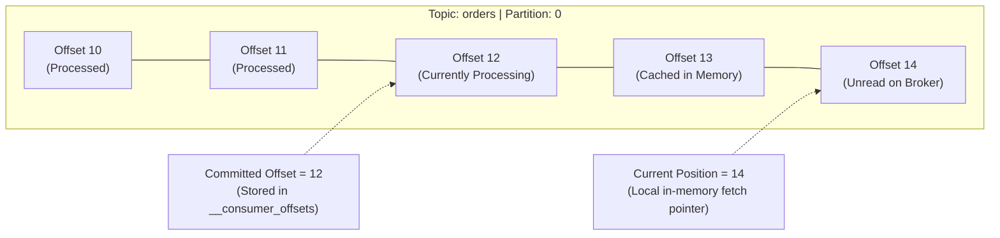
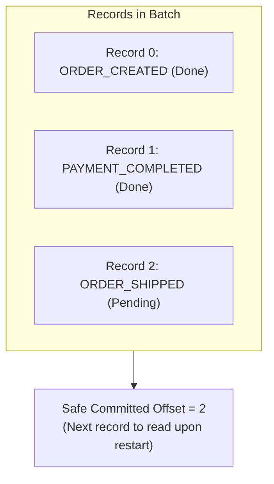
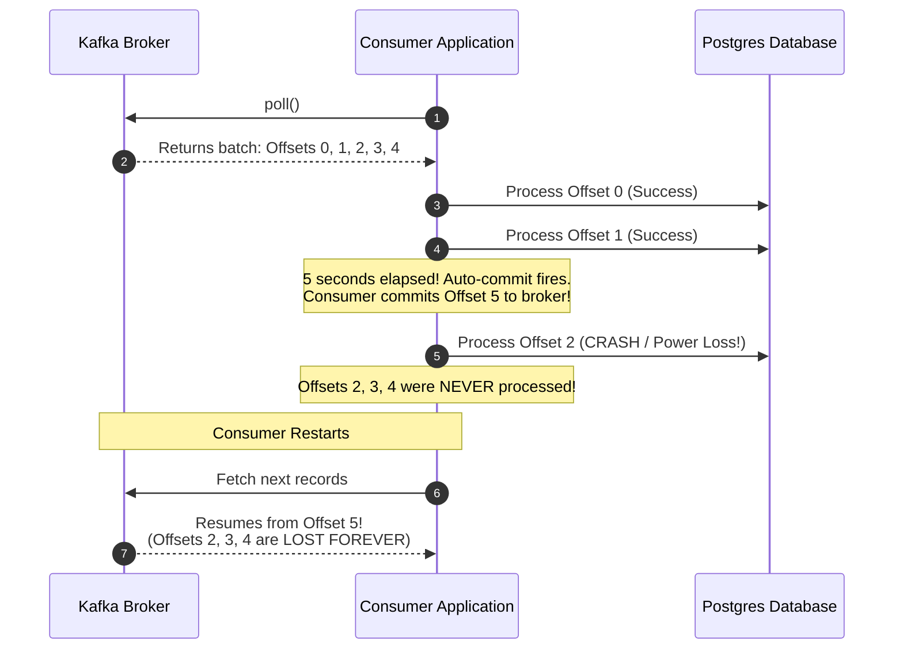
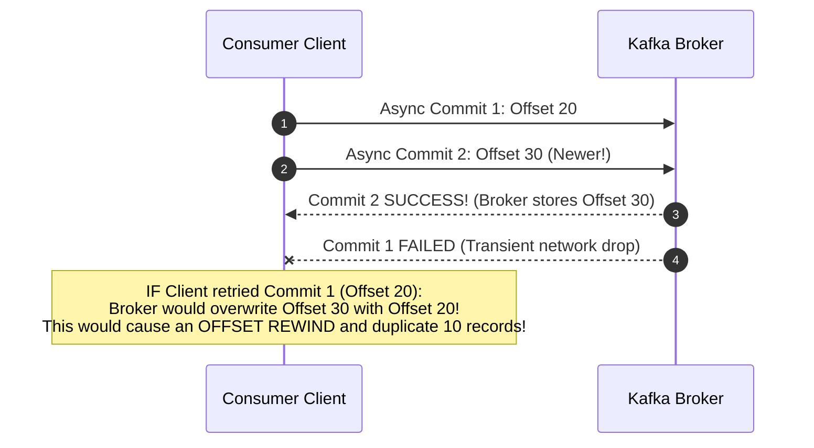
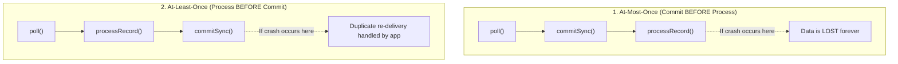
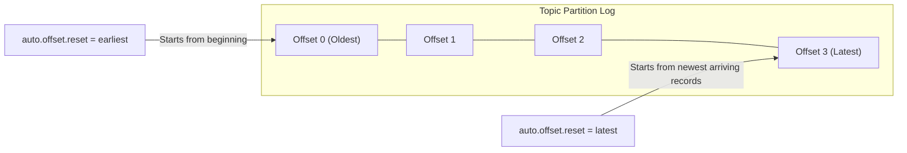
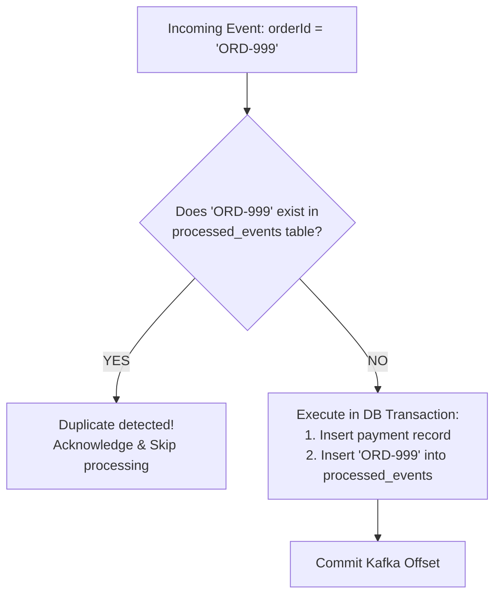

# 018: Offset Management and Delivery Semantics

> [!abstract] Module 08: Consumer Internals (Part 3)
> **Focus:** Current position vs. committed offset, the Golden Rule of Offsets, the Contiguous Completion Rule, Auto Commit vs. Manual Commit (`commitSync`, `commitAsync`), delivery semantics (At-Most-Once, At-Least-Once, Exactly-Once), `auto.offset.reset`, consumer idempotency in production, and Spring Boot `AckMode` strategies.
> **Prerequisites:** `016-Consumer_Polling_and_Fetch_Internals.md` and `017-Consumer_Rebalancing_and_Liveness.md`.

---

## 1. Anatomy of an Offset: Position vs. Committed Offset

An **offset** is a 64-bit integer that uniquely identifies the sequential position of a record within a partition. To understand how consumers track progress, you must distinguish between two different offset pointers:



1. **Current Position (Fetch Pointer):** The offset of the next record the consumer will read in its local in-memory loop. As records are fetched, this advances immediately.
2. **Committed Offset:** The durable, persisted progress saved for the consumer group inside Kafka's internal topic **`__consumer_offsets`**.
   - If the consumer crashes or a rebalance occurs, **Kafka resumes reading from the committed offset**, completely discarding the uncommitted in-memory position.

---

### The Golden Rule of Offsets: Always Commit $N + 1$
A committed offset represents the **next record to consume**, NOT the last record successfully processed.



* If you successfully process Offset 0 and Offset 1 $\rightarrow$ **Commit Offset 2**.
* If you mistakenly commit Offset 1, a restarting consumer will re-read Offset 1, causing a duplicate!
* If you mistakenly commit Offset 3, a restarting consumer resumes from Offset 3, completely skipping Offset 2 (permanent data loss)!

---

### How Kafka Tracks Offsets Across Groups
Kafka maintains offsets independently for every **`Consumer Group + Topic + Partition`** triple:

| Consumer Group | Topic | Partition | Committed Offset |
| :--- | :--- | :---: | :---: |
| `payment-service-group` | `orders` | `0` | `105` |
| `payment-service-group` | `orders` | `1` | `210` |
| `notification-service-group` | `orders` | `0` | `40` |

Notice that `payment-service-group` and `notification-service-group` consume the exact same partition (`orders-0`) at their own independent rates without interfering with each other.

---

## 2. Automatic Offset Commit (`enable.auto.commit=true`)

### How It Works
```properties
enable.auto.commit=true
auto.commit.interval.ms=5000   # (5 seconds default)
```
When auto-commit is enabled, the consumer commits offsets automatically during invocations of `poll()`.

> [!NOTE]
> `auto.commit.interval.ms` is **not** driven by a background timer. The consumer only executes the auto-commit check when your application thread calls `poll()`.

---

### The Hidden Danger of Auto-Commit: Silent Data Loss



Because auto-commit is tied to time and polling rather than business transaction completion:
- **Offsets can be committed before business logic finishes.**
- If the application crashes midway through a batch, uncompleted messages are skipped permanently upon restart.

---

## 3. Manual Offset Commit (`enable.auto.commit=false`)

In mission-critical enterprise systems (e.g., payments, order fulfillment), auto-commit is disabled to give the application explicit control over when progress is recorded.

```properties
enable.auto.commit=false
```

There are two primary methods: **`commitSync()`** and **`commitAsync()`**.

### 1. Synchronous Commit: `commitSync()`
Blocks the application thread until the broker responds with confirmation that the offset is safely written to `__consumer_offsets`.

```java
while (true) {
    ConsumerRecords<String, String> records = consumer.poll(Duration.ofMillis(100));
    try {
        for (ConsumerRecord<String, String> record : records) {
            processPayment(record.value());
        }
        // Blocks until Kafka broker confirms write
        consumer.commitSync();
    } catch (Exception e) {
        log.error("Processing failed; do NOT commit offsets", e);
        // Error handling / backoff
    }
}
```

* **Pros:** Bulletproof reliability. You know with 100% certainty that the offset was saved before polling new records.
* **Cons:** Blocking introduces network latency overhead, slightly reducing maximum throughput.

---

### 2. Asynchronous Commit: `commitAsync()`
Dispatches the offset commit request over the network socket and immediately returns without waiting for the broker's reply.

```java
consumer.commitAsync(new OffsetCommitCallback() {
    @Override
    public void onComplete(Map<TopicPartition, OffsetAndMetadata> offsets, Exception exception) {
        if (exception != null) {
            log.error("Commit failed for offsets: {}", offsets, exception);
        } else {
            log.debug("Offsets successfully committed: {}", offsets);
        }
    }
});
```

* **Pros:** Highest throughput; non-blocking.
* **Cons:** What happens if an asynchronous commit fails? **Kafka does NOT retry failed async commits.**

#### Why `commitAsync()` Must Never Auto-Retry: The Stale Rewind Hazard



If an older async commit were automatically retried after a newer async commit succeeded, it would overwrite the newer offset with an older one, causing a massive replay of already-processed records.

---

## 4. Practical Commit Granularities

### Strategy A: Commit After the Entire Batch
Process all records returned by `poll()`, then commit once at the end of the loop.
- **Throughput:** Very high.
- **Failure Impact:** If record 499 of 500 fails, none of the 500 records are committed. Upon restart, all 500 records are re-delivered (At-Least-Once).

### Strategy B: Commit After Each Record
Call `commitSync()` after every single message.
- **Throughput:** Low (causes hundreds of network round-trips per second).
- **Failure Impact:** Only the single failed record is redelivered upon restart.

### Strategy C: Commit Explicit Offsets Per Partition
When a consumer receives records from multiple partitions simultaneously, you can commit progress for each partition independently:

```java
Map<TopicPartition, OffsetAndMetadata> currentOffsets = new HashMap<>();

for (ConsumerRecord<String, String> record : records) {
    processOrder(record.value());
    
    // Remember: Commit offset must be NEXT offset (offset + 1)
    currentOffsets.put(
        new TopicPartition(record.topic(), record.partition()),
        new OffsetAndMetadata(record.offset() + 1, "Order processed")
    );
    
    if (processedCount % 50 == 0) {
        consumer.commitSync(currentOffsets);
    }
}
consumer.commitSync(currentOffsets);
```

---

## 5. The Contiguous Completion Rule

When processing records—especially in multi-threaded, parallel, or asynchronous pipelines—you must obey the **Contiguous Completion Rule**:

> [!CRITICAL]
> **The Contiguous Completion Rule:**  
> For each partition, you must **ONLY commit the next offset after the highest continuously successful record**. You must NEVER commit past a failed record simply because subsequent records succeeded.

### The Real-World Scenario
Suppose a batch contains offsets 10, 11, 12, and 13:

```text
Offset 10: SUCCESS
Offset 11: SUCCESS
Offset 12: FAILED (Database connection error)
Offset 13: SUCCESS (Different thread finished it)
```

| Commit Choice | What Happens on Consumer Restart? | Correctness Verdict |
| :---: | :--- | :--- |
| **Commit 13** | Resumes from Offset 13. **Offset 12 is skipped and LOST.** | ❌ **Fatal Data Loss** |
| **Commit 14** | Resumes from Offset 14. **Offset 12 is skipped and LOST.** | ❌ **Fatal Data Loss** |
| **Commit 11** | Resumes from Offset 11. Offsets 11 and 13 are re-processed unnecessarily. | ⚠️ **Duplicate Overhead** |
| **Commit 12** | Resumes from Offset 12. **Offset 12 is re-attempted safely!** | ✅ **CORRECT (At-Least-Once)** |

**The Formula:**
$$\text{Committed Offset} = \text{Highest Contiguous Successful Offset} + 1 = 11 + 1 = \mathbf{12}$$

---

## 6. Delivery Semantics Decoded

Delivery semantics describe the contractual guarantee between Kafka and your business logic.



| Delivery Semantic | Commit Timing | Risk | Best Used For |
| :--- | :--- | :--- | :--- |
| **At-Most-Once** | Commit offset **before** processing records. | **High Data Loss Risk.** Never duplicates. | High-volume sensory metrics, IoT telemetry where losing a datapoint is fine. |
| **At-Least-Once** | Commit offset **after** processing records. | **Duplicate Processing Risk.** Never loses data. | **Industry Standard.** Orders, payments, user notifications. |
| **Exactly-Once (EOS)** | Offsets committed in the same transaction as state updates (`KafkaProducer.sendOffsetsToTransaction`). | Complex setup; requires transactional producers and Kafka-to-Kafka pipelines. | Financial ledger accounting, stream processing (Kafka Streams). |

---

## 7. `auto.offset.reset`: Where Does a Consumer Start?

When a consumer starts up, it asks the coordinator for its committed offset. **What if no committed offset exists** (e.g., brand-new consumer group, or offsets expired after 7 days)?

Kafka inspects the **`auto.offset.reset`** property:

```properties
auto.offset.reset=earliest   # options: earliest, latest, none
```



| Value | Behavior When No Committed Offset Exists |
| :--- | :--- |
| **`latest` (Default)** | Starts reading only **new records** that arrive after the consumer starts. Historical data is ignored. |
| **`earliest`** | Starts reading from the **very beginning** of the retained partition log (Offset 0). |
| **`none`** | Throws an `NoOffsetForPartitionException` to the application, forcing an administrator to intervene. |

> [!IMPORTANT]
> `auto.offset.reset` **ONLY applies when there is no valid committed offset** in `__consumer_offsets`. It will **never** rewind or alter progress for an established consumer group that already has committed offsets.

---

## 8. Consumer-Side Idempotency in Production

A common misconception among developers is believing that manual offset commits prevent duplicate processing.

### The Inevitable Duplicate Scenario
1. Payment service processes `ORDER_CREATED` for Order #101.
2. It charges the customer's credit card and saves the transaction in PostgreSQL.
3. Before it can call `commitSync()`, the Kubernetes pod is abruptly killed (OOM or node restart).
4. A new pod spins up, finds the uncommitted offset, and **re-reads Order #101**.

### How to Guarantee Idempotency
Because network failures make duplicate delivery inevitable in distributed systems, **your consumer business logic must be idempotent**.



#### Production Patterns:
1. **Unique Database Constraint:** Add a `UNIQUE` constraint on `event_id` or `order_id` in your relational database table. If duplicate messages arrive, the second insert fails with a constraint violation and is safely ignored.
2. **Idempotent Upsert:** Use `INSERT ... ON CONFLICT DO UPDATE` or Redis `SETNX`.
3. **Deduplication Table:** Maintain a dedicated `processed_events` table inside the same database transaction as your business state changes.

---

## 9. Spring Boot Acknowledgment Modes (`AckMode`)

When using Spring Boot (`@KafkaListener`), Spring abstracts the underlying `poll()` and commit loop through its `ContainerProperties.AckMode`:

```yaml
spring:
  kafka:
    listener:
      ack-mode: MANUAL_IMMEDIATE  # Spring Boot acknowledgment mode
```

| `AckMode` | When Does Spring Commit the Offset? |
| :--- | :--- |
| **`RECORD`** | Commits the offset immediately after each individual record listener completes. |
| **`BATCH` (Default)** | Commits the offset of all records returned by the `poll()` call once the entire batch finishes processing. |
| **`TIME`** | Commits only if `ack-time` has elapsed since the last commit. |
| **`COUNT`** | Commits only if `ack-count` records have been processed since the last commit. |
| **`COUNT_TIME`** | Commits if either `ack-count` or `ack-time` condition is met. |
| **`MANUAL`** | The listener receives an `Acknowledgment` object. When `ack.acknowledge()` is called, the commit is queued and flushed on the next poll. |
| **`MANUAL_IMMEDIATE`** | Calling `ack.acknowledge()` synchronously executes `commitSync()` immediately. **(Recommended for financial / strict durability services).** |

### Spring Boot Example with `MANUAL_IMMEDIATE`
```java
@Component
@Slf4j
public class PaymentEventListener {

    @KafkaListener(topics = "orders", groupId = "payment-group")
    public void onOrderReceived(ConsumerRecord<String, String> record, Acknowledgment ack) {
        try {
            log.info("Processing order: key={}, partition={}, offset={}",
                    record.key(), record.partition(), record.offset());

            processPayment(record.value());

            // Manually commit offset synchronously
            ack.acknowledge();
        } catch (Exception ex) {
            log.error("Failed processing payment for order: {}", record.key(), ex);
            // Do NOT acknowledge; message will be retried
            throw ex;
        }
    }
}
```

---

## 10. Key Configuration Summary

| Property | Default Value | Recommended Value | Purpose |
| :--- | :--- | :--- | :--- |
| **`enable.auto.commit`** | `true` | `false` | Disables silent background commits to prevent data loss. |
| **`auto.commit.interval.ms`**| `5000` (5s) | N/A (when false) | Frequency of automatic commits. |
| **`auto.offset.reset`** | `latest` | `earliest` | Default start position when no committed offset exists. |
| **`spring.kafka.listener.ack-mode`** | `BATCH` | `MANUAL_IMMEDIATE` | Gives code explicit control over offset commits per message. |
