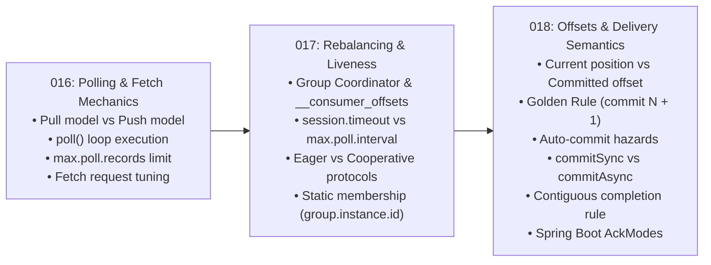

# Module 08: Consumer Internals (Map of Content)

> [!abstract] Module Overview
> In Kafka, consumers do not wait passively for messages to be pushed to them—they actively drive data flow via the **Pull Model**.
> This module explores how records are polled and fetched into JVM memory, how group coordinators detect member failures and orchestrate rebalances, how offsets are safely tracked in `__consumer_offsets`, and how to implement zero-data-loss delivery semantics in Spring Boot.

---

## Module Index & Reading Order



### [016: Consumer Polling and Fetch Internals](file:///c:/Users/siddhesh.pawar/Desktop/Workspace/Obsidian-Vault/Inbox/Kafka_Obsidian_Organized/08%20-%20Consumer%20Internals/016-Consumer_Polling_and_Fetch_Internals.md)
* **The Pull Paradigm:** Why Kafka chose Pull over Push (flow control, natural backpressure).
* **The `poll()` Loop:** Application thread vs. network engine, multi-partition batch aggregation.
* **Batch Sizing:** `max.poll.records` (500 default) and JVM memory bounds.
* **Fetch Request Tuning:** `fetch.min.bytes`, `fetch.max.wait.ms`, and partition byte limits.
* **Processing Time Budget:** Aligning record processing duration with `max.poll.interval.ms`.

### [017: Consumer Rebalancing and Liveness](file:///c:/Users/siddhesh.pawar/Desktop/Workspace/Obsidian-Vault/Inbox/Kafka_Obsidian_Organized/08%20-%20Consumer%20Internals/017-Consumer_Rebalancing_and_Liveness.md)
* **The Group Coordinator:** How the broker coordinator is hashed and elected.
* **Two-Tiered Liveness:** Background heartbeat thread (`session.timeout.ms`) vs. application poll thread (`max.poll.interval.ms`).
* **Rebalancing Triggers:** Hard crashes, soft hangs, pod scale-ups, and partition changes.
* **Modern Protocols:** Eager "stop-the-world" vs. Cooperative Sticky incremental rebalancing.
* **Static Membership:** Preventing rebalance storms during Kubernetes rolling updates via `group.instance.id`.

### [018: Offset Management and Delivery Semantics](file:///c:/Users/siddhesh.pawar/Desktop/Workspace/Obsidian-Vault/Inbox/Kafka_Obsidian_Organized/08%20-%20Consumer%20Internals/018-Offset_Management_and_Delivery_Semantics.md)
* **Anatomy of an Offset:** Current in-memory position vs. durable committed offset in `__consumer_offsets`.
* **The Golden Rule:** Always commit the NEXT offset ($N + 1$).
* **Auto-Commit Hazards:** Why `enable.auto.commit=true` leads to silent data loss upon crashes.
* **Manual Commit Methods:** Synchronous (`commitSync`) vs. Asynchronous (`commitAsync`) and the stale rewind hazard.
* **The Contiguous Completion Rule:** Safely handling partial batch failures without skipping uncommitted records.
* **Delivery Semantics:** At-Most-Once, At-Least-Once, and true application-level idempotency patterns.
* **Spring Boot `AckMode`:** `RECORD`, `BATCH`, `MANUAL`, and `MANUAL_IMMEDIATE`.

---

## Master Consumer Configuration Reference

| Property | Default Value | Production Recommended | Primary Responsibility |
| :--- | :--- | :--- | :--- |
| **`group.id`** | - | `payment-service-group` | Unique string identifying the consumer group. |
| **`key.deserializer`** | - | `StringDeserializer` / Avro | Deserializer for message keys. |
| **`value.deserializer`** | - | `StringDeserializer` / Avro | Deserializer for message payloads. |
| **`enable.auto.commit`** | `true` | `false` | Disables automatic commits; guarantees explicit at-least-once control. |
| **`auto.commit.interval.ms`**| `5000` (5s) | N/A (when false) | Interval for automatic background commits. |
| **`auto.offset.reset`** | `latest` | `earliest` | Starting offset when no committed offset exists. |
| **`max.poll.records`** | `500` | `100` - `500` | Maximum records returned by a single call to `poll()`. |
| **`max.poll.interval.ms`** | `300000` (5 min) | `300000` (5 min) | Max time between `poll()` calls before coordinator evicts the consumer. |
| **`heartbeat.interval.ms`**| `3000` (3s) | `3000` (3s) | Frequency of liveness heartbeats sent to the coordinator. |
| **`session.timeout.ms`** | `45000` (45s) | `45000` (45s) | Time coordinator waits without heartbeats before declaring a crash. |
| **`partition.assignment.strategy`** | `Range, CooperativeSticky` | `CooperativeStickyAssignor` | Assignor protocol; eliminates stop-the-world rebalance pauses. |
| **`group.instance.id`** | `null` | `${HOSTNAME}` (in K8s) | Enables static membership; skips rebalances on rolling restarts. |
| **`fetch.min.bytes`** | `1` byte | `1` (latency) or `65536` (throughput) | Min data broker accumulates before responding to fetch. |
| **`fetch.max.wait.ms`** | `500` ms | `500` ms | Max time broker waits for `fetch.min.bytes` to accumulate. |
| **`max.partition.fetch.bytes`** | `1048576` (1 MB) | `1048576` (1 MB) | Max bytes returned per partition per fetch request. |

---

## Production Spring Boot Template (`application.yml`)

```yaml
spring:
  kafka:
    consumer:
      bootstrap-servers:
        - kafka-1.prod.internal:9092
        - kafka-2.prod.internal:9092
        - kafka-3.prod.internal:9092
      group-id: payment-service-group
      auto-offset-reset: earliest
      enable-auto-commit: false        # Explicit control over commits
      key-deserializer: org.apache.kafka.common.serialization.StringDeserializer
      value-deserializer: org.apache.kafka.common.serialization.StringDeserializer
      properties:
        # Rebalancing & Liveness
        partition.assignment.strategy: org.apache.kafka.clients.consumer.CooperativeStickyAssignor
        session.timeout.ms: 45000
        heartbeat.interval.ms: 3000
        max.poll.interval.ms: 300000

        # Batch Size & Fetch Tuning
        max.poll.records: 200
        fetch.min.bytes: 1
        fetch.max.wait.ms: 500

    listener:
      ack-mode: MANUAL_IMMEDIATE       # Synchronous commit per acknowledged message
      concurrency: 3                   # 3 concurrent consumer threads per pod
```

---

## Module 08 Syllabus Checklist

- [x] Consumer Pull model vs. Push model advantages
- [x] Internal polling loop execution (`poll()`, `Duration`, `ConsumerRecords`)
- [x] Multi-partition batch aggregation
- [x] Memory management and processing bounds (`max.poll.records`)
- [x] Fetch tuning parameters (`fetch.min.bytes`, `fetch.max.wait.ms`, `max.partition.fetch.bytes`)
- [x] Group Coordinator election and `__consumer_offsets` partition hashing
- [x] Two-tiered liveness: Heartbeat thread vs. application poll thread
- [x] `session.timeout.ms` vs. `max.poll.interval.ms` failure distinction
- [x] Rebalance triggers and rebalance storm hazards
- [x] Eager vs. Cooperative Sticky rebalance protocols
- [x] Partition assignment strategies (`RangeAssignor`, `RoundRobinAssignor`, `CooperativeStickyAssignor`)
- [x] Static membership with `group.instance.id` for Kubernetes zero-rebalance deploys
- [x] Current in-memory position vs. durable committed offset in `__consumer_offsets`
- [x] Golden Rule of Offsets ($N + 1$)
- [x] Auto-commit hazards and silent data loss scenarios
- [x] Manual commits: `commitSync` vs. `commitAsync` and the stale rewind hazard
- [x] Contiguous Completion Rule for partial batch and parallel execution
- [x] Delivery semantics: At-Most-Once vs. At-Least-Once vs. Exactly-Once
- [x] `auto.offset.reset` rules and caveats
- [x] Consumer-side idempotency patterns (DB unique constraints, deduplication tables)
- [x] Spring Boot container `AckMode` options
