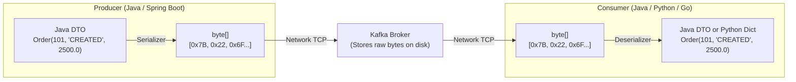
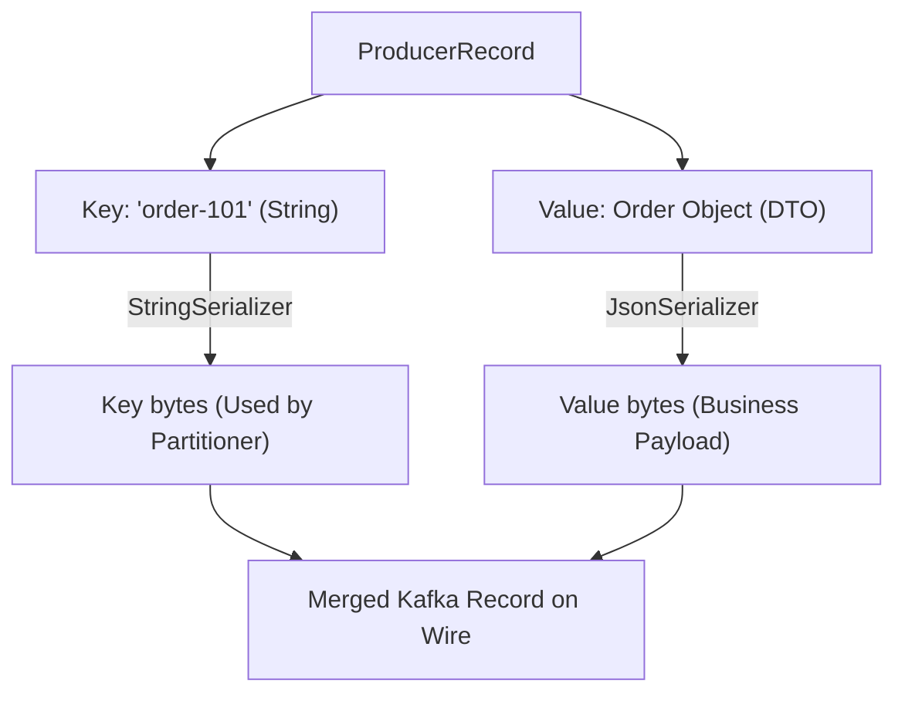
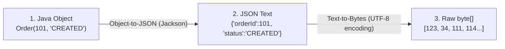
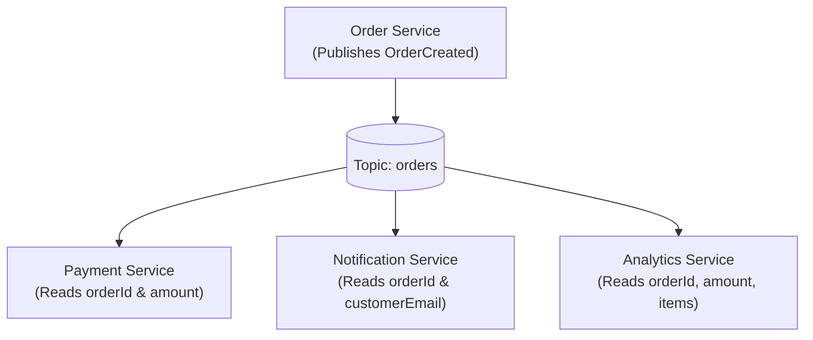

# 019: Serialization Fundamentals and JSON

> [!abstract] Module 09: Serialization and Schemas (Part 1)
> **Focus:** Why Kafka only stores bytes, how serializers and deserializers work, key vs. value serialization, JSON DTO mapping, handling field mismatches with `@JsonProperty`, and securing Spring Boot JSON deserialization with trusted packages.
> **Prerequisites:** Producer internals (`013`–`015`) and Consumer internals (`016`–`018`).

---

## 1. Why Kafka Only Stores Bytes

A common beginner question is: *"Why can't I just send a Java `Order` object directly into Kafka?"*

### The Problem
If Kafka stored Java objects directly:
- **Language Lock-in:** A Python analytics script or a Go microservice would not be able to read events written by a Java service.
- **Broker Overhead:** Kafka brokers would need to know the code and classes of every application in your company. Every time you changed a field in Java, you would have to restart your Kafka cluster!
- **Memory Inefficiency:** Live Java objects contain JVM memory headers, pointers, and class references that waste disk space and network bandwidth.

### The Solution: The Byte Array Contract
Kafka brokers are completely blind to what is inside your messages. Kafka only knows about **raw bytes (`byte[]`)**.



- **Serialization (Producer Side):** Takes your application object (like a Java DTO) and turns it into a list of bytes (`byte[]`).
- **Deserialization (Consumer Side):** Takes those raw bytes (`byte[]`) and reconstructs them into an application object.

Because Kafka only carries bytes, a Java producer can send an event, and a Python consumer can read it without any issues.

---

## 2. Key Serializer vs. Value Serializer

Every Kafka record consists of two separate parts: a **Key** and a **Value**. They are serialized and deserialized completely independently using separate components.

```java
// Example: Sending a message with key and value
kafkaTemplate.send("orders", "order-101", orderPayload);
```



| Record Part | Common Example | Typical Serializer | Primary Job |
| :--- | :--- | :--- | :--- |
| **Key** | `"order-101"` (String) | `StringSerializer` | **Routing:** Used by the partitioner to decide which partition gets the message. Identical keys always go to the same partition. |
| **Value** | `Order` object (DTO) | `JsonSerializer` (or Avro) | **Payload:** Contains the actual business data (event details, amounts, customer info). |

---

## 3. How JSON Serialization Works Under the Hood

When you use JSON serialization, the conversion happens in two steps:



1. **Object to Text:** A library (like Jackson in Spring Boot) inspects the Java class getters/fields and creates a standard JSON text string.
2. **Text to Bytes:** The JSON text string is converted into bytes using character encoding (almost always **UTF-8**). These bytes are what Kafka transmits.
3. **Consumer Reversal:** On the other end, the consumer reads the UTF-8 bytes back into text, and Jackson parses the text into the target Java object.

---

## 4. Spring Boot Configuration for JSON

Spring Kafka makes serialization easy by providing built-in serializers: `JsonSerializer` and `JsonDeserializer`.

### Producer Configuration (`application.yml`)
```yaml
spring:
  kafka:
    bootstrap-servers: localhost:9092
    producer:
      key-serializer: org.apache.kafka.common.serialization.StringSerializer
      value-serializer: org.springframework.kafka.support.serializer.JsonSerializer
```

Now you can send Java DTOs directly using `KafkaTemplate`. Spring converts the object to JSON bytes automatically:

```java
@Service
public class OrderProducer {

    private final KafkaTemplate<String, OrderDto> kafkaTemplate;

    public OrderProducer(KafkaTemplate<String, OrderDto> kafkaTemplate) {
        this.kafkaTemplate = kafkaTemplate;
    }

    public void createOrder(OrderDto order) {
        // Spring handles JSON serialization behind the scenes
        kafkaTemplate.send("orders", order.getOrderId(), order);
    }
}
```

---

### Consumer Configuration & The Trusted Packages Setting (`application.yml`)
```yaml
spring:
  kafka:
    bootstrap-servers: localhost:9092
    consumer:
      group-id: payment-service-group
      auto-offset-reset: earliest
      key-deserializer: org.apache.kafka.common.serialization.StringDeserializer
      value-deserializer: org.springframework.kafka.support.serializer.JsonDeserializer
      properties:
        # Security: Only allow JSON to create objects in this package
        spring.json.trusted.packages: "com.example.paymentservice.dto"
```

### Why Is `spring.json.trusted.packages` Required?
When the producer serializes an object, Spring Kafka puts the Java class name into a record header (e.g., `__TypeId__ = com.example.orderservice.dto.OrderDto`).

When the consumer deserializes the message:
- Without protection, an attacker could send a message pointing to a dangerous class on the consumer's classpath, leading to an arbitrary code execution attack.
- By configuring `spring.json.trusted.packages`, you tell Spring: *"Only convert incoming messages into Java classes that live inside my trusted DTO package."*
- **Best Practice:** Always specify your exact package (e.g., `"com.mycompany.orders.dto"`). Never use `"*"` in production unless you are in a protected local test environment.

---

## 5. Receiving DTOs with `@KafkaListener`

In your consumer service, `@KafkaListener` receives the pre-deserialized DTO directly:

```java
@Component
@Slf4j
public class PaymentOrderConsumer {

    @KafkaListener(topics = "orders", groupId = "payment-service-group")
    public void handleOrderCreated(OrderDto order) {
        log.info("Received order ID: {} with amount: {}", order.getOrderId(), order.getAmount());
        // Process business logic here
    }
}
```

**How Spring runs this:**
1. Spring pulls the raw bytes from Kafka using its internal consumer `poll()` loop.
2. Spring passes the bytes to `JsonDeserializer`, which creates the `OrderDto` object.
3. Spring calls your `@KafkaListener` method and passes the finished `OrderDto`.

---

## 6. Handling Field Name Mismatches (`@JsonProperty`)

In microservices, the producer and consumer are often built by different teams. What happens when field names don't match?

### The Problem Scenario
The Producer sends this JSON:
```json
{
  "orderId": 101,
  "status": "CREATED",
  "amount": 2500.0
}
```

The Consumer has this Java DTO:
```java
public class OrderDto {
    private Long orderId;
    private String status;
    private Double totalAmount; // Notice: name is totalAmount, not amount!
}
```

### What Happens?
* Jackson matches `orderId` $\rightarrow$ sets `101`.
* Jackson matches `status` $\rightarrow$ sets `"CREATED"`.
* Jackson looks for a JSON field called `"totalAmount"`, cannot find it, and leaves `totalAmount` as **`null`**!
* **Danger:** Deserialization does **not** fail with an error! The consumer runs, but `order.getTotalAmount()` returns `null`, potentially causing a silent bug or `NullPointerException` later in your payment code.

### The Fix: `@JsonProperty`
Use the Jackson `@JsonProperty` annotation to map the incoming JSON name to your Java field:

```java
public class OrderDto {
    private Long orderId;
    private String status;

    @JsonProperty("amount") // Maps the JSON key "amount" to this field
    private Double totalAmount;
}
```

---

## 7. Event Contract Rules Between Microservices

An event published to Kafka is a public contract. Multiple microservices rely on that event structure:



Because many services read from the same topic, follow these **Golden Contract Rules**:
1. **Never rename an existing field:** If you change `"amount"` to `"totalPrice"`, old consumers will read `null`.
2. **Never change the meaning of a field:** If `"amount"` was in Dollars, do not silently switch it to Cents.
3. **Always make additions backward-compatible:** If you add a new field (e.g., `"discountCode"`), make sure it is optional so older consumers don't break.
4. **Different Consumer Groups read independently:** Payment Service (`payment-group`) and Notification Service (`notification-group`) each maintain their own offsets and read at their own speed.

---

## 8. Key Configuration Summary

| Configuration Property | Default Value | Recommended Setting | Purpose |
| :--- | :--- | :--- | :--- |
| **`key-serializer`** | - | `StringSerializer` | Converts message keys into bytes for partition routing. |
| **`value-serializer`** | - | `JsonSerializer` | Converts message Java objects into JSON bytes. |
| **`key-deserializer`** | - | `StringDeserializer` | Converts key bytes back into a String. |
| **`value-deserializer`** | - | `JsonDeserializer` | Converts incoming JSON bytes back into a Java DTO. |
| **`spring.json.trusted.packages`** | (empty) | `"com.mycompany.dto"` | Security whitelist of Java packages allowed for deserialization. |
| **`spring.json.use.type.headers`** | `true` | `true` (or `false` with explicit target type) | Controls whether Spring writes Java class names into message headers. |
