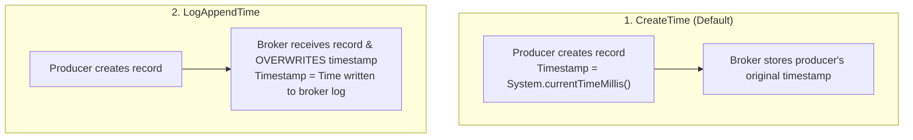
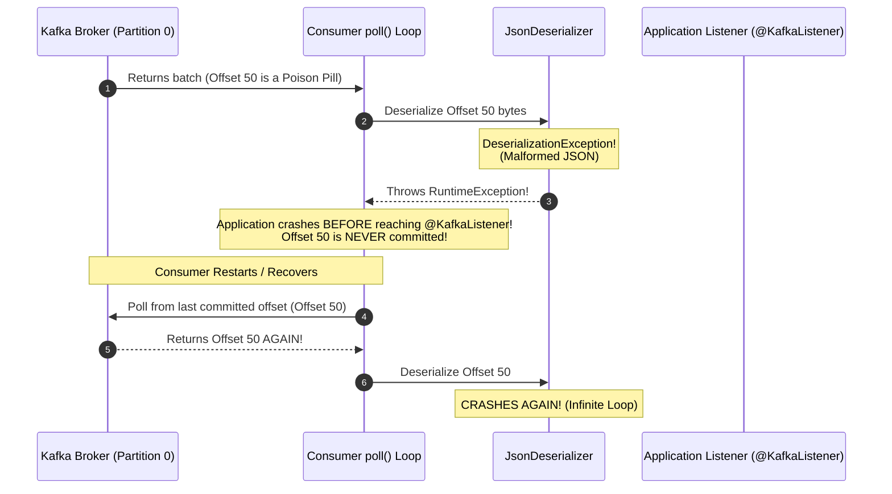
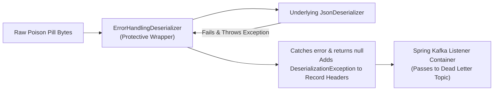
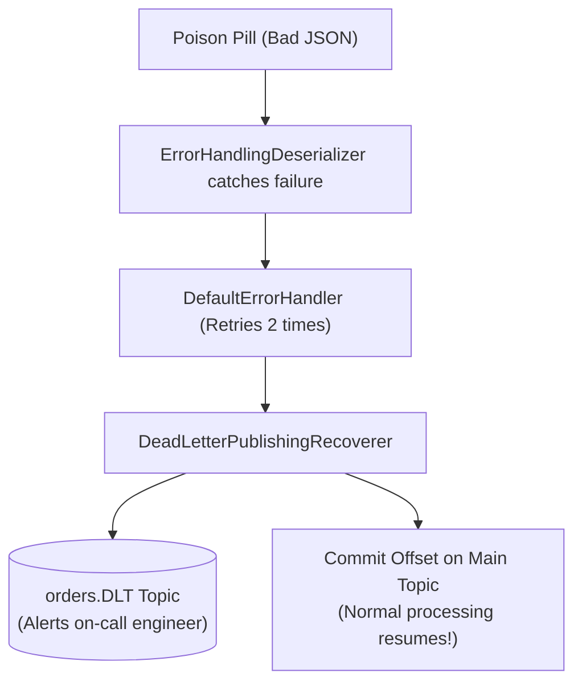

# 020: Record Headers, Timestamps, and Poison Pills

> [!abstract] Module 09: Serialization and Schemas (Part 2)
> **Focus:** Kafka record headers, event timestamps (`CreateTime` vs. `LogAppendTime`), the dangerous "Poison Pill" problem, and how to protect production consumers using `ErrorHandlingDeserializer` and Dead Letter Topics.
> **Prerequisites:** `019-Serialization_Fundamentals_and_JSON.md`.

---

## 1. Kafka Record Headers in Practice

A Kafka record does not just consist of a Key and a Value. Since Kafka 0.11, records also support **Record Headers**.

### What are Headers?
Headers are a list of **key-value pairs of metadata** attached to a record, completely separate from the business payload.

```text
+--------------------------------------------------------------------------+
| KAFKA RECORD                                                             |
|                                                                          |
| HEADERS:                                                                 |
|   • correlation-id = "corr-abc-123"                                      |
|   • tenant-id      = "enterprise-customer-42"                            |
|   • __TypeId__     = "com.example.OrderDto"                              |
|                                                                          |
| KEY:   "order-101"                                                       |
| VALUE: {"orderId": 101, "amount": 2500.0, "status": "CREATED"}          |
+--------------------------------------------------------------------------+
```

### Why Use Headers Instead of Putting Data in the Payload?
1. **Separation of Concerns:** Business logic belongs in the payload. Infrastructure data (tracing IDs, security tokens, source system names) belongs in headers.
2. **Fast Filtering / Routing:** Intermediary tools (like API gateways or routing proxies) can read headers without having to decompress and parse a heavy JSON or Avro payload.
3. **Distributed Tracing:** Tools like OpenTelemetry, Micrometer, or Jaeger pass `trace-id` and `span-id` in headers so you can trace a request across multiple microservices.

---

### Spring Boot: Sending and Reading Headers

#### Sending Headers with `ProducerRecord` or `MessageBuilder`
```java
@Service
public class OrderNotificationService {

    @Autowired
    private KafkaTemplate<String, OrderDto> kafkaTemplate;

    public void sendOrderWithTracing(OrderDto order, String traceId) {
        Message<OrderDto> message = MessageBuilder
                .withPayload(order)
                .setHeader(KafkaHeaders.TOPIC, "orders")
                .setHeader(KafkaHeaders.KEY, order.getOrderId())
                .setHeader("trace-id", traceId)
                .setHeader("tenant-id", "US-WEST")
                .build();

        kafkaTemplate.send(message);
    }
}
```

#### Reading Headers in `@KafkaListener` with `@Header`
```java
@Component
@Slf4j
public class OrderEventConsumer {

    @KafkaListener(topics = "orders", groupId = "analytics-group")
    public void consume(
            @Payload OrderDto order,
            @Header("trace-id") String traceId,
            @Header("tenant-id") String tenantId,
            @Header(KafkaHeaders.RECEIVED_PARTITION) int partition,
            @Header(KafkaHeaders.OFFSET) long offset) {

        log.info("Processing order {} [Trace: {}, Tenant: {}] from Partition {} at Offset {}",
                order.getOrderId(), traceId, tenantId, partition, offset);
    }
}
```

---

## 2. Record Timestamps: `CreateTime` vs. `LogAppendTime`

Every record in Kafka has a 64-bit millisecond timestamp. This timestamp is configured at the topic level using:
```properties
message.timestamp.type=CreateTime   # options: CreateTime (default) or LogAppendTime
```



### The Difference
* **`CreateTime` (Default):** Set by the producer client at the exact instant the message is created. Represents **event time**.
* **`LogAppendTime`:** Overwritten by the broker leader at the exact instant it appends the message to its local log. Represents **ingestion time**.

### Where Timestamps Matter in Production
1. **Time-based Retention:** Kafka cleans up old log segments based on the timestamps of records inside the segment (`log.retention.hours=168`).
2. **Offset Seeking by Timestamp:** If your service had a bug on Tuesday at 2:00 PM, you can tell your consumer to rewind and replay messages from Tuesday at 2:00 PM using `consumer.offsetsForTimes()`.
3. **Stream Processing (Kafka Streams / Flink):** Windowing operations (e.g., "calculate total sales over a 5-minute sliding window") rely on record timestamps.

---

## 3. The Poison Pill Problem

In Kafka, a **Poison Pill** is a message that was successfully produced to a topic, but **cannot be deserialized** by the consumer.

### Common Causes of a Poison Pill
* **Corrupted bytes:** Network glitch or buggy serializer produced invalid JSON text (e.g., `{orderId: 101, amount: ` missing closing bracket).
* **Incompatible class change:** The producer wrote a string into a field that the consumer expects to be a number.
* **Malicious / Stray payload:** Someone published raw plain text into a topic expecting JSON.

---

### The Disaster Scenario: The Infinite Crash Loop

If you use standard `JsonDeserializer` without error handling, a poison pill will **completely halt your consumer partition**:



1. The consumer calls `poll()`.
2. The broker returns the poison pill record at **Offset 50**.
3. `JsonDeserializer` attempts to parse the bytes and throws a `SerializationException` or `DeserializationException`.
4. The exception is thrown **inside the `poll()` call**, before your `@KafkaListener` method can even run!
5. Because your code never processed the record, the offset is **never committed**.
6. The consumer crashes. Spring restarts the container.
7. The consumer polls Kafka again $\rightarrow$ Kafka serves **Offset 50 again**!
8. **Result:** The consumer is stuck in an infinite crash loop. No messages behind Offset 50 can ever be consumed!

---

## 4. The Solution: `ErrorHandlingDeserializer`

To prevent a single bad message from killing your entire consumer pipeline, Spring Kafka provides the **`ErrorHandlingDeserializer`**.

### How It Works: The Decorator Pattern
Instead of letting the deserializer throw an unhandled exception that crashes `poll()`, `ErrorHandlingDeserializer` acts as a **protective shield**:



1. It catches the deserialization exception safely.
2. It returns `null` to the listener container.
3. It packages the raw failed bytes and the exception stack trace into **special Kafka headers** (`DeserializationExceptionHeader`).
4. Spring's error handler detects the failure, routes the bad record to a **Dead Letter Topic (DLT)**, and **commits the offset** so normal processing can continue!

---

## 5. Production Spring Boot Configuration

Here is the industry-standard way to configure `ErrorHandlingDeserializer` with a Dead Letter Topic in Spring Boot:

### `application.yml`
```yaml
spring:
  kafka:
    bootstrap-servers: localhost:9092
    consumer:
      group-id: payment-service-group
      auto-offset-reset: earliest
      # Use ErrorHandlingDeserializer as the top-level deserializers
      key-deserializer: org.springframework.kafka.support.serializer.ErrorHandlingDeserializer
      value-deserializer: org.springframework.kafka.support.serializer.ErrorHandlingDeserializer
      properties:
        # Delegate to the actual underlying deserializers
        spring.deserializer.key.delegate.class: org.apache.kafka.common.serialization.StringDeserializer
        spring.deserializer.value.delegate.class: org.springframework.kafka.support.serializer.JsonDeserializer
        spring.json.trusted.packages: "com.example.dto"
```

---

### Spring Boot Error Handler & Dead Letter Topic (`KafkaConfig.java`)

```java
@Configuration
public class KafkaConsumerConfig {

    @Bean
    public CommonErrorHandler errorHandler(KafkaTemplate<Object, Object> template) {
        // Automatically publish poison pills to a Dead Letter Topic named '<topic>.DLT'
        DeadLetterPublishingRecoverer recoverer = new DeadLetterPublishingRecoverer(template);

        // Fixed backoff: Retry twice with 1 second delay, then forward to DLT
        return new DefaultErrorHandler(recoverer, new FixedBackOff(1000L, 2L));
    }
}
```



---

## 6. Key Configuration Summary

| Property | Recommended Value | Purpose |
| :--- | :--- | :--- |
| **`key-deserializer`** | `ErrorHandlingDeserializer` | Wraps key deserializer to catch key parsing errors safely. |
| **`value-deserializer`** | `ErrorHandlingDeserializer` | Wraps value deserializer to catch payload parsing errors safely. |
| **`spring.deserializer.value.delegate.class`** | `JsonDeserializer` | Specifies the real deserializer that parses the payload. |
| **`message.timestamp.type`** | `CreateTime` (broker/topic) | Sets whether timestamps represent creation time or broker log time. |
