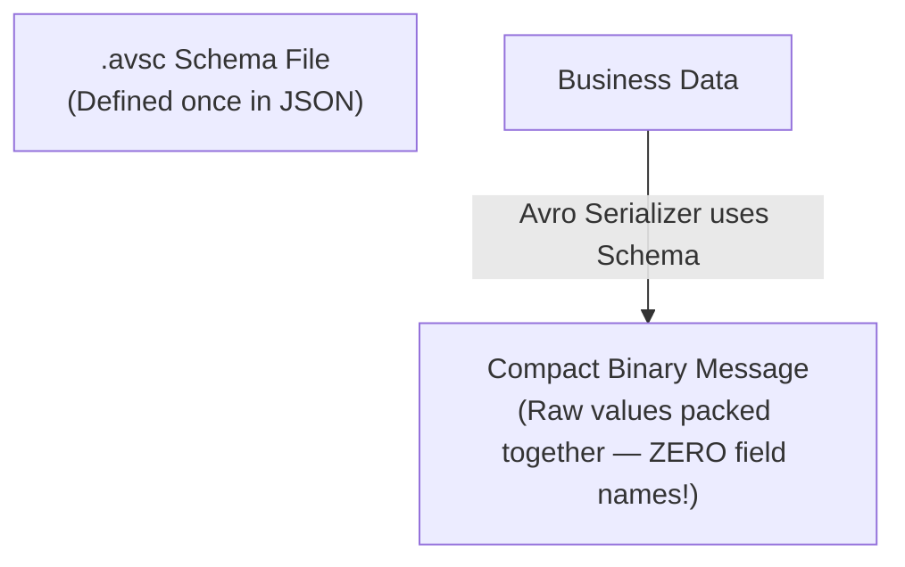
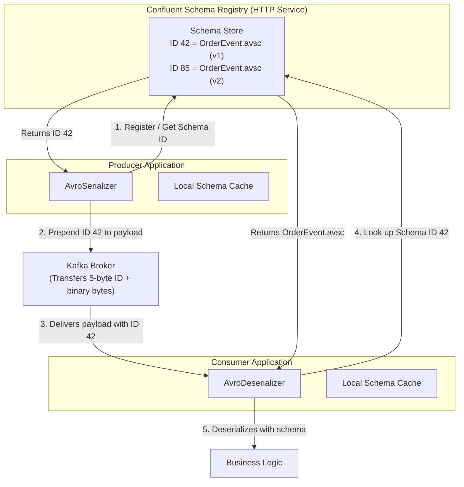
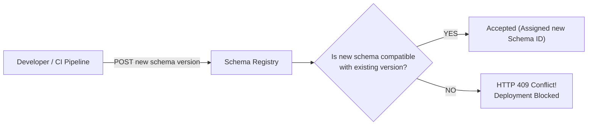

# 021: Schema Evolution, Avro, and Schema Registry

> [!abstract] Module 09: Serialization and Schemas (Part 3)
> **Focus:** Why plain JSON fails at enterprise scale, Apache Avro binary serialization, the Confluent Schema Registry architecture, the 5-byte Kafka wire format, schema evolution rules, and compatibility modes (`BACKWARD`, `FORWARD`, `FULL`).
> **Prerequisites:** `019-Serialization_Fundamentals_and_JSON.md` and `020-Record_Headers_Timestamps_and_Poison_Pills.md`.

---

## 1. Why Plain JSON Fails at Enterprise Scale

JSON is human-readable and convenient, but in high-throughput enterprise architectures, it has two major weaknesses:

### 1. Massive Bandwidth and Disk Waste
In JSON, **field names are repeated in every single record**.

Suppose you produce 100 million records per day:
```json
{
  "customerBillingAddressStreet": "123 Main Street",
  "customerBillingAddressCity": "Seattle",
  "customerBillingAddressZipCode": "98101",
  "transactionAuthorizationCode": "AUTH-9948271"
}
```
* The actual data is just a few bytes.
* The field names take up **70% of the entire payload size**!
* Over billions of messages, your company spends thousands of extra dollars on AWS/GCP cross-zone network data transfer and disk storage.

### 2. Lack of Contract Enforcement
JSON is untyped text:
* If the Producer team renames `"amount"` to `"total_amount"` without telling anyone, the Kafka broker accepts it happily.
* Downstream Consumer teams only discover the break when their production dashboards show empty values or services crash!

---

## 2. What is Apache Avro?

**Apache Avro** is a compact, high-performance binary serialization format.



### Key Characteristics of Avro
1. **Schema-Driven:** Every message must conform to a strictly typed schema defined in JSON format (usually in a `.avsc` file).
2. **Binary Encoding:** Field names are **not** sent over the wire. Only raw values and length indicators are packed into binary bytes.
3. **Huge Size Savings:** An Avro record is typically **60% to 90% smaller** than the equivalent JSON record!
4. **Code Generation:** Tools automatically generate strongly-typed Java classes (getters, setters, builders) directly from the `.avsc` schema.

---

### Example: Avro Schema (`OrderEvent.avsc`)

```json
{
  "type": "record",
  "name": "OrderEvent",
  "namespace": "com.example.orders.avro",
  "fields": [
    { "name": "orderId", "type": "string" },
    { "name": "customerId", "type": "string" },
    { "name": "amount", "type": "double" },
    { 
      "name": "status", 
      "type": "string", 
      "default": "PENDING"   // Default value allows backward compatibility!
    }
  ]
}
```

---

## 3. The Confluent Schema Registry Architecture

If Avro binary messages do not include field names, how does the consumer know how to read the bytes?

* **Bad Idea:** Attaching the entire schema file to every single message (this would make messages huge).
* **The Industry Solution:** **Confluent Schema Registry**.



### The 5-Byte Kafka Wire Format
When you use the Confluent `KafkaAvroSerializer`, it prepends a **5-byte header** to every message:

```text
+----------+--------------------+-------------------------------------+
| 1 Byte   | 4 Bytes            | Remaining Bytes                     |
| Magic    | Schema ID          | Avro Binary Payload                 |
| (0x00)   | (e.g., ID = 42)    | (Packed data values)                |
+----------+--------------------+-------------------------------------+
```

1. **Magic Byte (`0x00`):** Indicates this message follows the Schema Registry wire format.
2. **Schema ID (4 Bytes integer):** The exact schema ID registered in the Schema Registry.
3. **Payload:** The raw Avro binary data.

### How Producer and Consumer Use the Schema Registry
1. **Producer:** When sending, it asks the Schema Registry: *"What is the ID for `OrderEvent.avsc`?"* The Registry returns `ID = 42`. The producer caches this ID in RAM so it doesn't call HTTP again.
2. **Wire Transfer:** The producer writes `[0x00, 0x00, 0x00, 0x00, 0x2A]` (ID 42) followed by the binary bytes.
3. **Consumer:** When reading, the consumer inspects the 4-byte Schema ID (42).
   - If ID 42 is already in its local RAM cache, it decodes the message instantly (0 HTTP calls).
   - If it is the first time seeing ID 42, it calls Schema Registry once, caches the schema, and decodes.

---

## 4. Schema Evolution & Compatibility Modes

Business requirements change over time. You will need to add new fields (like `discountCode`) or remove obsolete ones. **Schema Evolution** is how you update schemas without breaking existing running services.

The Schema Registry acts as a gatekeeper: if a developer tries to publish a breaking schema, the Registry rejects it with an HTTP error!



---

### The 4 Compatibility Modes

| Mode | Who Can Be Upgraded First? | Evolution Rule |
| :--- | :--- | :--- |
| **`BACKWARD` (Default)** | **Upgrade Consumers First.** | Consumers using the *new* schema can read records written with the *old* schema.<br/>• **Rule:** When adding a new field, you **must provide a default value**. |
| **`FORWARD`** | **Upgrade Producers First.** | Consumers using the *old* schema can read records written with the *new* schema.<br/>• **Rule:** When deleting a field, that field must have had a default value. |
| **`FULL`** | **Upgrade in ANY Order.** | Both Backward and Forward compatible.<br/>• **Rule:** Only add or remove fields that have default values. |
| **`NONE`** | N/A | No compatibility checks performed (dangerous for production). |

---

### The Golden Rule of Avro Evolution

> [!CRITICAL]
> **Always provide a default value when adding a field!**
> If you add a new field without a default value, old consumers reading new messages will fail with missing field exceptions.

```json
// ✅ SAFE EVOLUTION (Can evolve smoothly under BACKWARD and FULL):
{
  "name": "discountCode",
  "type": ["null", "string"],   // Union type: can be null or string
  "default": null               // Default value ensures backward compatibility!
}
```

---

## 5. Production Spring Boot Configuration with Avro

To use Avro with Confluent Schema Registry in Spring Boot:

### Maven Dependencies (`pom.xml`)
```xml
<!-- Confluent Avro Serializer -->
<dependency>
    <groupId>io.confluent</groupId>
    <artifactId>kafka-avro-serializer</artifactId>
    <version>7.5.0</version>
</dependency>
```

### `application.yml`
```yaml
spring:
  kafka:
    bootstrap-servers: localhost:9092
    properties:
      # URL of the Confluent Schema Registry
      schema.registry.url: http://localhost:8081

    producer:
      key-serializer: org.apache.kafka.common.serialization.StringSerializer
      # Use Confluent Avro Serializer
      value-serializer: io.confluent.kafka.serializers.KafkaAvroSerializer

    consumer:
      group-id: payment-service-group
      auto-offset-reset: earliest
      key-deserializer: org.apache.kafka.common.serialization.StringDeserializer
      # Use Confluent Avro Deserializer
      value-deserializer: io.confluent.kafka.serializers.KafkaAvroDeserializer
      properties:
        # Generate specific Avro Java objects (OrderEvent) instead of GenericRecord
        specific.avro.reader: true
```

---

## 6. Key Configuration Summary

| Property | Typical Value | Purpose |
| :--- | :--- | :--- |
| **`schema.registry.url`** | `http://schema-registry:8081` | Address of the Confluent Schema Registry cluster. |
| **`value-serializer`** | `KafkaAvroSerializer` | Converts Avro Java objects into binary and attaches 5-byte Schema ID. |
| **`value-deserializer`** | `KafkaAvroDeserializer` | Reads 5-byte Schema ID, downloads schema from registry, and decodes binary. |
| **`specific.avro.reader`** | `true` | Tells consumer to create compiled Java DTO classes (e.g. `OrderEvent`) rather than generic dictionaries. |
| **`auto.register.schemas`** | `true` (dev) / `false` (prod CI/CD) | In production, set to `false` so only CI/CD pipelines can register new schemas. |
