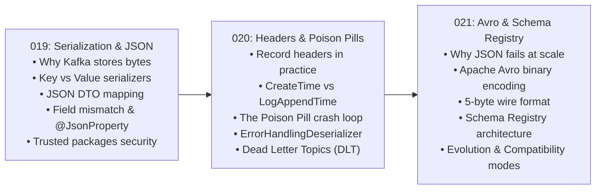

# Module 09: Serialization and Schemas (Map of Content)

> [!abstract] Module Overview
> Kafka brokers are completely blind to data formats—they only store raw byte arrays (`byte[]`).
> This module explores how application objects are converted into bytes and back, how to safely handle JSON DTOs, how to use record headers and timestamps, how to prevent consumer crash loops caused by **Poison Pills** using `ErrorHandlingDeserializer`, and how to govern enterprise event contracts using **Apache Avro** and the **Confluent Schema Registry**.

---

## Module Index & Reading Order



### [019: Serialization Fundamentals and JSON](file:///c:/Users/siddhesh.pawar/Desktop/Workspace/Obsidian-Vault/Inbox/Kafka_Obsidian_Organized/09%20-%20Serialization%20and%20Schemas/019-Serialization_Fundamentals_and_JSON.md)
* **The Byte Array Contract:** Why Kafka only knows about bytes and decouples programming languages.
* **Key vs. Value Serializers:** Why key serializers affect partition hashing, and value serializers carry payload data.
* **Spring Boot JSON Integration:** `JsonSerializer`, `JsonDeserializer`, `KafkaTemplate`, and `@KafkaListener`.
* **Field Name Mismatches:** Using Jackson's `@JsonProperty` to prevent silent null values.
* **Security Whitelisting:** Preventing arbitrary code execution with `spring.json.trusted.packages`.

### [020: Record Headers, Timestamps, and Poison Pills](file:///c:/Users/siddhesh.pawar/Desktop/Workspace/Obsidian-Vault/Inbox/Kafka_Obsidian_Organized/09%20-%20Serialization%20and%20Schemas/020-Record_Headers_Timestamps_and_Poison_Pills.md)
* **Record Headers in Practice:** Separating infrastructure metadata (tracing IDs, tenant flags, `__TypeId__`) from payloads.
* **Event Timestamps:** `CreateTime` (event time) vs. `LogAppendTime` (broker arrival time) and their impact on retention.
* **The Poison Pill Problem:** Why a single unparseable message can cause an infinite crash loop on consumer partitions.
* **The Solution: `ErrorHandlingDeserializer`:** Catching deserialization exceptions, packaging them into headers, and safely routing bad records to a Dead Letter Topic (DLT).

### [021: Schema Evolution, Avro, and Schema Registry](file:///c:/Users/siddhesh.pawar/Desktop/Workspace/Obsidian-Vault/Inbox/Kafka_Obsidian_Organized/09%20-%20Serialization%20and%20Schemas/021-Schema_Evolution_Avro_and_Schema_Registry.md)
* **The Limits of Plain JSON:** Wasted network bandwidth from repeated field names and lack of contract enforcement.
* **Apache Avro Binary Serialization:** Compacting payloads by 60%–90% by omitting field names from messages.
* **Confluent Schema Registry:** Central schema repository, local client caching, and the 5-byte Kafka wire format.
* **Schema Evolution & Compatibility Modes:** Safely evolving schemas under `BACKWARD`, `FORWARD`, and `FULL` rules.

---

## Master Serialization & Schema Configuration Reference

| Property | Default Value | Production Value | Primary Responsibility |
| :--- | :--- | :--- | :--- |
| **`key.serializer`** | - | `StringSerializer` | Converts message keys into bytes for partition routing. |
| **`value.serializer`** | - | `JsonSerializer` / `KafkaAvroSerializer` | Converts message payloads into bytes. |
| **`key.deserializer`** | - | `ErrorHandlingDeserializer` | Catches key deserialization errors safely. |
| **`value.deserializer`** | - | `ErrorHandlingDeserializer` | Catches value deserialization errors safely. |
| **`spring.deserializer.value.delegate.class`** | - | `JsonDeserializer` / `KafkaAvroDeserializer` | The underlying real deserializer wrapped by error handling. |
| **`spring.json.trusted.packages`** | (empty) | `"com.mycompany.dto"` | Whitelist of Java packages permitted for JSON deserialization. |
| **`message.timestamp.type`** | `CreateTime` | `CreateTime` | Broker/topic timestamp origin (`CreateTime` vs. `LogAppendTime`). |
| **`schema.registry.url`** | - | `http://schema-registry:8081` | HTTP address of Confluent Schema Registry. |
| **`specific.avro.reader`** | `false` | `true` | Tells Avro to create compiled Java DTOs rather than generic records. |
| **`auto.register.schemas`** | `true` | `false` (in prod) | Restricts schema registration to CI/CD pipelines in production. |

---

## Production Spring Boot Template (`application.yml`)

```yaml
spring:
  kafka:
    bootstrap-servers:
      - kafka-1.prod.internal:9092
      - kafka-2.prod.internal:9092
      - kafka-3.prod.internal:9092

    # Global Schema Registry URL (if using Avro)
    properties:
      schema.registry.url: http://schema-registry.prod.internal:8081

    producer:
      key-serializer: org.apache.kafka.common.serialization.StringSerializer
      # Choose JsonSerializer OR KafkaAvroSerializer based on your architecture
      value-serializer: org.springframework.kafka.support.serializer.JsonSerializer

    consumer:
      group-id: payment-service-group
      auto-offset-reset: earliest
      # Bulletproof Poison Pill Protection: Use ErrorHandlingDeserializer
      key-deserializer: org.springframework.kafka.support.serializer.ErrorHandlingDeserializer
      value-deserializer: org.springframework.kafka.support.serializer.ErrorHandlingDeserializer
      properties:
        # Delegate Deserializers
        spring.deserializer.key.delegate.class: org.apache.kafka.common.serialization.StringDeserializer
        spring.deserializer.value.delegate.class: org.springframework.kafka.support.serializer.JsonDeserializer

        # JSON Security Whitelist
        spring.json.trusted.packages: "com.mycompany.payment.dto"

        # Avro specific reader (if using Avro)
        specific.avro.reader: true
```

---

## Module 09 Syllabus Checklist

- [x] Why Kafka only transports bytes (`byte[]`)
- [x] Key vs. Value serializer and deserializer responsibilities
- [x] Two-step JSON serialization (Object $\rightarrow$ JSON text $\rightarrow$ UTF-8 bytes)
- [x] Spring Boot `JsonSerializer` and `JsonDeserializer` setup
- [x] DTO field mapping and fixing mismatches with `@JsonProperty`
- [x] Security: Protecting deserialization with `spring.json.trusted.packages`
- [x] Kafka Record Headers in practice (Distributed tracing, routing flags)
- [x] Record Timestamps: `CreateTime` vs. `LogAppendTime` and log retention
- [x] The Poison Pill disaster scenario and infinite consumer crash loops
- [x] Poison Pill solution: `ErrorHandlingDeserializer` with Dead Letter Topics (DLT)
- [x] Bandwidth limits and contract challenges of plain JSON at scale
- [x] Apache Avro binary serialization benefits (60%–90% payload reduction)
- [x] Confluent Schema Registry architecture and the 5-byte wire format
- [x] Schema evolution rules and compatibility modes (`BACKWARD`, `FORWARD`, `FULL`, `NONE`)
