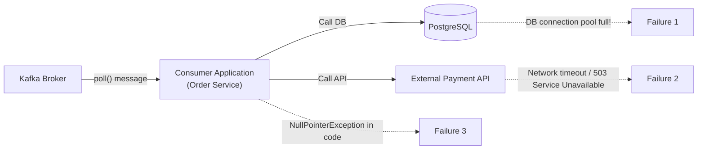
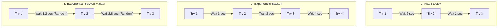
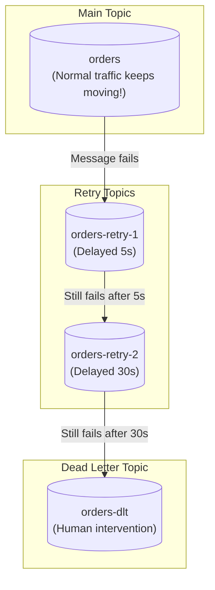

# 022: Consumer Error Handling and Dead Letter Topics

> [!abstract] Module 10: Reliability and Error Handling (Part 1)
> **Focus:** Consumer processing failures, transient vs. permanent errors, backoff strategies (exponential and jitter), why blocking retries cause head-of-line blocking, non-blocking retry topics, and Dead Letter Topics (DLT).
> **Prerequisites:** Consumer internals (`016`–`018`) and Poison Pills (`020`).

---

## 1. What Goes Wrong in a Consumer?

When a consumer receives a message from Kafka, running your business logic is not always guaranteed to succeed. Failures happen constantly in production:



If your code throws an exception, what should happen to that message?
- Should you ignore the error and keep reading? *(Data loss!)*
- Should you retry forever right there? *(Your service freezes!)*
- Should you send it somewhere safe to investigate later?

To handle errors properly, you must first classify the type of error.

---

## 2. Transient Errors vs. Permanent Errors

Every error in an event-driven system falls into one of two buckets:

| Error Type | What It Means | Real-World Examples | How to Handle It |
| :--- | :--- | :--- | :--- |
| **Transient Error** (Temporary) | The system is temporarily unavailable, but will likely work if you try again in a few seconds. | • Database connection timeout<br/>• Third-party payment gateway 503 error<br/>• Network socket glitch<br/>• Rate limit hit (HTTP 429) | **Retry the message** with a backoff delay. |
| **Permanent Error** (Fatal) | The message itself is invalid or broken. Retrying a million times will produce the exact same error. | • Malformed JSON (Poison pill)<br/>• `NullPointerException` due to bad data<br/>• Missing required fields<br/>• Incompatible business state | **Do NOT retry.** Send immediately to a Dead Letter Topic (DLT). |

---

## 3. Backoff Strategies: Fixed, Exponential, and Jitter

When handling a transient error, you should never retry immediately in a tight loop. If a database is overloaded, retrying 1,000 times a second will only crash the database harder.

Instead, use a **Backoff Strategy**:



### 1. Fixed Delay
Waits the exact same time between every attempt (e.g., retry every 2 seconds). Simple, but can overwhelm a recovering service.

### 2. Exponential Backoff
Doubles the wait time after each failure (e.g., 1s $\rightarrow$ 2s $\rightarrow$ 4s $\rightarrow$ 8s $\rightarrow$ 16s). Gives downstream systems breathing room to recover from outages.

### 3. Jitter (Random Variation)
Why is pure exponential backoff not enough?
If 500 consumer pods fail at the exact same second, they will all back off for 1 second, and then **all 500 pods will hit the database at the exact same millisecond**! This is called the **Thundering Herd problem**.

**The Fix:** Add **Jitter** (a small random delay, like $\pm 200 \text{ ms}$). This spreads out the retries so requests hit the database smoothly instead of in massive spikes.

---

## 4. The Trap: Blocking Retries (Head-of-Line Blocking)

A common mistake is putting a `Thread.sleep()` or retry loop directly inside the consumer listener:

```java
// ❌ DANGEROUS IN HIGH-THROUGHPUT PRODUCTION:
while (retries < 5) {
    try {
        callPaymentGateway();
        break;
    } catch (Exception e) {
        Thread.sleep(5000); // Freezes the consumer thread!
        retries++;
    }
}
```

### Why is This Dangerous?
1. **Head-of-Line Blocking:** Because Kafka partitions are strictly ordered, while your consumer thread sleeps waiting on Order #101, **Order #102, #103, and #104 behind it are stuck waiting**.
2. **Rebalance Storm:** If your retries take longer than `max.poll.interval.ms` (default 5 minutes), the Kafka broker will assume your consumer is dead, kick it out of the group, and trigger a rebalance!

---

## 5. The Solution: Non-Blocking Retry Topics

To prevent one failing message from blocking all the healthy messages behind it, production systems use **Non-Blocking Retry Topics**.



### How Non-Blocking Retries Work
1. When Order #101 fails on the main topic `orders`, the consumer immediately publishes it to a retry topic: `orders-retry-1`.
2. The consumer **commits the offset on `orders`** and moves on to Order #102 immediately! No traffic is blocked.
3. A separate listener consumes `orders-retry-1` with a delay (e.g., 5 seconds).
4. If it fails again, it moves to `orders-retry-2` (delay 30 seconds).
5. If all retries are exhausted, it is moved to the **Dead Letter Topic (DLT)**.

---

## 6. Spring Boot Implementation: `@RetryableTopic`

Spring Kafka provides a clean annotation to set up this entire non-blocking retry pipeline automatically:

```java
@Component
@Slf4j
public class OrderProcessingConsumer {

    @RetryableTopic(
        attempts = "4",                                       // 1 initial try + 3 retries
        backoff = @Backoff(delay = 2000, multiplier = 2.0),  // 2s, 4s, 8s exponential delay
        autoCreateTopics = "true",
        include = { ResourceAccessException.class, TimeoutException.class } // Only retry transient errors
    )
    @KafkaListener(topics = "orders", groupId = "order-group")
    public void processOrder(OrderDto order) {
        log.info("Processing order: {}", order.getOrderId());
        
        // If this throws TimeoutException, Spring routes to orders-retry, NOT blocking the main topic
        paymentGatewayClient.charge(order);
    }

    @DltHandler
    public void handleDlt(OrderDto order, @Header(KafkaHeaders.ORIGINAL_OFFSET) long offset) {
        log.error("Order {} permanently failed after all retries! Original offset: {}", 
                order.getOrderId(), offset);
        // Alert on-call team or save to a review table
    }
}
```

### What Spring Does Behind the Scenes
With just `@RetryableTopic`, Spring Kafka automatically creates:
- `orders-retry-2000` (waits 2 seconds)
- `orders-retry-4000` (waits 4 seconds)
- `orders-retry-8000` (waits 8 seconds)
- `orders-dlt` (Dead Letter Topic)

Healthy orders in `orders` continue processing at full speed without waiting on failing orders.

---

## 7. What is a Dead Letter Topic (DLT)?

A **Dead Letter Topic (DLT)** is a dedicated Kafka topic where unprocessable or permanently failed messages are sent for storage and investigation.

Think of it as the **quarantine zone** of your Kafka cluster.

### What Goes into DLT Record Headers?
When Spring routes a message to a DLT, it automatically attaches valuable diagnostic headers:

```text
+--------------------------------------------------------------------------+
| DEAD LETTER TOPIC RECORD                                                 |
|                                                                          |
| HEADERS:                                                                 |
|   • kafka_dlt-original-topic       = "orders"                            |
|   • kafka_dlt-original-partition   = 2                                   |
|   • kafka_dlt-original-offset      = 10482                               |
|   • kafka_dlt-original-timestamp   = 1718000000000                       |
|   • kafka_dlt-exception-message    = "Connection refused: stripe.com"    |
|   • kafka_dlt-exception-stacktrace = "java.net.ConnectException: ..."    |
|                                                                          |
| PAYLOAD: {"orderId": "ORD-99", "amount": 2500.0}                         |
+--------------------------------------------------------------------------+
```

### The Production DLT Lifecycle
1. **Alerting:** An alert triggers in Datadog or Prometheus when messages land in a DLT.
2. **Investigation:** Engineers inspect the headers to see why it failed.
3. **Bug Fix:** If it was a code bug, developers push a fix.
4. **Replay:** Once the downstream system is healthy, an admin script replays the messages from `orders-dlt` back into `orders`.

---

## 8. Key Configuration Summary

| Feature | Recommended Practice | Why? |
| :--- | :--- | :--- |
| **Error Classification** | Retry transient errors; forward permanent errors immediately | Prevents wasting CPU retrying unfixable data bugs. |
| **Backoff Strategy** | Exponential backoff + Jitter | Prevents overwhelming recovering databases. |
| **Retry Topology** | Non-blocking retry topics (`@RetryableTopic`) | Prevents single bad messages from freezing entire partitions. |
| **DLT Monitoring** | Set alerts on DLT consumer lag or incoming record rate | Ensures failed transactions don't sit unaddressed indefinitely. |
