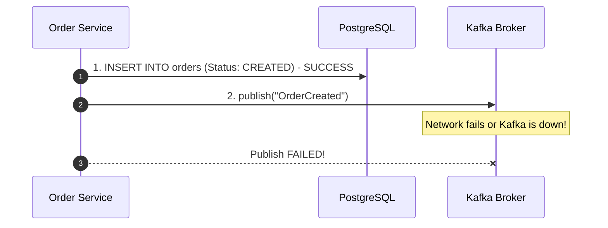
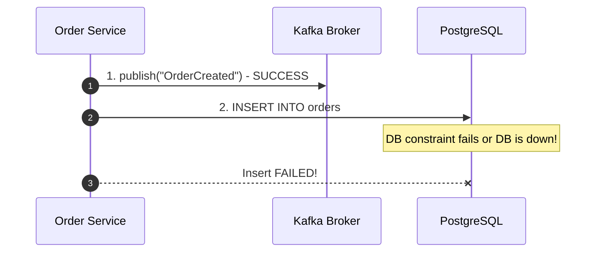
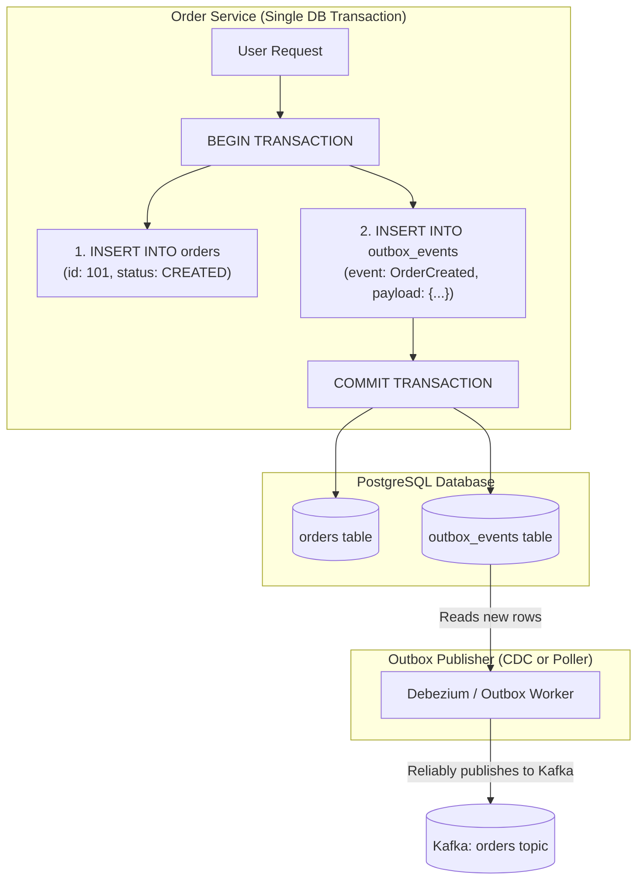
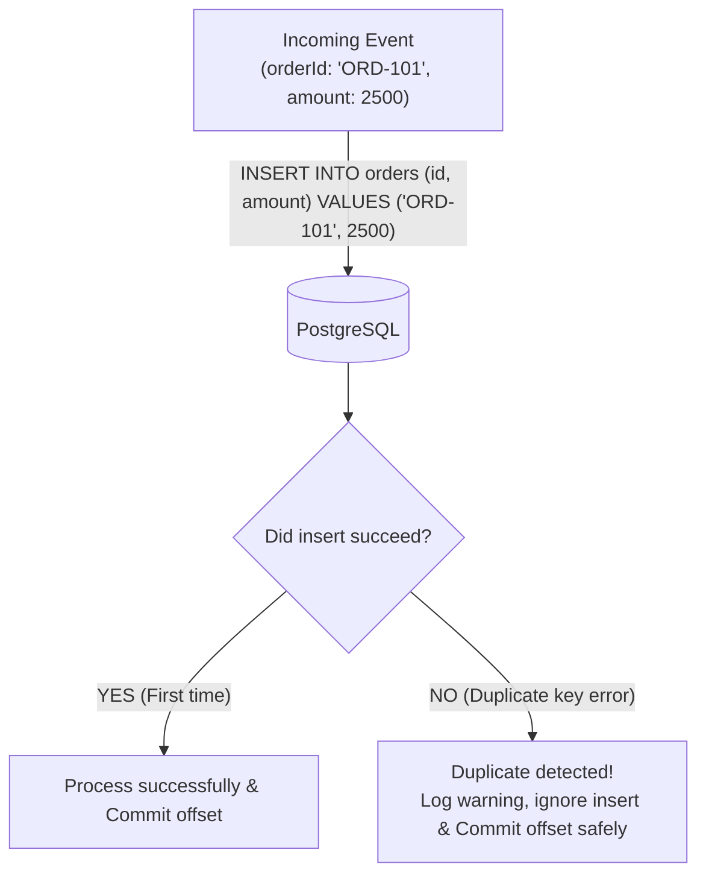

# 023: Idempotent Consumers and the Outbox Pattern

> [!abstract] Module 10: Reliability and Error Handling (Part 2)
> **Focus:** The notorious "Dual-Write Problem", duplicate message delivery in distributed systems, designing idempotent consumers, and using the Transactional Outbox and Inbox patterns to keep databases and Kafka perfectly in sync.
> **Prerequisites:** Producer delivery guarantees (`014`) and Consumer offsets (`018`).

---

## 1. The Dual-Write Problem

In modern microservices, almost every business action involves two steps:
1. **Save data to your local database** (e.g., PostgreSQL).
2. **Publish an event to Kafka** (so other microservices know about it).

```text
User clicks "Buy Now" ---> [ Order Service ] ---> 1. Save order to PostgreSQL
                                             ---> 2. Publish event to Kafka
```

### The Problem: Distributed Failure
There is no built-in transaction that spans across both a relational database and a Kafka cluster. One of them will always happen first:

#### Scenario A: Database First, Kafka Second

* **Result:** The order exists in your database, but Kafka never gets the message. Downstream payment and inventory services are never notified! The customer's order is lost in limbo.

#### Scenario B: Kafka First, Database Second

* **Result:** Kafka tells the world the order was created, but your database has no record of it! Downstream payment services charge the customer for an order that does not exist.

> [!CRITICAL]
> **The Dual-Write Dilemma:**  
> You cannot atomically update a database and publish to Kafka in a standard `try-catch` block. If a crash occurs between the two operations, your systems become permanently inconsistent.

---

## 2. The Solution: The Transactional Outbox Pattern

The **Transactional Outbox Pattern** solves the dual-write problem by taking advantage of your local database's native ACID transaction guarantees.

Instead of talking directly to Kafka during the user request, your service writes to **two tables in the SAME database transaction**:
1. The business table (`orders`).
2. An `outbox` table (`outbox_events`).



### Why This Is Bulletproof
- Either **both** the order and the outbox event are saved, or **neither** is saved.
- It is impossible for the order to exist in PostgreSQL without a corresponding event in the outbox table.

---

## 3. How Outbox Messages Reach Kafka

Once the message is safely stored in the `outbox_events` table, how does it get published into Kafka? There are two common approaches:

### Option 1: Polling Publisher (Simple, Good for Moderate Load)
A background scheduled thread runs every second:
```sql
SELECT * FROM outbox_events WHERE status = 'PENDING' LIMIT 100;
```
1. It reads the rows and sends them to Kafka.
2. Upon receiving the Kafka ACK, it updates `status = 'PROCESSED'` (or deletes the rows).
3. **Trade-off:** Adds polling queries to your database.

### Option 2: Change Data Capture / Debezium (Modern Enterprise Standard)
Instead of polling with SQL queries, a tool called **Debezium** attaches to your database's internal transaction log (like the PostgreSQL Write-Ahead Log / WAL).
1. Whenever a row is committed to `outbox_events`, Debezium reads it directly from the disk log in real-time.
2. Debezium publishes the event into Kafka with sub-millisecond latency.
3. **Trade-off:** Requires running a Kafka Connect cluster, but places almost zero query load on your primary database.

---

## 4. The Outbox Table Structure

Here is a typical production schema for the `outbox_events` table:

```sql
CREATE TABLE outbox_events (
    id UUID PRIMARY KEY,
    aggregate_type VARCHAR(255) NOT NULL,   -- e.g., 'ORDER'
    aggregate_id VARCHAR(255) NOT NULL,     -- e.g., 'ORD-101'
    event_type VARCHAR(255) NOT NULL,       -- e.g., 'OrderCreated'
    payload JSONB NOT NULL,                 -- The actual JSON message
    created_at TIMESTAMP WITH TIME ZONE NOT NULL DEFAULT NOW()
);
```

---

## 5. Idempotent Consumer Design

Because networks glitch and consumers retry, **Kafka will occasionally deliver the same message twice** (At-Least-Once delivery).

An **Idempotent Consumer** is designed so that receiving a message 1 time or 10 times results in the exact same business outcome.

```text
Natural Idempotency vs. Artificial Idempotency:

• Natural (Safe):     UPDATE users SET status = 'ACTIVE' WHERE id = 5;
  (Running this 10 times leaves status as 'ACTIVE')

• Non-Idempotent:    UPDATE bank_accounts SET balance = balance + 100 WHERE id = 5;
  (Running this twice accidentally adds $200!)
```

To make non-idempotent operations safe, use one of the following **3 production patterns**.

---

### Pattern 1: Database Unique Constraint

The simplest and most reliable pattern. Every Kafka event must carry a unique `eventId` or business identifier (like `orderId`).



Because `orders.id` has a `PRIMARY KEY` or `UNIQUE` constraint, the second duplicate message is automatically blocked by the database engine!

---

### Pattern 2: Dedicated Deduplication Table (The Inbox Pattern)

If your consumer performs multiple actions (e.g., inserts a record, updates an inventory count, and creates an audit log), use a **`processed_events` table** inside the same database transaction:

```java
@Component
@Slf4j
public class PaymentEventListener {

    @Autowired
    private DataSource dataSource;

    @KafkaListener(topics = "orders", groupId = "payment-group")
    @Transactional
    public void onOrderReceived(ConsumerRecord<String, OrderDto> record) {
        String eventId = record.key(); // Or read eventId from JSON payload
        OrderDto order = record.value();

        // 1. Check if we already processed this event
        if (isEventAlreadyProcessed(eventId)) {
            log.warn("Duplicate event {} detected! Skipping.", eventId);
            return;
        }

        // 2. Execute business operations
        chargeCustomer(order);
        updateInventory(order);

        // 3. Mark event as processed in the SAME transaction
        markEventAsProcessed(eventId);
    }
}
```

#### SQL Implementation
```sql
-- Inside the application transaction:
INSERT INTO processed_events (event_id, processed_at) 
VALUES ('event-abc-123', NOW());

-- If a duplicate arrives, the INSERT fails with duplicate key exception,
-- rolling back the whole transaction safely!
```

---

### Pattern 3: Distributed Lock with Redis (High Throughput)

When you need ultra-fast deduplication without adding write load to your SQL database, use Redis with an atomic `SETNX` (Set if Not Exists) command and a Time-To-Live (TTL):

```java
public boolean isDuplicate(String eventId) {
    // Sets the key only if it doesn't already exist, expiring after 24 hours
    Boolean wasSet = redisTemplate.opsForValue()
            .setIfAbsent("processed:event:" + eventId, "1", Duration.ofHours(24));

    // If wasSet is false, the key already existed -> it's a DUPLICATE!
    return Boolean.FALSE.equals(wasSet);
}
```

---

## 6. Key Architecture Summary

| Challenge | Anti-Pattern | Industry Standard Solution |
| :--- | :--- | :--- |
| **Publishing to Kafka + Saving to DB** | Saving to DB and calling `kafkaTemplate.send()` directly in the same method. | **Transactional Outbox Pattern** (Write event to outbox table in local DB transaction; publish via CDC/Debezium). |
| **Duplicate Events Delivered to Consumer** | Trusting that Kafka only delivers messages once. | **Idempotent Consumer** (Use DB Unique Constraints or a `processed_events` table). |
| **Long-term Event Storage in Outbox** | Leaving millions of rows in `outbox_events` forever. | Periodically delete or archive processed outbox rows to keep the table small. |
