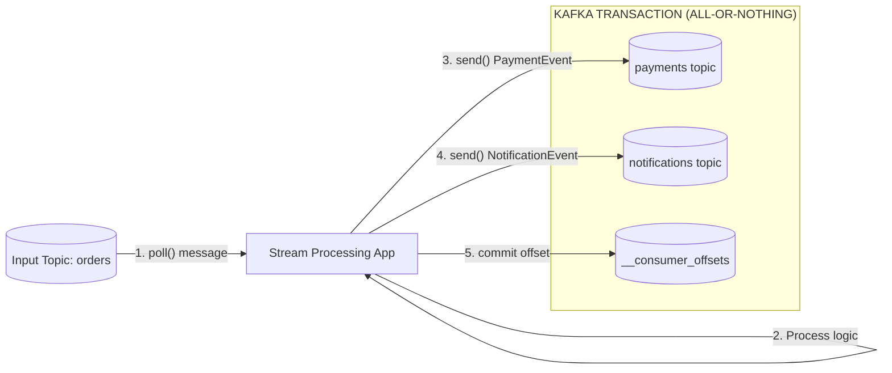
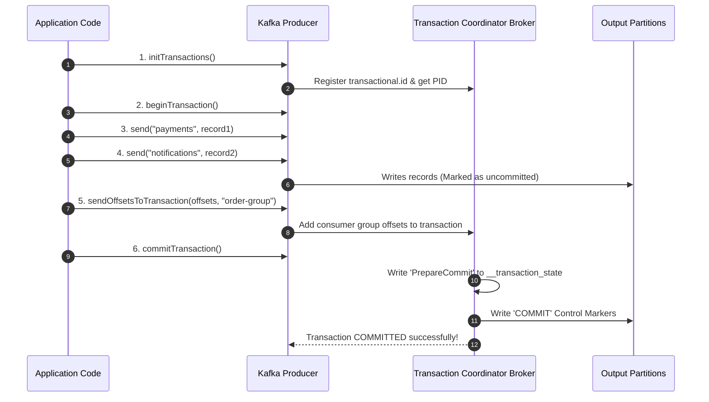
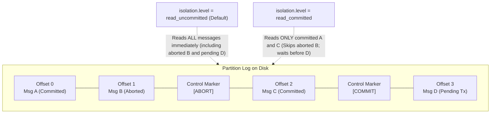
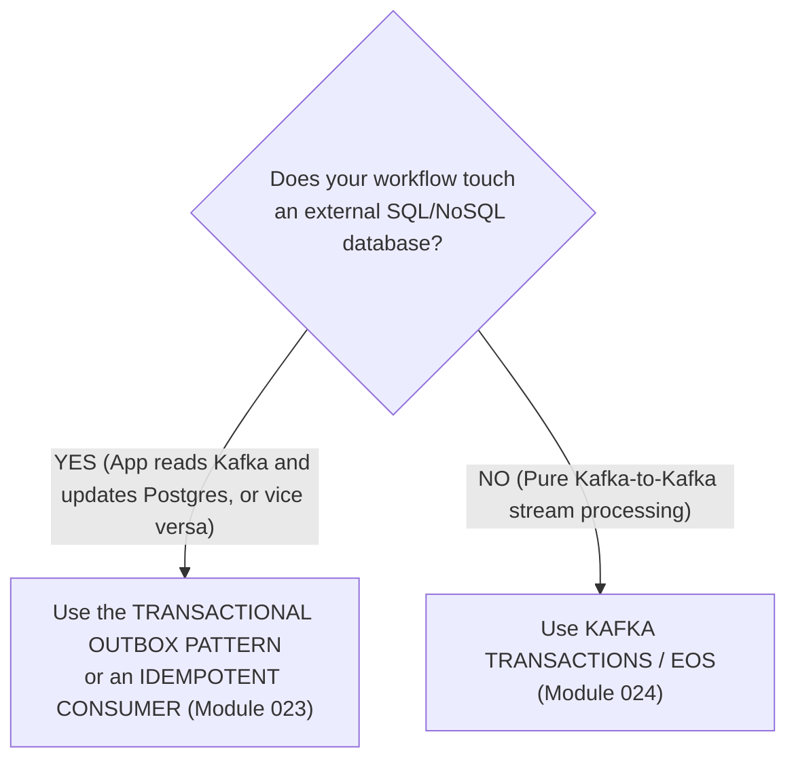

# 024: Kafka Transactions and Exactly-Once Semantics

> [!abstract] Module 10: Reliability and Error Handling (Part 3)
> **Focus:** Kafka transactions, atomic multi-partition writes, the Transaction Coordinator, the "Consume-Process-Produce" loop, consumer isolation levels (`read_committed` vs. `read_uncommitted`), and why Kafka transactions do not rollback SQL databases.
> **Prerequisites:** Producer idempotence (`014`) and Consumer offsets (`018`).

---

## 1. What is Exactly-Once Semantics (EOS) in Kafka?

In Module 07, we learned about the **Idempotent Producer** (`enable.idempotence=true`). Idempotence prevents duplicate messages, but it has two limitations:
1. It only works for **a single partition**.
2. It only lasts for **a single producer session** (if the producer restarts, it gets a new PID).

**What if your application needs to:**
- Write to **multiple partitions or multiple topics** atomically (either all messages are saved, or none are)?
- Read an event from an input topic, transform it, write to an output topic, and commit the consumer offset **all in one single atomic transaction**?

This is called the **Consume-Process-Produce** loop, and it is solved by **Kafka Transactions**.



With Kafka Transactions:
- Output records on `payments` and `notifications` + consumer offsets in `__consumer_offsets` are committed **together**.
- If a crash occurs midway, **everything is aborted**. No partial messages or corrupt offsets exist!

---

## 2. Core Building Blocks of Kafka Transactions

Kafka achieves atomic distributed transactions without using heavy protocols like XA or 2-Phase Commit (2PC). It uses three internal components:

### 1. `transactional.id`
A static, unique name assigned to your producer instance in configuration (e.g., `transactional.id=order-service-node-1`).
- Unlike the temporary Producer ID (PID), `transactional.id` **survives application restarts**.
- Kafka uses it to identify returning producers and fence off old zombie instances (stale leaders) from corrupting open transactions.

### 2. The Transaction Coordinator
Just like consumer groups have a Group Coordinator, transactions are managed by a **Transaction Coordinator** broker.
- The coordinator logs transaction states (`Ongoing`, `PrepareCommit`, `Committed`, `Aborted`) to an internal, compacted Kafka topic called **`__transaction_state`**.

### 3. Control Markers (`COMMIT` and `ABORT`)
Kafka does not erase aborted messages from the disk log. Instead, when a transaction finishes, the coordinator appends a special invisible message called a **Control Marker**:
- If committed $\rightarrow$ appends a `COMMIT` marker.
- If aborted $\rightarrow$ appends an `ABORT` marker.

---

## 3. Step-by-Step Transaction Execution Flow

Here is the low-level lifecycle of a transactional producer:



If any error occurs during step 3, 4, or 5:
- The application calls `producer.abortTransaction()`.
- The coordinator writes an `ABORT` control marker to all partitions, effectively canceling the write.

---

## 4. Consumer Isolation Levels: `read_uncommitted` vs. `read_committed`

How do downstream consumers see these transactional messages? That depends on their **`isolation.level`** setting:

```properties
isolation.level=read_committed   # options: read_uncommitted (default) or read_committed
```



### 1. `read_uncommitted` (Default)
* The consumer reads every record as soon as it is written to the log, **even if the transaction is still open or was aborted**.
* **Danger:** A consumer using `read_uncommitted` can read messages that were later aborted and rolled back (dirty reads)!

### 2. `read_committed` (Required for Exactly-Once)
* The consumer filters out any messages belonging to aborted transactions.
* **The Last Stable Offset (LSO):** The consumer will **pause reading** at the first open, unfinished transaction until the producer either commits or aborts it.
* Once committed, the consumer smoothly reads all valid records and silently skips the aborted ones.

---

## 5. The Big Reality Check: Kafka Transactions vs. Database Transactions

A frequent mistake in enterprise system design is confusing Kafka transactions with relational database transactions.

> [!WARNING]
> **Kafka transactions CANNOT rollback a database!**  
> If your application throws an exception:
> - Kafka rolls back writes made to Kafka topics.
> - **BUT it has NO control over PostgreSQL or MySQL.** If you updated a row in your database, Kafka cannot undo it!

### When to Use Which Pattern



* **Use Kafka Transactions when:** You are building a pure Kafka pipeline (read from topic A $\rightarrow$ aggregate in memory $\rightarrow$ write to topic B and topic C).
* **Use the Outbox Pattern when:** You are updating a database table and notifying Kafka (e.g., Spring Boot + PostgreSQL).

---

## 6. Spring Boot Configuration for Kafka Transactions

Spring Boot provides declarative transaction support via `@Transactional`:

### `application.yml`
```yaml
spring:
  kafka:
    bootstrap-servers: localhost:9092
    producer:
      # Setting a transaction-id-prefix activates Kafka transactions in Spring Boot!
      transaction-id-prefix: tx-order-service-
      acks: all
    consumer:
      # Must read committed records only
      isolation-level: read_committed
```

### Producer Code with Spring `@Transactional`
```java
@Service
public class OrderProcessingPipeline {

    @Autowired
    private KafkaTemplate<String, String> kafkaTemplate;

    // Both messages are published within a single Kafka atomic transaction!
    @Transactional("kafkaTransactionManager")
    public void processAndForward(String orderId, String payload) {
        kafkaTemplate.send("payments", orderId, payload);
        kafkaTemplate.send("inventory", orderId, payload);
        
        // If an unchecked exception is thrown here, BOTH messages are aborted in Kafka!
    }
}
```

---

## 7. Key Architecture Summary

| Dimension | Idempotent Producer | Kafka Transactions |
| :--- | :--- | :--- |
| **Scope** | Single partition, single session | Multiple partitions, multiple topics, cross-restarts |
| **Identifiers** | Ephemeral PID (Producer ID) | Persistent `transactional.id` + PID |
| **Consumer Requirement**| None (works with default consumers) | Consumers **must** set `isolation.level=read_committed` |
| **Primary Use Case** | Eliminating retry duplicates on message produce | Atomic **Consume-Process-Produce** streaming pipelines |
| **Database Coordination** | None | None (requires Outbox Pattern for DB atomicity) |
