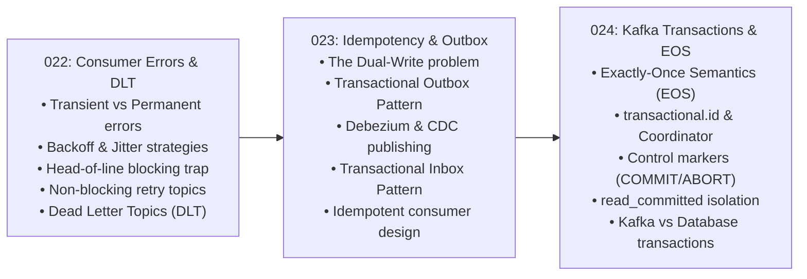

# Module 10: Reliability and Error Handling (Map of Content)

> [!abstract] Module Overview
> In distributed architectures, networks fail, databases lock, and microservices crash.
> This module explores how to build resilient, fault-tolerant Kafka systems: how to classify errors, implement non-blocking retry topics and Dead Letter Topics (DLT), solve the notorious Dual-Write problem using the **Transactional Outbox Pattern**, design idempotent consumers, and orchestrate atomic multi-partition workflows using **Kafka Transactions**.

---

## Module Index & Reading Order



### [022: Consumer Error Handling and Dead Letter Topics](file:///c:/Users/siddhesh.pawar/Desktop/Workspace/Obsidian-Vault/Inbox/Kafka_Obsidian_Organized/10%20-%20Reliability%20and%20Error%20Handling/022-Consumer_Error_Handling_and_Dead_Letter_Topics.md)
* **Error Classification:** Transient (retryable) vs. Permanent/Fatal (non-retryable) errors.
* **Backoff Strategies:** Fixed delay, exponential backoff, and random jitter to defeat the Thundering Herd problem.
* **The Blocking Retry Trap:** Why thread sleeps cause head-of-line blocking and trigger rebalance storms.
* **Non-Blocking Retry Topics:** Decoupling retries from the main partition using Spring Boot's `@RetryableTopic`.
* **Dead Letter Topics (DLT):** Quarantine patterns, diagnostic metadata headers, and operational replay strategies.

### [023: Idempotent Consumers and the Outbox Pattern](file:///c:/Users/siddhesh.pawar/Desktop/Workspace/Obsidian-Vault/Inbox/Kafka_Obsidian_Organized/10%20-%20Reliability%20and%20Error%20Handling/023-Idempotent_Consumers_and_Outbox_Pattern.md)
* **The Dual-Write Problem:** Why updating a database and publishing to Kafka cannot be safely coordinated in standard code.
* **The Transactional Outbox Pattern:** Writing events to an `outbox` table in the same local ACID transaction as business entities.
* **Publishing Mechanics:** Polling publishers vs. Change Data Capture (CDC) with Debezium.
* **The Transactional Inbox Pattern:** Deduplicating and staging incoming events locally before processing.
* **Idempotent Consumer Design:** Database unique constraints, idempotent upserts (`ON CONFLICT`), and Redis distributed deduplication.

### [024: Kafka Transactions and Exactly-Once Semantics](file:///c:/Users/siddhesh.pawar/Desktop/Workspace/Obsidian-Vault/Inbox/Kafka_Obsidian_Organized/10%20-%20Reliability%20and%20Error%20Handling/024-Kafka_Transactions_and_Exactly_Once_Semantics.md)
* **The Consume-Process-Produce Loop:** Atomic multi-partition writes across topics and consumer offsets.
* **Core Architecture:** `transactional.id`, Transaction Coordinator, `__transaction_state`, and `COMMIT`/`ABORT` control markers.
* **Consumer Isolation Levels:** `read_uncommitted` vs. `read_committed` and the Last Stable Offset (LSO).
* **The Big Reality Check:** Why Kafka transactions do NOT rollback SQL databases, and when to use Transactions vs. the Outbox Pattern.
* **Spring Boot Integration:** Declarative Kafka transactions via `@Transactional`.

---

## Master Reliability & Error Handling Reference

| Concept | Primary Setting / Annotation | Recommended Value | Architecture Purpose |
| :--- | :--- | :--- | :--- |
| **Non-blocking Retries** | `@RetryableTopic` | `attempts = "4", backoff = @Backoff(delay = 1000, multiplier = 2.0)` | Routes failing messages to separate retry topics without blocking main partition. |
| **Dead Letter Quarantine**| `@DltHandler` | Auto-routes to `<topic>.DLT` | Safely stores unprocessable records with error headers for investigation. |
| **Dual-Write Protection**| Transactional Outbox | Outbox Table + Debezium CDC | Guarantees atomic state updates between relational DB and Kafka. |
| **Duplicate Prevention** | DB Unique Constraint | `UNIQUE (event_id)` | Guarantees consumer idempotency at the database engine level. |
| **Atomic Multi-Topic Tx**| `transaction-id-prefix` | `tx-service-name-` | Enables atomic multi-partition writes across Kafka topics. |
| **Consumer Isolation** | `isolation.level` | `read_committed` | Ensures consumers only read messages from successfully committed transactions. |

---

## Production Spring Boot Template (`application.yml`)

```yaml
spring:
  kafka:
    bootstrap-servers:
      - kafka-1.prod.internal:9092
      - kafka-2.prod.internal:9092
      - kafka-3.prod.internal:9092

    producer:
      acks: all
      retries: 2147483647
      properties:
        enable.idempotence: true
        # Optional: Activate Kafka Transactions if doing pure Kafka-to-Kafka streaming
        # transaction-id-prefix: tx-order-service-

    consumer:
      group-id: order-processing-group
      auto-offset-reset: earliest
      enable-auto-commit: false
      # Read only committed messages if transactions are used upstream
      isolation-level: read_committed
      properties:
        # Prevent rebalance storms from slow retries
        max.poll.interval.ms: 300000
        max.poll.records: 100
```

---

## Module 10 Syllabus Checklist

- [x] Producer-side retry behavior in depth (`014`, `015`)
- [x] Consumer processing failures: Transient vs. Permanent errors
- [x] Retry strategies: Fixed delay, exponential backoff, and random jitter
- [x] Blocking vs. non-blocking retries (Head-of-Line blocking hazards)
- [x] Retry topics pattern and Spring Boot `@RetryableTopic`
- [x] Dead Letter Topic (DLT) architecture and diagnostic metadata headers
- [x] Poison pill message isolation and recovery
- [x] Duplicate message handling and idempotent consumer design
- [x] Database deduplication using event/message IDs and unique constraints
- [x] The Dual-Write Problem: Database transaction vs. Kafka offset commit challenge
- [x] The Transactional Outbox Pattern and Change Data Capture (CDC)
- [x] The Transactional Inbox Pattern
- [x] Kafka transactions, `transactional.id`, and atomic multi-partition writes
- [x] Consumer isolation levels: `read_committed` vs. `read_uncommitted`
- [x] Kafka Exactly-Once Processing (EOS) overview
- [x] Kafka transactions vs. database transactions: when to use each
