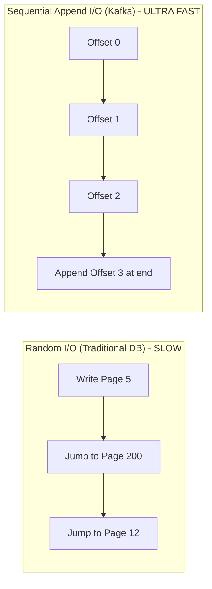
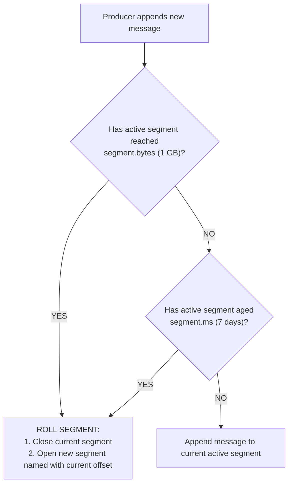
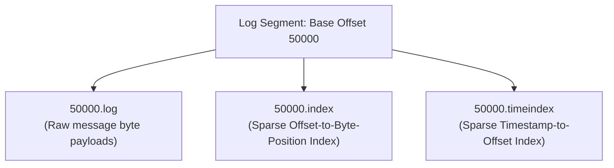

# 025: Log Segments and Index Mechanics

> [!abstract] Module 11: Storage and Retention (Part 1)
> **Focus:** How Kafka stores data physically on disk, sequential disk I/O, Page Cache and Zero-Copy, log segments, the active segment, segment rolling, and sparse index files (`.index` and `.timeindex`).
> **Prerequisites:** Foundations (`003`) and Topics & Partitions (`004`).

---

## 1. How Does Kafka Store Data on Disk So Fast?

A common myth is that disks (especially spinning hard drives) are slow, and databases must keep everything in RAM to be fast. 

Yet Kafka writes and reads gigabytes of data per second directly to and from ordinary hard drives. How?

### 1. Sequential Disk I/O vs. Random Disk I/O
- **Random Disk Writes (Traditional Databases):** Traditional relational databases update tables using B-Trees. A write might update byte 100, then byte 50,000, then byte 2,000. The disk head has to jump all over the platter, which is extremely slow (often only 100 to 200 operations per second).
- **Sequential Disk Writes (Kafka's Append-Only Log):** Kafka writes records strictly in one direction: appending to the very end of the file. Sequential disk writes are as fast as writing directly to RAM (often 600+ MB/second)!



---

### 2. Page Cache and Zero-Copy Transfer
When an application reads a file, standard operating systems copy data 4 times across memory boundaries (Disk $\rightarrow$ OS Cache $\rightarrow$ App Buffer $\rightarrow$ Socket Buffer $\rightarrow$ Network Card).

Kafka bypasses the application memory completely using the Linux **`sendfile`** system call (known as **Zero-Copy**):


Data flows directly from the OS page cache to the network card without wasting CPU copying bytes into Kafka's JVM heap!

---

## 2. Physical Layout on Disk

In Kafka, a **Topic** is just a logical concept. What physically exists on the broker's hard drive are **Partition Directories**.

If your broker stores data in `/var/lib/kafka/data`, and you have a topic named `orders` with 3 partitions, Kafka creates 3 separate folders:

```text
/var/lib/kafka/data/
├── orders-0/    <-- Folder for Partition 0
├── orders-1/    <-- Folder for Partition 1
└── orders-2/    <-- Folder for Partition 2
```

---

## 3. What is a Log Segment?

Inside a partition folder (like `orders-0/`), Kafka **does not store all messages in one giant file**. 

### The Problem
If partition 0 had 500 GB of messages in a single file called `orders.log`:
- Deleting old messages from 7 days ago would require opening a 500 GB file and deleting bytes from the beginning. This is extremely slow and corrupts files.
- Searching for an offset inside a 500 GB file would take minutes.

### The Solution: Log Segments
Kafka divides a partition's log into smaller, manageable chunks called **Log Segments** (typically 1 GB each).

```text
/var/lib/kafka/data/orders-0/
├── 00000000000000000000.log    <-- Closed Segment (Offsets 0 to 49,999)
├── 00000000000000000000.index
├── 00000000000000000000.timeindex
├── 00000000000000050000.log    <-- Closed Segment (Offsets 50,000 to 99,999)
├── 00000000000000050000.index
├── 00000000000000050000.timeindex
└── 00000000000000100000.log    <-- ACTIVE SEGMENT (Receiving live writes!)
```

### The Active Segment vs. Closed Segments
- **The Active Segment:** The **only** segment currently open for writes. When producers publish new records, they are appended to the active segment.
- **Closed (Inactive) Segments:** Once a segment reaches its size or age limit, Kafka closes it permanently. Closed segments are completely **read-only and immutable**. They are never modified again—only read by consumers or eventually deleted when retention expires.

---

## 4. Segment Rolling: When Does Kafka Create a New Segment?

The process of closing the current active segment and opening a fresh one is called **Segment Rolling**.



Kafka rolls a segment when **either** of two thresholds is met:

### 1. Size Limit: `segment.bytes` (Default: `1073741824` bytes / 1 GB)
When the active `.log` file reaches 1 GB in size, Kafka freezes it and creates a new active segment.
* *Topic-level override:* `segment.bytes=536870912` (e.g., 512 MB).

### 2. Time Limit: `segment.ms` (Default: 7 days / `604800000` ms)
What if a topic has very low traffic and only gets 10 MB of data in a week? Without a time limit, the segment would stay active for years!
Kafka forces a roll after `segment.ms` (7 days by default) even if the segment is only partially full.

> [!NOTE]
> Every segment file is named after its **Base Offset** (the first offset stored in that segment), padded with 20 digits. For example, `00000000000000050000.log` starts at Offset 50,000.

---

## 5. The Three Files Inside Every Segment

Every log segment on disk consists of 3 complementary files:



### 1. The Log File (`.log`)
Contains the actual batches of messages stored in raw binary format on disk, exactly as sent by the producer.

---

### 2. The Offset Index File (`.index`)
When a consumer asks: *"Give me the message at Offset 52,140"*, how does Kafka find it without reading the entire 1 GB file?

Kafka uses a **Sparse Index**:
- It does **not** index every single message (that would waste too much memory).
- It records an entry roughly every 4 KB of data (`index.interval.bytes=4096`).

```text
Contents of 50000.index:
[Offset 50000] -> Byte Position 0
[Offset 50050] -> Byte Position 4120
[Offset 50110] -> Byte Position 8290
...
[Offset 52100] -> Byte Position 154200
[Offset 52150] -> Byte Position 158400
```

#### How Kafka Searches:
To find Offset 52,140:
1. Kafka loads the small `.index` file into memory.
2. It runs a lightning-fast **Binary Search** to find the closest offset $\le$ 52,140 (which is 52,100 at byte position 154,200).
3. Kafka seeks directly to byte position 154,200 on disk and scans forward sequentially for just a few records until it hits Offset 52,140!

This search takes less than 1 millisecond.

---

### 3. The Timestamp Index File (`.timeindex`)
Maps record timestamps to their logical offsets:

```text
Contents of 50000.timeindex:
[Timestamp 1718000000000] -> Offset 50000
[Timestamp 1718000005000] -> Offset 50050
[Timestamp 1718000012000] -> Offset 50110
```

When a consumer wants to replay data from Tuesday at 10:00 AM using `consumer.offsetsForTimes()`, Kafka uses this `.timeindex` file to find the exact offset corresponding to that timestamp.

---

## 6. Key Configuration Summary

| Configuration Property | Default Value | Production Recommended | Purpose |
| :--- | :--- | :--- | :--- |
| **`log.dir` / `log.dirs`** | `/tmp/kafka-logs` | `/var/lib/kafka/data` | Physical directory on disk where partition logs are stored. |
| **`log.segment.bytes`** | `1073741824` (1 GB) | `1073741824` (1 GB) | Maximum size of a single segment before rolling a new one. |
| **`segment.bytes`** | - | `1073741824` (1 GB) | Topic-level override for segment size. |
| **`log.roll.hours` / `segment.ms`**| 7 days (`168` hours) | 7 days (`604800000` ms)| Maximum time before forcing a segment roll on quiet topics. |
| **`index.interval.bytes`** | `4096` (4 KB) | `4096` (4 KB) | How often Kafka adds an index entry in `.index` and `.timeindex`. |
