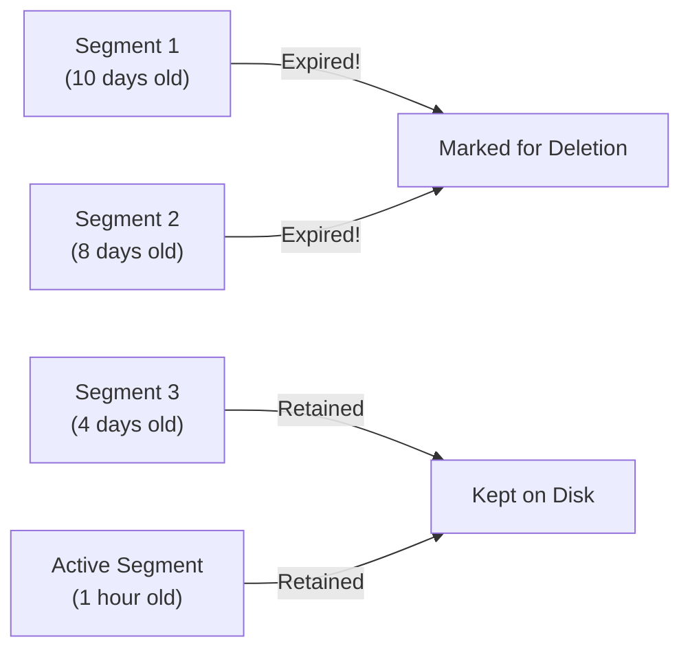
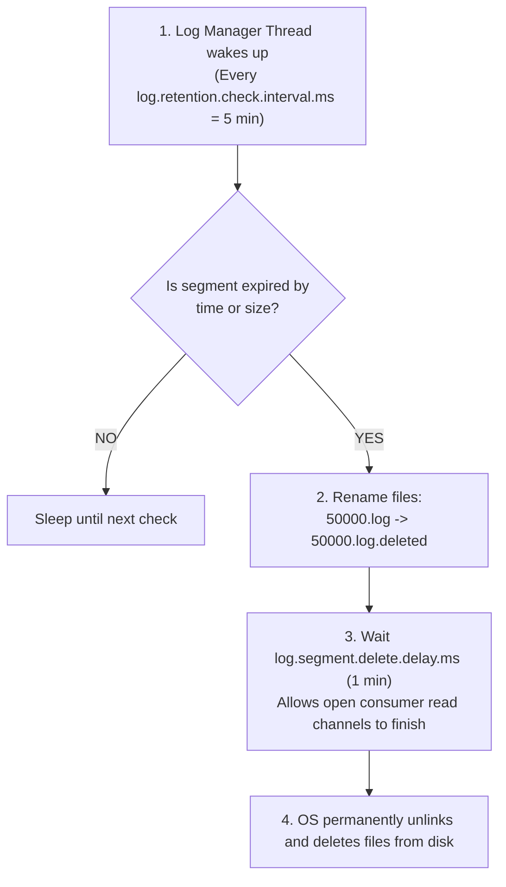

# 026: Retention Policies and Log Deletion

> [!abstract] Module 11: Storage and Retention (Part 2)
> **Focus:** How Kafka manages disk space, the default `cleanup.policy=delete`, time-based and size-based retention, why retention is per partition, and why the active segment is never deleted.
> **Prerequisites:** Log segments and index mechanics (`025`).

---

## 1. The Disk Management Challenge

Because Kafka is an **immutable, append-only log**, records are never deleted when a consumer reads them. Consumers simply advance their offset pointers.

If Kafka never deleted old data:
- Over weeks and months, hard drives would fill up to 100%.
- Once disk usage hits 100%, the operating system blocks writes, and the Kafka broker crashes!

To keep disk usage under control, Kafka enforces **Retention Policies**.

---

## 2. The Delete Cleanup Policy (`cleanup.policy=delete`)

Kafka provides two cleanup mechanisms: **Delete** and **Compact**. 

By default, every Kafka topic uses the delete policy:
```properties
cleanup.policy=delete
```

Under this policy, Kafka periodically purges entire old segments based on **time** or **size** thresholds.

---

## 3. Time-Based Retention

Time-based retention is the most common way to configure data lifespan. You tell Kafka: *"Keep messages for 7 days. Any segment older than 7 days should be removed."*



### Configuration Hierarchy
Kafka allows you to set time retention at both the broker and topic levels:

1. **Broker Level (Global Default):**
   - `log.retention.ms` (highest priority)
   - `log.retention.minutes`
   - `log.retention.hours` (default: **168 hours = 7 days**)

2. **Topic Level (Per-Topic Override):**
   ```bash
   # Set retention to 3 days (259,200,000 ms) for the 'orders' topic:
   kafka-configs.sh --bootstrap-server localhost:9092 --alter \
     --entity-type topics --entity-name orders \
     --add-config retention.ms=259200000
   ```

### How Kafka Decides If a Segment Has Expired
Kafka does not inspect every individual message. It evaluates **entire segments**:
1. Kafka looks at the **largest timestamp recorded in the segment's `.timeindex`** (or the file modification timestamp).
2. If:
   $$\text{Current Time} - \text{Largest Segment Timestamp} > \text{retention.ms}$$
3. The entire segment is marked as expired and scheduled for deletion.

---

## 4. Size-Based Retention

You can also bound data by physical disk space: *"Never allow a partition to take more than 20 GB of disk space."*

```properties
retention.bytes=21474836480   # 20 GB in bytes
```

### The Critical Catch: `retention.bytes` is PER PARTITION!

> [!WARNING]
> **A Very Common Production Mistake:**  
> `retention.bytes` is **not** the limit for the topic, and **not** the limit for the entire broker.  
> It is strictly the **maximum size allowed for a SINGLE PARTITION**.

#### Sizing Example:
Suppose you configure `retention.bytes = 10 GB` for the `orders` topic:
- If `orders` has **1 partition** $\rightarrow$ max disk usage is **10 GB**.
- If `orders` has **5 partitions** $\rightarrow$ max disk usage is $5 \times 10\text{ GB} = \mathbf{50\text{ GB}}$!
- If `orders` has **20 partitions** $\rightarrow$ max disk usage is $20 \times 10\text{ GB} = \mathbf{200\text{ GB}}$!

Always multiply your partition count by `retention.bytes` when planning server disk capacity.

---

## 5. Combining Time and Size Retention

You can configure both `retention.ms` and `retention.bytes` at the same time:

```properties
retention.ms=604800000        # 7 days
retention.bytes=10737418240   # 10 GB per partition
```

**Rule:** Whichever threshold is breached **first** triggers deletion:
- If a partition reaches 10 GB on day 3, Kafka deletes the oldest segment immediately, even though it hasn't reached 7 days.
- If data only reaches 2 GB after 7 days, Kafka deletes the oldest segment because its time expired.

---

## 6. The Sacred Rule: The Active Segment is NEVER Deleted!

Consider this scenario:
- You configure `retention.bytes = 100 MB`.
- The active segment is currently taking writes and has grown to **400 MB**.

Will Kafka delete the active segment? **NO.**

```text
/var/lib/kafka/data/orders-0/
├── 00000000000000000000.log  (Closed: 1 GB) -> ELIGIBLE FOR DELETION
└── 00000000000000050000.log  (ACTIVE: 400 MB) -> NEVER DELETED!
```

> [!IMPORTANT]
> **The Active Segment is Immune to Deletion.**  
> Kafka will never delete the currently active segment, regardless of how small you set `retention.ms` or `retention.bytes`.  
> An active segment can only be deleted **after it rolls** and becomes closed.

---

## 7. How Segment Deletion Works Under the Hood

Deleting files on Linux can cause I/O freezes if done naively. Kafka purges files smoothly using a 4-step background process:



1. **Periodic Scan:** A background thread wakes up every `log.retention.check.interval.ms` (default: 5 minutes) to check for expired segments.
2. **Rename to `.deleted`:** Expired segments are immediately unlinked from Kafka's in-memory index and renamed with a `.deleted` extension.
3. **Grace Period (`log.segment.delete.delay.ms`):** Kafka waits 1 minute before touching the file. This ensures that any consumer currently streaming bytes from that segment can finish its read without throwing an I/O crash.
4. **Permanent Removal:** The operating system unlinks and permanently reclaims the disk sectors.

---

## 8. Key Configuration Summary

| Property | Default Value | Scope | Purpose |
| :--- | :--- | :--- | :--- |
| **`cleanup.policy`** | `delete` | Topic / Broker | Determines cleanup behavior (`delete`, `compact`, or `compact,delete`). |
| **`log.retention.hours`** | `168` (7 days) | Broker | Global default time retention. |
| **`retention.ms`** | - | Topic | Per-topic time retention override (in milliseconds). |
| **`log.retention.bytes`** | `-1` (unlimited) | Broker | Global default size retention per partition. |
| **`retention.bytes`** | `-1` (unlimited) | Topic | Per-topic size retention override **per partition**. |
| **`log.retention.check.interval.ms`** | `300000` (5 min) | Broker | How often the broker scans for expired segments. |
| **`log.segment.delete.delay.ms`** | `60000` (1 min) | Broker | Grace delay before physically removing `.deleted` files. |
