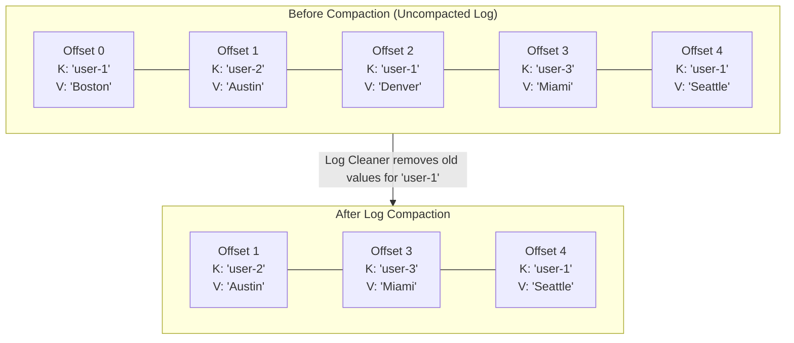
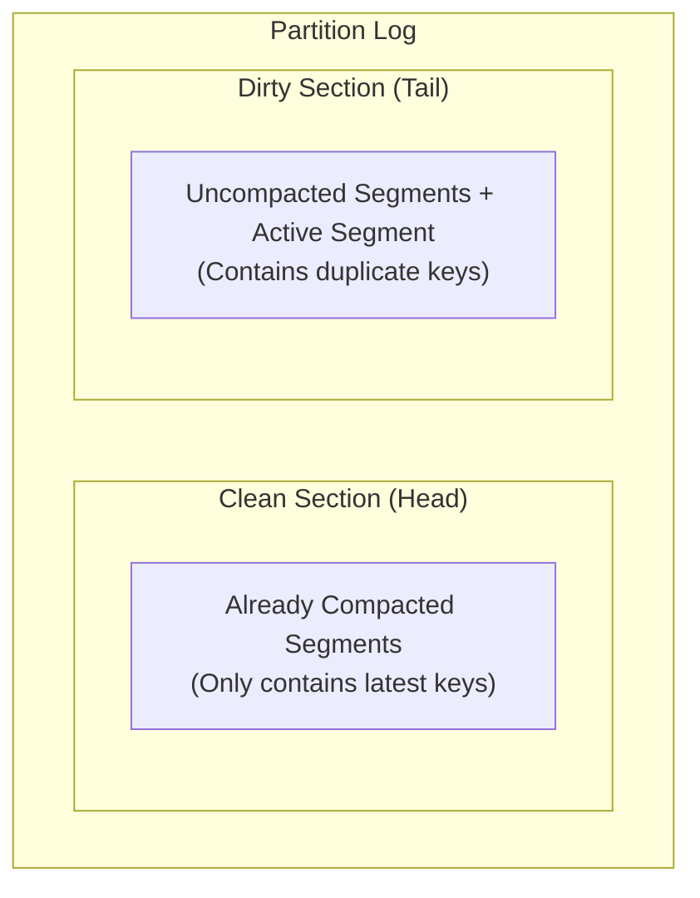
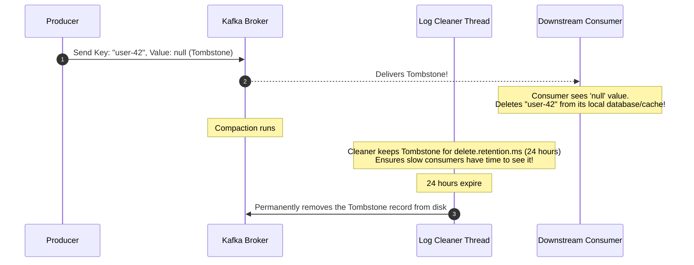

# 027: Log Compaction and Tombstones

> [!abstract] Module 11: Storage and Retention (Part 3)
> **Focus:** The changelog problem, Log Compaction (`cleanup.policy=compact`), clean vs. dirty segment regions, Tombstone deletion markers, and combining compaction with deletion.
> **Prerequisites:** Log segments (`025`) and Deletion policies (`026`).

---

## 1. The Changelog Problem vs. Event Streams

In Kafka, there are two fundamentally different types of data:

### 1. Transient Event Streams (Handled by `cleanup.policy=delete`)
- Examples: Clickstream tracking, sensor metrics, user logins, notifications.
- **Characteristics:** You care about the historical events as they happened. Keeping messages for 7 days is fine; after 7 days, you delete them to free up disk space.

---

### 2. State & Changelogs (The Problem)
- Examples: Customer mailing addresses, bank account balances, product prices, database row updates via CDC (Change Data Capture).
- **The Dilemma:**
  - Suppose User #42 sets their address to *"Seattle"*.
  - User #42 lives in Seattle for 3 years without moving.
  - If you use `cleanup.policy=delete` with a 7-day retention, **Kafka will delete User #42's address after 7 days!**
  - If a new service starts up, it will believe User #42 has no address.

You cannot delete the data based on time. But you also cannot keep every single intermediate update forever (which would fill up your disk).

**What you actually want:**  
Keep the **latest, current value for every unique Key forever**, and throw away the old, obsolete updates.

This is exactly what **Log Compaction** does.

---

## 2. What is Log Compaction?

When a topic is configured with:
```properties
cleanup.policy=compact
```

Kafka guarantees that it will **retain at least the most recent value for every message key**.



### Notice Two Critical Details:
1. **Offsets Are Never Renumbered:** Offset 4 stays Offset 4. It does not become Offset 2.
2. **Offsets Have Gaps:** After compaction, the log will have missing offsets (e.g., 1, 3, 4). When a consumer asks for Offset 0, Kafka seamlessly serves the next available offset (Offset 1).

---

## 3. How the Log Cleaner Works Under the Hood

Log compaction is performed in the background by a dedicated thread called the **Log Cleaner**.

The log is divided into two logical sections:



1. **The Clean Section (Head):** Segments that have already been compacted. They contain at most one record per key.
2. **The Dirty Section (Tail):** New segments containing new records and duplicate keys that have not been compacted yet.

---

### The Compaction Process
1. **The Trigger (`min.cleanable.dirty.ratio`):** By default `0.5` (50%). When the dirty section represents more than 50% of the total partition log size, the Log Cleaner wakes up.
2. **Build In-Memory Hash Map:** The cleaner scans the dirty segments and builds an in-memory hash table of:
   $$\text{Key} \longrightarrow \text{Latest Offset}$$
3. **Copy to New Clean Segment:** The cleaner copies records into a new replacement segment. If a record's offset matches the latest offset in the map, it is kept. If its offset is older, it is **discarded**.
4. **Swap Segments:** The old segments are deleted, and the newly compacted segment takes their place.

---

## 4. How Do You Delete a Key? Tombstone Records

If a compacted topic keeps the latest record for every key forever, **how do you ever delete a key?** (e.g., a customer deletes their account).

If you just stop sending messages for that key, Kafka will keep the old record forever.

### The Solution: A Tombstone
To delete a key in a compacted topic, the producer sends a **Tombstone**:
A record with the target **Key** and a **`null` payload (`value = null`)**.

```java
// Producing a Tombstone to delete "user-42"
kafkaTemplate.send("user-profiles", "user-42", null);
```



### Why Can't Kafka Erase the Tombstone Immediately?
If Kafka instantly erased the tombstone from disk, lagging consumers that were offline for 2 hours would **never see the deletion**! When they booted back up, they would never know the user was deleted.

**The Grace Period: `delete.retention.ms` (Default: 24 hours / `86400000` ms)**  
Kafka preserves the tombstone marker on disk for 24 hours so all consumers can see it. After 24 hours, the next compaction run purges the tombstone permanently.

---

## 5. Combining Policies: `compact,delete`

You can combine both cleanup policies on a single topic:

```properties
cleanup.policy=compact,delete
retention.ms=2592000000   # 30 days
```

### How It Works:
- **Compaction:** Kafka continually removes superseded records, keeping only the latest state for each key.
- **Deletion:** If a record's latest version has not been modified for more than 30 days, the time-based retention kicks in and deletes it anyway.
- **Use Case:** Perfect for caching or temporary session state where you only want the latest data, but want inactive users to expire after 30 days.

---

## 6. Real-World Use Cases for Compaction

| Use Case | How Log Compaction Solves It |
| :--- | :--- |
| **Change Data Capture (CDC)** | Debezium streams database updates into Kafka. Compaction keeps the exact current state of the database table in Kafka indefinitely. |
| **Kafka Streams `KTable`** | Backing store for materialized tables in stream processing. Enables instant local state recovery after a pod restart. |
| **System Configurations** | Topics holding feature flags, application settings, or routing rules where you only care about the latest active configuration. |

---

## 7. Key Configuration Summary

| Configuration Property | Default Value | Recommended Value | Purpose |
| :--- | :--- | :--- | :--- |
| **`cleanup.policy`** | `delete` | `compact` (or `compact,delete`) | Activates log compaction on the topic. |
| **`min.cleanable.dirty.ratio`** | `0.5` (50%) | `0.5` | Ratio of dirty-to-total log required to trigger compaction. |
| **`delete.retention.ms`** | `86400000` (24h) | `86400000` (24h) | Time tombstone deletion markers are preserved for consumers. |
| **`segment.ms`** | 7 days | 1 day (for compacted topics) | Forces active segments to roll sooner so dirty data can be compacted. |
| **`min.compaction.lag.ms`** | `0` | `0` (or hours if needed) | Minimum time a message must sit in the log before being compacted. |
