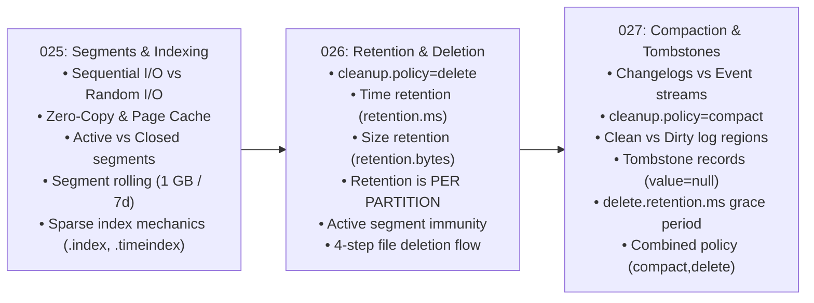

# Module 11: Storage and Retention (Map of Content)

> [!abstract] Module Overview
> Kafka achieves extraordinary performance by treating the hard drive as an append-only sequential log.
> This module explores how Kafka writes and indexes partition segments on disk, how it achieves near-RAM speeds using Zero-Copy (`sendfile`), how disk space is safely managed with time-based and size-based retention, and how **Log Compaction** and **Tombstones** preserve the latest state for changelogs and CDC architectures.

---

## Module Index & Reading Order



### [025: Log Segments and Index Mechanics](file:///c:/Users/siddhesh.pawar/Desktop/Workspace/Obsidian-Vault/Inbox/Kafka_Obsidian_Organized/11%20-%20Storage%20and%20Retention/025-Log_Segments_and_Index_Mechanics.md)
* **High-Speed Storage Secrets:** Sequential append-only disk writes, Linux OS Page Cache, and Zero-Copy (`sendfile`) network transfer.
* **Disk Partition Directories:** Physical filesystem layout (`orders-0/`, `orders-1/`).
* **Log Segments:** Breaking partitions into manageable 1 GB chunks; the active segment vs. immutable closed segments.
* **Segment Rolling:** When Kafka closes an active segment via size (`segment.bytes`) or time (`segment.ms`).
* **The Sparse Index:** How `.index` and `.timeindex` use binary search and sequential scanning to seek offsets in sub-milliseconds.

### [026: Retention Policies and Log Deletion](file:///c:/Users/siddhesh.pawar/Desktop/Workspace/Obsidian-Vault/Inbox/Kafka_Obsidian_Organized/11%20-%20Storage%20and%20Retention/026-Retention_Policies_and_Log_Deletion.md)
* **The Disk Purge Strategy:** Why Kafka never deletes records upon consumer reads, and how `cleanup.policy=delete` prevents disk exhaustion.
* **Time-Based Retention:** Configuring `retention.ms` (default: 7 days) and how timestamps in `.timeindex` determine segment expiration.
* **Size-Based Retention:** The critical production catch—why `retention.bytes` applies **per partition**, not per topic!
* **The Sacred Rule:** Why the active segment is immune to deletion, regardless of retention settings.
* **Under the Hood Deletion:** The 4-step process of renaming to `.deleted`, unmapping memory, and waiting for `log.segment.delete.delay.ms`.

### [027: Log Compaction and Tombstones](file:///c:/Users/siddhesh.pawar/Desktop/Workspace/Obsidian-Vault/Inbox/Kafka_Obsidian_Organized/11%20-%20Storage%20and%20Retention/027-Log_Compaction_and_Tombstones.md)
* **The Changelog Problem:** Why stateful tables (customer addresses, account balances, CDC) cannot use time-based deletion.
* **Log Compaction (`cleanup.policy=compact`):** Preserving the latest record for every message key forever while discarding obsolete updates.
* **Log Cleaner Mechanics:** Scanning the dirty section, building in-memory offset maps, and merging clean segments.
* **Tombstone Records:** Deleting keys in a compacted topic by publishing a `null` payload, and the `delete.retention.ms` (24h) grace window.
* **Combined Policies:** Using `cleanup.policy=compact,delete` for stateful caches with expiration windows.

---

## Master Storage & Retention Configuration Reference

| Property | Default Value | Scope | Primary Responsibility |
| :--- | :--- | :--- | :--- |
| **`log.dirs`** | `/tmp/kafka-logs` | Broker | Physical disk directories used for partition storage. |
| **`segment.bytes`** | `1073741824` (1 GB) | Topic / Broker | Maximum size of a single segment before rolling a new one. |
| **`segment.ms`** | `604800000` (7 days) | Topic / Broker | Maximum time before forcing an active segment to roll. |
| **`cleanup.policy`** | `delete` | Topic / Broker | Cleanup strategy: `delete`, `compact`, or `compact,delete`. |
| **`log.retention.hours`**| `168` (7 days) | Broker | Global default time retention. |
| **`retention.ms`** | `604800000` (7 days) | Topic | Per-topic time retention override (in milliseconds). |
| **`retention.bytes`** | `-1` (unlimited) | Topic | Per-topic size retention override **per partition**. |
| **`delete.retention.ms`**| `86400000` (24h) | Topic / Broker | How long tombstone deletion markers are preserved. |
| **`min.cleanable.dirty.ratio`** | `0.5` (50%) | Topic / Broker | Ratio of dirty log required before log compaction triggers. |
| **`index.interval.bytes`**| `4096` (4 KB) | Topic / Broker | Frequency of sparse offset entries in index files. |

---

## Production CLI Management Cheat Sheet

### 1. Change Topic Retention to 3 Days
```bash
kafka-configs.sh --bootstrap-server localhost:9092 --alter \
  --entity-type topics --entity-name orders \
  --add-config retention.ms=259200000
```

### 2. Cap Partition Size to 10 GB
```bash
kafka-configs.sh --bootstrap-server localhost:9092 --alter \
  --entity-type topics --entity-name orders \
  --add-config retention.bytes=10737418240
```

### 3. Create a Compacted Topic for User State (CDC)
```bash
kafka-topics.sh --bootstrap-server localhost:9092 --create \
  --topic customer-profiles \
  --partitions 6 \
  --replication-factor 3 \
  --config cleanup.policy=compact \
  --config segment.ms=86400000 \
  --config min.cleanable.dirty.ratio=0.5
```

---

## Module 11 Syllabus Checklist

- [x] Kafka log structure and sequential append-only disk I/O
- [x] Log segments, active segment, and closed immutable segments
- [x] Segment rolling triggers: size (`segment.bytes`) and time (`segment.ms`)
- [x] Offset index (`.index`) and timestamp index (`.timeindex`) sparse mechanics
- [x] Zero-Copy data transfer (`sendfile`) and OS Page Cache
- [x] Retention policy: `cleanup.policy=delete`
- [x] Time-based retention (`retention.ms` / `log.retention.hours`)
- [x] Size-based retention (`retention.bytes`) and the **per-partition** sizing rule
- [x] The Active Segment immunity rule
- [x] Under-the-hood file deletion (`.deleted` extension, grace delays)
- [x] Log compaction (`cleanup.policy=compact`) for changelogs and CDC
- [x] Clean vs. Dirty log regions and the log cleaner thread
- [x] Tombstone records (`value=null`) and `delete.retention.ms`
- [x] Combined cleanup policies (`cleanup.policy=compact,delete`)
