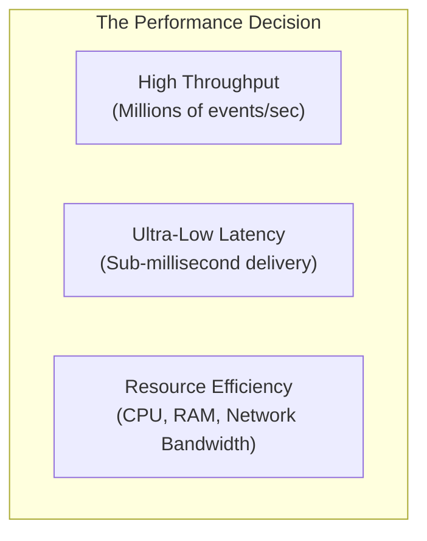
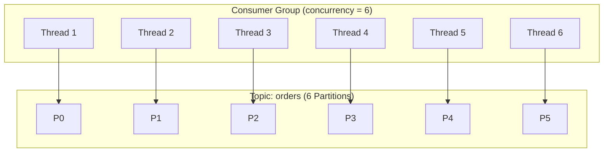
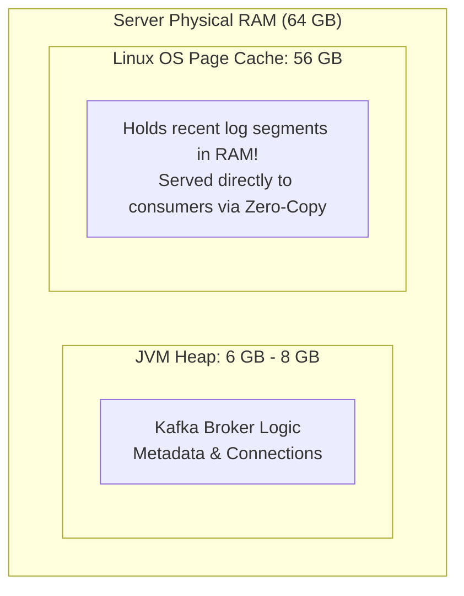

# 028: Performance Tuning and Optimization

> [!abstract] Module 12: Performance and Operations (Part 1)
> **Focus:** The latency vs. throughput trade-off triangle, producer tuning (batching, compression, buffer memory), consumer tuning (concurrency, batch listeners, fetch limits), and broker OS page cache optimization.
> **Prerequisites:** Producer internals (`013`–`015`), Consumer internals (`016`–`018`), and Storage (`025`).

---

## 1. The Core Trade-Off: Latency vs. Throughput

When configuring Kafka, you cannot maximize everything at once. There is a fundamental engineering trade-off:



| Goal | What It Prioritizes | Real-World Use Case | Key Strategy |
| :--- | :--- | :--- | :--- |
| **Ultra-Low Latency** | Messages must arrive in milliseconds; don't wait to batch. | Stock trading, payment auth, multiplayer gaming, fraud alerts. | `linger.ms=0`, small batches, `compression.type=none`. |
| **High Throughput** | Maximize total data processed per second; cost efficiency. | Log aggregation, IoT telemetry, clickstreams, analytics. | `linger.ms=10-20`, `batch.size=64KB`, `compression.type=lz4`. |

---

## 2. Tuning the Producer for Maximum Throughput

A producer defaults to sending messages almost immediately. In high-volume systems, tuning 4 key levers can increase throughput by **400% to 500%**:


### 1. `batch.size` (Target: 32 KB to 64 KB)
* Default: `16384` bytes (16 KB).
* **Optimization:** Increase to `32768` (32 KB) or `65536` (64 KB). Larger batches mean fewer network packets, less TCP header overhead, and much better compression ratios.

### 2. `linger.ms` (Target: 5 ms to 20 ms)
* Default: `0` ms (send immediately).
* **Optimization:** Set to `10` ms. The producer pauses for just a few milliseconds to let incoming records bundle together into full 64 KB batches. If the batch fills before 10 ms, it ships immediately.

### 3. `compression.type` (Recommended: `lz4` or `zstd`)
* Default: `none`.
* **Optimization:** Set to `lz4`. Compressing batches reduces network bandwidth by 60%–70% with virtually zero CPU overhead.

### 4. `buffer.memory` and `max.block.ms`
* Default: `33554432` bytes (32 MB).
* **Optimization:** Increase to `67108864` (64 MB) on high-throughput services to prevent the producer from blocking during network bursts.

---

## 3. Tuning the Consumer for High Concurrency

On the consumer side, throughput is limited by how fast your application can process records.

### 1. The Partition Ceiling Rule
> [!IMPORTANT]
> **A single partition can only be read by ONE consumer thread in a group at any time.**  
> If a topic has 6 partitions, running 12 consumer threads means **6 threads will sit completely idle**!

To increase consumer processing throughput, you must **first increase the topic's partition count** (e.g., from 6 to 12), and then scale your consumer instances.



---

### 2. Spring Boot Listener Concurrency
Instead of deploying separate pods for every single thread, Spring Boot can run multiple concurrent consumer threads inside a single pod:

```yaml
spring:
  kafka:
    listener:
      concurrency: 3   # Spawns 3 consumer threads inside this JVM
```

If you have 6 partitions and run 2 application pods with `concurrency: 3`, all 6 partitions are consumed concurrently across your 2 pods!

---

### 3. Spring Boot Batch Listeners (Process in Bulk)
By default, `@KafkaListener` passes records to your method one-by-one. If your code inserts records into PostgreSQL, doing 500 individual `INSERT` queries is 100x slower than one bulk `INSERT ... VALUES (...), (...)`.

You can switch Spring Boot to a **Batch Listener**:

```java
@Component
@Slf4j
public class BulkOrderConsumer {

    // Receives up to 500 records at once in a single List!
    @KafkaListener(topics = "orders", groupId = "bulk-order-group", batch = "true")
    public void consumeBatch(List<ConsumerRecord<String, OrderDto>> records) {
        log.info("Received batch of {} records", records.size());

        // Fast bulk database insert in a single SQL query
        orderRepository.saveAll(records.stream()
                .map(ConsumerRecord::value)
                .toList());
    }
}
```

In `application.yml`:
```yaml
spring:
  kafka:
    listener:
      type: batch   # Activates List<ConsumerRecord> injection
    consumer:
      max-poll-records: 500
```

---

## 4. Broker & OS Level Optimization

Why can Kafka brokers handle millions of messages without crashing their JVM?

### 1. The JVM Heap Sizing Rule: Less is More!
Developers often think: *"My server has 64 GB of RAM, so I will give Kafka a 48 GB JVM heap!"*  
**This is a critical mistake in Kafka.**



* **Kafka Heap:** Set to **6 GB to 8 GB** (using G1GC). Kafka does not store message payloads in Java heap memory. Large heaps only cause massive garbage collection pauses.
* **Linux OS Page Cache:** Leave the remaining 85% of RAM free for the Linux operating system. Linux automatically uses this free RAM to cache disk log segments. When consumers read data, it is served straight from RAM at zero-copy speeds!

### 2. Network and I/O Thread Sizing
In `server.properties` on Kafka brokers:
* `num.network.threads`: (Default: 3). Set to the number of physical CPU cores. Handles socket read/write requests.
* `num.io.threads`: (Default: 8). Set to $2 \times$ number of physical disk drives. Handles writing and reading segments to and from disk.

---

## 5. Performance Tuning Cheat Sheet

| Parameter | Default Value | High-Throughput Tuning | Purpose |
| :--- | :--- | :--- | :--- |
| **`batch.size`** (Producer) | `16384` (16 KB) | `65536` (64 KB) | Bundles more records into a single network packet. |
| **`linger.ms`** (Producer) | `0` ms | `10` ms | Waits up to 10 ms for batches to fill before sending. |
| **`compression.type`** (Producer) | `none` | `lz4` | Fast compression that saves 60%–70% network and disk I/O. |
| **`buffer.memory`** (Producer) | `33554432` (32 MB) | `67108864` (64 MB) | Expands client RAM buffer to absorb traffic spikes. |
| **`max.poll.records`** (Consumer) | `500` | `500` (Bulk) or `50` (Slow DB) | Bounds records per poll; match to your processing speed. |
| **`concurrency`** (Consumer) | `1` | Matches partition count | Spawns parallel worker threads inside a single pod. |
| **`spring.kafka.listener.type`**| `single` | `batch` | Injects records as a `List` for bulk database operations. |
