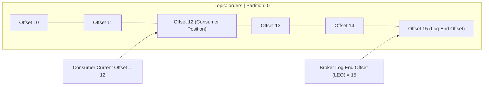
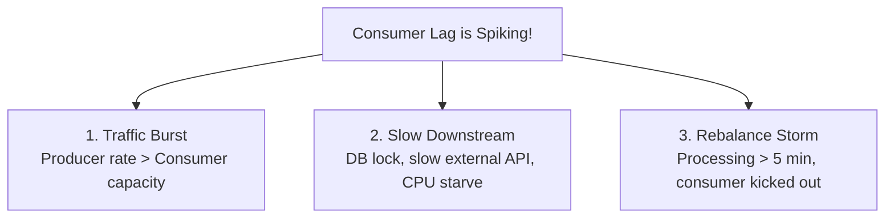

# 029: Consumer Lag and Metrics Monitoring

> [!abstract] Module 12: Performance and Operations (Part 2)
> **Focus:** Consumer Lag (the #1 operational metric in Kafka), Log End Offset (LEO) vs. Current Offset, the 3 root causes of lag, golden broker and client metrics to alert on, and monitoring with Spring Boot Actuator and Prometheus.
> **Prerequisites:** Consumer internals (`016`–`018`) and Performance tuning (`028`).

---

## 1. What is Consumer Lag?

In Kafka, producers write records, and consumers read records. 

**Consumer Lag** is simply the number of messages that have been published to a partition but have **not yet been processed** by your consumer group.



### The Math of Consumer Lag
$$\text{Consumer Lag} = \text{Log End Offset (LEO)} - \text{Current Consumer Offset}$$

In the example above:
$$\text{Lag} = 15 - 12 = \mathbf{3 \text{ messages pending}}$$

- **Log End Offset (LEO):** The offset of the next message that the broker will write to the partition log (the newest message).
- **Current Consumer Offset:** The last offset committed by the consumer group.

> [!CRITICAL]
> **Why Consumer Lag is the #1 Metric:**  
> If your lag is growing steadily (e.g., from 100 to 10,000 to 100,000), it means your consumers are falling behind real-time. Customers will experience delayed emails, late payment updates, and stale inventory!

---

## 2. The 3 Root Causes of Consumer Lag

When you get an alert that consumer lag is spiking in production, it is almost always caused by one of these 3 issues:



### Cause 1: Traffic Burst (Flash Sale / Peak Hours)
* **What happens:** Your Order Service suddenly receives 10,000 orders/sec during a Black Friday flash sale, but your consumer is sized for 2,000 orders/sec.
* **Fix:** Scale out the consumer group by adding more pods (up to the partition count ceiling).

### Cause 2: Slow Downstream Processing (Database Bottleneck)
* **What happens:** The consumer code calls a database that has slow queries or lock contention, or calls an external third-party API that is throttling requests (HTTP 429).
* **Fix:** Use Spring Boot batch listeners to bulk-insert records into the database, add caching, or use non-blocking asynchronous calls.

### Cause 3: Rebalance Storms (Poll Timeout Exceeded)
* **What happens:** Processing a batch of records takes 5 minutes and 10 seconds. Kafka's `max.poll.interval.ms` (5 minutes) expires. The coordinator assumes the consumer died and triggers a rebalance. All processing pauses while partitions are reassigned, causing lag to explode!
* **Fix:** Reduce `max.poll.records` (e.g., from 500 down to 50) so each batch finishes well under the 5-minute threshold.

---

## 3. Golden Signals: The Most Critical Metrics to Alert On

Do not try to monitor 500 different metrics. In production, focus on these **Golden Signals**:

### 1. Broker Health Metrics (Critical Infrastructure)

| Metric Name | Normal Value | Critical Threshold | What It Means When Broken |
| :--- | :---: | :---: | :--- |
| **`UnderReplicatedPartitions` (URP)** | **`0`** | **`> 0`** | **IMMEDIATE PAGERDUTY ALERT!** Replicas are offline or falling behind. Data loss risk if broker crashes! |
| **`ActiveControllerCount`** | **`1`** | **`!= 1`** | If `0` or `> 1`, the KRaft/ZooKeeper controller consensus is broken. The cluster cannot coordinate! |
| **`OfflinePartitionsCount`** | **`0`** | **`> 0`** | Partitions have NO leader. Reads and writes on those partitions are completely blocked! |
| **`RequestHandlerAvgIdlePercent`** | `> 0.6` (60%) | `< 0.2` (20%) | Broker CPU is saturated handling network requests. |

---

### 2. Client Metrics (Producer & Consumer)

| Metric Name | Component | What to Watch |
| :--- | :--- | :--- |
| **`records-lag-max`** | Consumer | The maximum lag across any single partition assigned to this consumer. Alert if this grows continuously for 5+ minutes. |
| **`record-queue-time-avg`** | Producer | Average time messages spend waiting in the producer's `RecordAccumulator` buffer before being sent. |
| **`record-error-rate`** | Producer | Rate of records that failed to be delivered (network drops, auth errors). |

---

## 4. Monitoring with Spring Boot Actuator and Prometheus

Spring Boot microservices make it very easy to export Kafka metrics into Prometheus and Grafana.

### Step 1: Add Dependencies (`pom.xml`)
```xml
<!-- Spring Boot Actuator -->
<dependency>
    <groupId>org.springframework.boot</groupId>
    <artifactId>spring-boot-starter-actuator</artifactId>
</dependency>

<!-- Micrometer Prometheus Registry -->
<dependency>
    <groupId>io.micrometer</groupId>
    <artifactId>micrometer-registry-prometheus</artifactId>
</dependency>
```

### Step 2: Enable Prometheus Endpoint (`application.yml`)
```yaml
management:
  endpoints:
    web:
      exposure:
        include: health, info, metrics, prometheus
  endpoint:
    health:
      show-details: always
  metrics:
    tags:
      application: ${spring.application.name}
```

Now, Spring Boot automatically registers Micrometer metrics for every Kafka consumer and producer in your application at:
`http://localhost:8080/actuator/prometheus`

---

### Step 3: Useful Prometheus Metrics to Query in Grafana

```promql
# 1. Total Consumer Lag for your service:
kafka_consumer_fetch_manager_records_lag_max{application="payment-service"}

# 2. Number of records consumed per second:
rate(kafka_consumer_fetch_manager_records_consumed_total[1m])

# 3. Producer record send rate:
rate(kafka_producer_record_send_total[1m])
```

---

## 5. Prometheus Alert Rule Example (YAML)

Here is a standard production Prometheus alerting rule to notify on-call engineers when consumer lag is unmanageable:

```yaml
groups:
  - name: kafka-alerts
    rules:
      - alert: KafkaConsumerLagHigh
        expr: kafka_consumer_fetch_manager_records_lag_max > 10000
        for: 5m
        labels:
          severity: warning
        annotations:
          summary: "High Consumer Lag on {{ $labels.application }}"
          description: "Consumer lag is {{ $value }} for over 5 minutes. Downstream consumers may be stuck or falling behind!"
```

---

## 6. Key Monitoring Summary

| Entity | Primary Metric | Target | Remediation Action |
| :--- | :--- | :---: | :--- |
| **Broker** | `UnderReplicatedPartitions` | `0` | Check broker disk space, network connectivity, and broker logs. |
| **Broker** | `ActiveControllerCount` | `1` | Verify KRaft quorum status (`kafka-metadata-quorum.sh`). |
| **Consumer** | `records-lag-max` | Low / Steady | Scale consumer pods, optimize database queries, or lower `max.poll.records`. |
| **Producer** | `record-error-rate` | `0` | Check broker availability, network timeouts, or authorization ACLs. |
