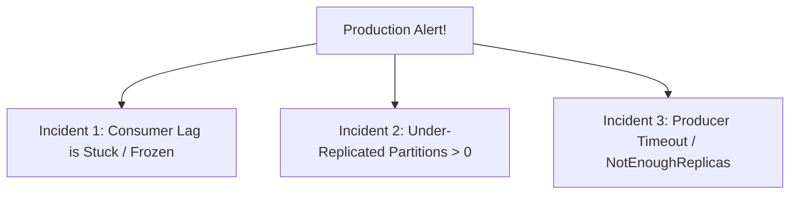
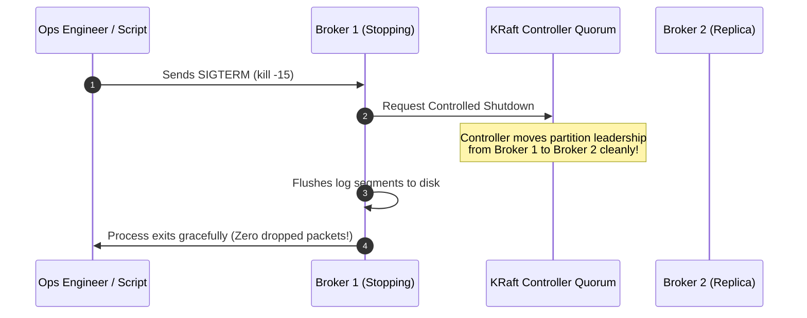

# 030: Operations, CLI Troubleshooting, and Benchmarking

> [!abstract] Module 12: Performance and Operations (Part 3)
> **Focus:** Essential Kafka CLI tools, diagnosing consumer lag, resetting offsets, step-by-step production incident response, performance benchmarking with built-in scripts, and zero-downtime graceful maintenance.
> **Prerequisites:** Operations & CLI foundations (`010`), Consumer lag (`029`), and KRaft consensus (`008`).

---

## 1. Essential CLI Diagnostic Commands

When an issue occurs in production, Kafka CLI scripts in the `/bin` directory are your primary diagnostic tools.

### 1. Inspecting Consumer Group Lag
To see exactly how many messages your consumers are lagging behind:

```bash
kafka-consumer-groups.sh --bootstrap-server localhost:9092 \
  --describe --group payment-service-group
```

#### Understanding the Output:
```text
GROUP                 TOPIC    PARTITION  CURRENT-OFFSET  LOG-END-OFFSET  LAG   CONSUMER-ID      HOST           CLIENT-ID
payment-service-group orders   0          10450           10455           5     consumer-1-abc   /192.168.1.10  client-1
payment-service-group orders   1          8200            9200            1000  consumer-1-abc   /192.168.1.10  client-1
payment-service-group orders   2          5100            5100            0     consumer-2-xyz   /192.168.1.11  client-2
```

- **`LAG`:** The number of unprocessed messages. Partition 1 has a lag of **1,000**, meaning that consumer thread is falling behind!
- **`CONSUMER-ID`:** Shows which consumer thread owns which partition.
- **`HOST`:** The IP address of the container/server running that consumer instance.

---

### 2. Resetting Consumer Offsets (Disaster Recovery & Replay)
If a bug corrupted data and you need to **replay the last 2 days of messages**, or if you need to **skip a bad message**:

> [!WARNING]
> You **MUST stop all consumer pods** in the group before executing an offset reset! Otherwise, the command will fail with an active member error.

#### Step 1: Preview with `--dry-run`
```bash
kafka-consumer-groups.sh --bootstrap-server localhost:9092 \
  --group payment-service-group \
  --reset-offsets --to-earliest \
  --topic orders \
  --dry-run
```

#### Step 2: Apply the Change with `--execute`
```bash
kafka-consumer-groups.sh --bootstrap-server localhost:9092 \
  --group payment-service-group \
  --reset-offsets --to-earliest \
  --topic orders \
  --execute
```

#### Offset Reset Options:
* `--to-earliest`: Rewinds to the oldest retained message on disk.
* `--to-latest`: Skips all pending lag and moves to the end of the log.
* `--to-offset <N>`: Sets the exact numeric offset.
* `--to-datetime YYYY-MM-DDTHH:mm:ss.sss`: Rewinds to a specific point in time (e.g., `2026-11-20T14:00:00.000`).
* `--shift-by -100`: Rewinds exactly 100 messages backward.

---

### 3. Finding Under-Replicated Partitions (URP)
To instantly list any partitions where replicas are unhealthy or offline:

```bash
kafka-topics.sh --bootstrap-server localhost:9092 \
  --describe --under-replicated-partitions
```

If this returns nothing, your cluster replication is 100% healthy.

---

## 2. Troubleshooting Real-World Production Incidents

Here is how senior engineers diagnose and solve the 3 most common Kafka outages:



---

### Incident 1: Consumer Group is Completely Stuck (Not Progressing)
* **Symptom:** Lag is climbing rapidly, but `CURRENT-OFFSET` never changes.
* **Root Cause A: Poison Pill Crash Loop:** A malformed message was published, and the consumer is crashing and restarting on the same offset.
  * **Fix:** Look at consumer application logs for `SerializationException`. Implement `ErrorHandlingDeserializer` or reset offsets by `+1` to skip the bad record.
* **Root Cause B: Rebalance Storm (Deadlock):** Message processing takes longer than `max.poll.interval.ms` (5 minutes). The consumer gets kicked out repeatedly.
  * **Fix:** Lower `max.poll.records` (e.g., from 500 down to 50) in `application.yml` and restart the pods.

---

### Incident 2: Under-Replicated Partitions (URP > 0)
* **Symptom:** PagerDuty alert: `UnderReplicatedPartitions > 0`.
* **Root Cause A: Broker Disk Full:** A broker's disk hit 100%, causing it to freeze and drop out of the In-Sync Replicas (ISR) list.
  * **Fix:** Run `df -h` on the broker. Increase disk size or lower retention (`retention.ms`).
* **Root Cause B: Large Garbage Collection (GC) Pause:** A broker with an oversized JVM heap (e.g., 32 GB) froze for 40 seconds during a full GC pause. Other brokers thought it died.
  * **Fix:** Reduce broker heap size to 6 GB–8 GB with G1GC.

---

### Incident 3: Producer Getting `NotEnoughReplicasException`
* **Symptom:** Producer logs show `org.apache.kafka.common.errors.NotEnoughReplicasException`.
* **The Cause:** You configured `acks=all` and `min.insync.replicas=2`. Two of your 3 brokers went offline, leaving only 1 live broker in the ISR. The remaining broker refuses writes to protect durability.
* **Fix:** Bring the failed replica brokers back online. **Never** lower `min.insync.replicas=1` in production, as that risks data loss upon leader failover!

---

## 3. Benchmarking with Built-in Kafka Performance Tools

Kafka bundles enterprise-grade benchmarking CLI tools in its `/bin` directory. You should run these to test your network and disk throughput before launching in production.

### 1. Producer Performance Test (`kafka-producer-perf-test.sh`)
Generates 1,000,000 synthetic records of 1 KB each at maximum speed:

```bash
kafka-producer-perf-test.sh \
  --topic perf-test \
  --num-records 1000000 \
  --record-size 1024 \
  --throughput -1 \
  --producer-props \
    bootstrap.servers=localhost:9092 \
    acks=all \
    batch.size=65536 \
    linger.ms=10 \
    compression.type=lz4
```

#### Sample Output:
```text
1000000 records sent, 142857.1 records/sec (139.51 MB/sec), 
4.21 ms avg latency, 18.00 ms 50th, 42.00 ms 95th, 84.00 ms 99th, 120.00 ms 99.9th.
```
* Shows sustained write speed (**139.5 MB/sec**) and latency percentiles (99% of requests finished within 84 ms).

---

### 2. Consumer Performance Test (`kafka-consumer-perf-test.sh`)
Reads those 1,000,000 messages from the topic to test read throughput:

```bash
kafka-consumer-perf-test.sh \
  --bootstrap-server localhost:9092 \
  --topic perf-test \
  --messages 1000000 \
  --threads 1
```

#### Sample Output:
```text
start.time, end.time, data.consumed.in.MB, MB.sec, data.consumed.in.nMsg, nMsg.sec
2026-11-24 10:00:00, 2026-11-24 10:00:05, 976.56, 195.31, 1000000, 200000
```
* Shows sustained consumer read throughput (**195.3 MB/sec** and 200,000 records/sec).

---

## 4. Graceful Shutdown & Zero-Downtime Maintenance

When restarting brokers for OS updates or Kafka version upgrades:

### Controlled Shutdown
Ensure `controlled.shutdown.enable=true` is set in `server.properties` (default is `true`).



1. When you issue a `SIGTERM` (`systemctl stop kafka`), the broker requests a **Controlled Shutdown** from the KRaft controller.
2. The controller gracefully moves partition leadership to healthy replicas **before** the broker goes offline.
3. Client producers and consumers experience zero errors and failover seamlessly.

---

## 5. Operations Troubleshooting Cheat Sheet

| Incident | First Diagnostic Command | Probable Cause | Action |
| :--- | :--- | :--- | :--- |
| **Consumer Lag Spiking** | `kafka-consumer-groups.sh --describe` | Slow downstream database or consumer crash. | Check consumer pod logs, scale consumer pods, or lower `max.poll.records`. |
| **Under-Replicated Partitions** | `kafka-topics.sh --describe --under-replicated-partitions` | Broker disk full, network glitch, or GC pause. | Check `df -h`, inspect broker logs, or expand EBS volumes. |
| **Offset Replay Required** | `kafka-consumer-groups.sh --reset-offsets` | Bug corrupted state; need to re-process history. | Stop consumer pods, reset offsets with `--execute`, and restart pods. |
| **Write Refused (NotEnoughReplicas)**| `kafka-topics.sh --describe` | ISR dropped below `min.insync.replicas`. | Restore failed replica brokers immediately. |
