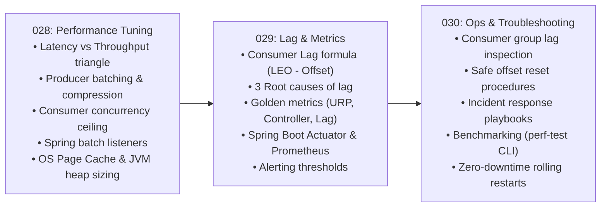

# Module 12: Performance and Operations (Map of Content)

> [!abstract] Module Overview
> Running Kafka in production requires mastering throughput optimization, liveness telemetry, and cluster operations.
> This module explores how to balance latency vs. throughput using producer batching and compression, how to maximize consumer concurrency, how to monitor **Consumer Lag** and golden broker metrics using Prometheus and Grafana, how to troubleshoot real-world production incidents with Kafka CLI tools, and how to benchmark throughput.

---

## Module Index & Reading Order



### [028: Performance Tuning and Optimization](file:///c:/Users/siddhesh.pawar/Desktop/Workspace/Obsidian-Vault/Inbox/Kafka_Obsidian_Organized/12%20-%20Performance%20and%20Operations/028-Performance_Tuning_and_Optimization.md)
* **The Engineering Trade-Off:** Low-latency real-time delivery vs. high-throughput batching.
* **Producer Levers:** Tuning `batch.size` (64 KB), `linger.ms` (10 ms), `compression.type` (`lz4`), and expanding `buffer.memory` to 64 MB.
* **Consumer Levers:** The partition count concurrency ceiling, Spring Boot `concurrency` thread pools, and Spring bulk **Batch Listeners** (`List<ConsumerRecord>`).
* **Broker & OS Tuning:** Why a small 6 GB–8 GB JVM heap is optimal, leaving 85% of RAM free for the Linux OS Page Cache.

### [029: Consumer Lag and Metrics Monitoring](file:///c:/Users/siddhesh.pawar/Desktop/Workspace/Obsidian-Vault/Inbox/Kafka_Obsidian_Organized/12%20-%20Performance%20and%20Operations/029-Consumer_Lag_and_Metrics_Monitoring.md)
* **What is Consumer Lag?** The mathematical gap between Log End Offset (LEO) and Current Consumer Offset.
* **The 3 Root Causes:** Traffic bursts, slow downstream database/API bottlenecks, and rebalance storm deadlocks.
* **The Golden Signals:** Critical broker metrics (`UnderReplicatedPartitions` must be 0, `ActiveControllerCount` must be 1) and client metrics (`records-lag-max`).
* **Prometheus & Grafana:** Setting up Spring Boot Actuator and Micrometer to export metrics, with sample PromQL queries and alert rules.

### [030: Operations, CLI Troubleshooting, and Benchmarking](file:///c:/Users/siddhesh.pawar/Desktop/Workspace/Obsidian-Vault/Inbox/Kafka_Obsidian_Organized/12%20-%20Performance%20and%20Operations/030-Operations_CLI_Troubleshooting_and_Benchmarking.md)
* **Essential CLI Tools:** Using `kafka-consumer-groups.sh` to inspect lag and perform `--reset-offsets` (dry-run & execute).
* **Production Incident Playbooks:** Step-by-step diagnostics for frozen consumer lag, Under-Replicated Partitions, and `NotEnoughReplicasException`.
* **Benchmarking:** Measuring hardware throughput limits with `kafka-producer-perf-test.sh` and `kafka-consumer-perf-test.sh`.
* **Zero-Downtime Maintenance:** Enabling `controlled.shutdown.enable=true` for graceful partition leader migration during rolling upgrades.

---

## Master Performance & Operations Reference Table

| Metric / Parameter | Component | Recommended Setting | Production Target |
| :--- | :--- | :--- | :--- |
| **`batch.size`** | Producer | `65536` (64 KB) | Maximizes network packet payload efficiency. |
| **`linger.ms`** | Producer | `10` ms | Allows records to bundle together before dispatch. |
| **`compression.type`** | Producer | `lz4` | Reduces network/disk bandwidth by 65% with ultra-low CPU overhead. |
| **`buffer.memory`** | Producer | `67108864` (64 MB) | Client RAM buffer absorbing traffic spikes. |
| **`concurrency`** | Consumer | Equal to partition count | Maximizes parallel processing threads inside a single pod. |
| **`UnderReplicatedPartitions`** | Broker Metric | Alert if `> 0` | **Must be 0.** Indicates replica synchronization failure. |
| **`ActiveControllerCount`** | Broker Metric | Alert if `!= 1` | **Must be 1.** Indicates KRaft quorum health. |
| **`records-lag-max`** | Consumer Metric| Alert if climbing for 5m | Early warning of downstream consumer bottlenecks. |
| **`controlled.shutdown.enable`**| Broker Config | `true` | Moves partition leadership gracefully before broker shuts down. |

---

## Production Spring Boot Monitoring Template (`application.yml`)

```yaml
# Spring Boot Actuator & Prometheus Setup
management:
  endpoints:
    web:
      exposure:
        include: health, info, metrics, prometheus
  endpoint:
    health:
      show-details: always
  metrics:
    tags:
      application: ${spring.application.name}

spring:
  kafka:
    bootstrap-servers:
      - kafka-1.prod.internal:9092
      - kafka-2.prod.internal:9092
      - kafka-3.prod.internal:9092
    producer:
      acks: all
      properties:
        batch.size: 65536
        linger.ms: 10
        compression.type: lz4
        buffer.memory: 67108864
    consumer:
      properties:
        max.poll.records: 500
    listener:
      concurrency: 3
```

---

## Module 12 Syllabus Checklist

- [x] Producer throughput and latency trade-offs
- [x] Batching and compression tuning (`batch.size`, `linger.ms`, `lz4`)
- [x] Consumer concurrency and throughput (partition ceiling rule)
- [x] Consumer lag: what it means and how to monitor it (LEO - Current Offset)
- [x] 3 root causes of consumer lag (spikes, DB locks, rebalance storms)
- [x] Broker/topic/partition golden metrics (`UnderReplicatedPartitions`, `ActiveControllerCount`)
- [x] Spring Boot Actuator, Micrometer, and Prometheus integration
- [x] Throughput benchmarking with `kafka-producer-perf-test.sh` and `kafka-consumer-perf-test.sh`
- [x] CLI-based troubleshooting (`kafka-consumer-groups.sh`, `--reset-offsets`)
- [x] Operational health checks, graceful shutdown, and zero-downtime maintenance
