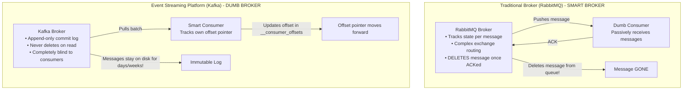
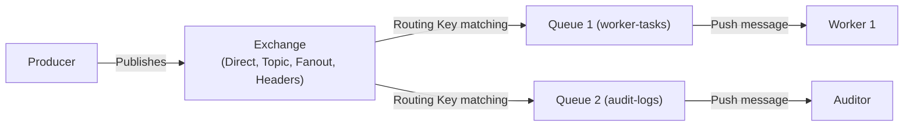
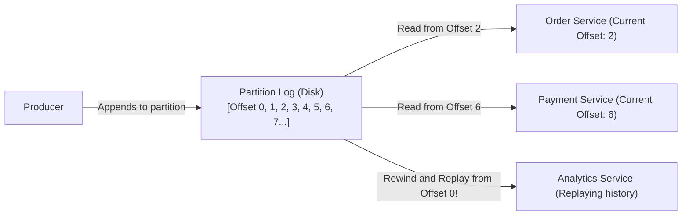
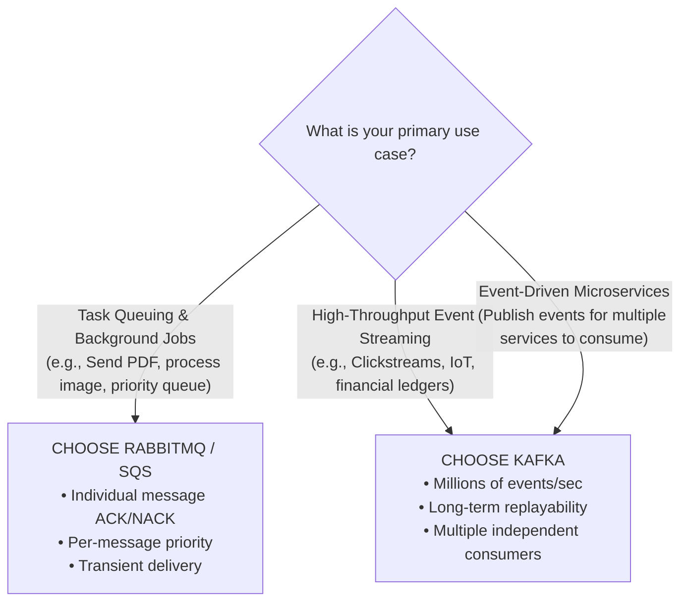

# 031: Kafka vs. Traditional Message Brokers

> [!abstract] Module 13: Kafka Ecosystem (Part 1)
> **Focus:** Architectural comparison between Kafka and traditional message brokers (RabbitMQ, ActiveMQ, Amazon SQS), Queue vs. Log architectures, "Smart Broker" vs. "Dumb Broker", and the practical decision framework for choosing the right tool.
> **Prerequisites:** Foundations (`001`–`003`) and Consumer Internals (`006`, `016`).

---

## 1. The Core Architectural Difference

A common interview and system design question is: *"Why use Kafka when tools like RabbitMQ already exist?"*

The answer lies in their fundamentally different design philosophies:

### 1. Traditional Message Queue (RabbitMQ / ActiveMQ / SQS)
* **The "Smart Broker / Dumb Consumer" Model:**
  * The broker does all the heavy thinking: it tracks who received which message, waits for acknowledgments, and **deletes the message as soon as it is processed**.
  * The queue only holds unconsumed messages. Once consumed, the data is gone forever.

### 2. Event Streaming Platform (Apache Kafka)
* **The "Dumb Broker / Smart Consumer" Model:**
  * The broker is just a high-speed sequential log. It does not track what individual consumers are doing.
  * Messages are **never deleted when read**. They remain on disk for days, weeks, or years.
  * Consumers are responsible for tracking their own position (**offsets**). Consumers can stop, restart, or rewind to replay historical data at any time.

---

## 2. Deep Dive: How RabbitMQ Works

RabbitMQ is designed around the **AMQP (Advanced Message Queuing Protocol)** model:

### RabbitMQ Strengths
1. **Flexible Routing:** Exchanges can route messages based on wildcards (e.g., `orders.*.urgent`), regex, or header values.
2. **Per-Message Priority:** You can assign priorities (e.g., VIP customer orders jump to the front of the queue).
3. **Per-Message Dead Lettering:** Individual rejected messages can be routed to a dead letter queue instantly.
4. **Transient Task Queues:** Perfect for background workers (e.g., "resize this photo", "send this verification email").

### RabbitMQ Limitations
1. **Destructive Reads:** You cannot replay messages from 3 days ago. Once processed and acknowledged, the message is erased from the broker.
2. **Throughput Ceiling:** Because RabbitMQ tracks state per message in memory and disk indexes, throughput tops out at tens of thousands of messages per second.
3. **Backpressure Issues:** If queues grow to millions of messages, RabbitMQ performance degrades significantly as it pages data to disk.

---

## 3. Deep Dive: How Kafka Works

Kafka is designed as a **Distributed Append-Only Commit Log**:

### Kafka Strengths
1. **Extreme Throughput:** Can easily process **millions of events per second** because sequential disk writes and Zero-Copy network transfers bypass CPU overhead.
2. **Replayability:** You can rewind any consumer group back to yesterday or last week to re-process historical events (critical for event sourcing and recovering from bugs).
3. **Decoupled Consumers:** 50 different microservices can read the exact same topic independently at their own pace without impacting each other or adding broker memory overhead.
4. **Permanent Buffer:** Storing 500 GB of messages does not slow Kafka down at all.

### Kafka Limitations
1. **No Complex Routing Inside Broker:** Kafka does not filter messages by headers or complex exchange rules; filtering happens in consumer code or Kafka Streams.
2. **No Message Priority:** Messages are strictly FIFO (First-In, First-Out) per partition. You cannot make message #500 jump ahead of message #2.
3. **Strict Partition Concurrency:** You cannot scale consumers beyond the number of partitions in a topic.

---

## 4. Feature-by-Feature Comparison Table

| Feature | Apache Kafka | Traditional MQ (RabbitMQ / ActiveMQ) |
| :--- | :--- | :--- |
| **Primary Model** | Distributed Append-Only Log | Message Queue (FIFO mailbox) |
| **Communication Style** | **Pull Model** (Consumer polls at own pace) | **Push Model** (Broker pushes to consumer) |
| **Data Retention** | **Time/Size based** (Days, months, or forever) | **Transient** (Deleted immediately upon ACK) |
| **Can Replay Messages?** | **YES.** Reset offsets to any point in history. | **NO.** Message is destroyed after read. |
| **Max Throughput** | **Millions of messages/sec** | Tens of thousands of messages/sec |
| **Message Ordering** | Strictly ordered **per partition** | Ordered per queue (can be disrupted by priorities/retries) |
| **Message Routing** | Topic and Partition Key routing | Complex AMQP Exchanges (Topic, Direct, Fanout, Headers) |
| **Consumer Scaling** | Limited to the number of partitions in topic | Any number of workers can compete for a single queue |
| **Operational Weight** | Higher (Needs KRaft quorum or ZooKeeper) | Lower (Simple single-node or clustered broker) |

---

## 5. The Decision Framework: When to Choose What?

### Choose RabbitMQ / ActiveMQ / SQS if:
1. **You need a Task Queue:** You have discrete, independent background jobs (e.g., video transcoding, generating invoices).
2. **You need Message Priority:** High-priority orders must skip ahead of regular orders.
3. **You need Complex Broker Routing:** You want the broker to route messages based on multiple dynamic routing keys without writing custom consumer logic.
4. **Simple Infrastructure:** You want a lightweight message broker that runs on small single instances without clustering complexity.

---

### Choose Apache Kafka if:
1. **You need Event Streaming / Event Sourcing:** You are building an event-driven architecture where business events (e.g., `OrderCreated`) represent a timeline of business state.
2. **You need Replayability:** If a consumer has a bug, you need the superpower to fix the bug, rewind the consumer offset, and re-process the last 3 days of events.
3. **You have Massive Scale:** You produce hundreds of thousands or millions of events per second (telemetry, financial transactions, logs).
4. **Multiple Systems Need the Same Data:** You publish data once, and 10 different downstream teams (analytics, fraud detection, payments, audit) read it independently without affecting performance.
