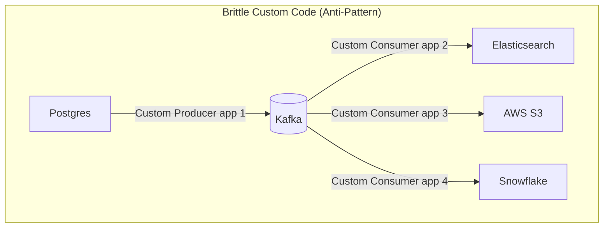
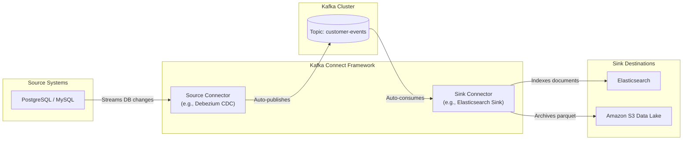
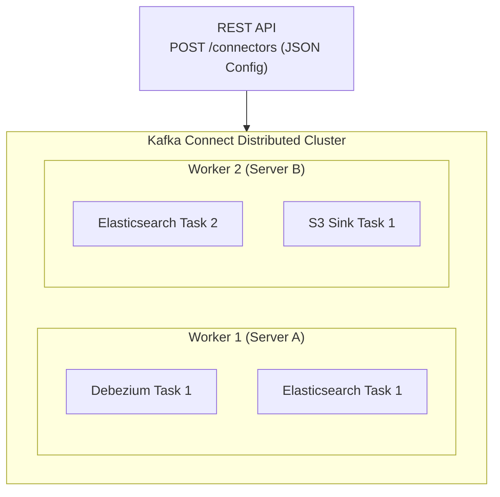
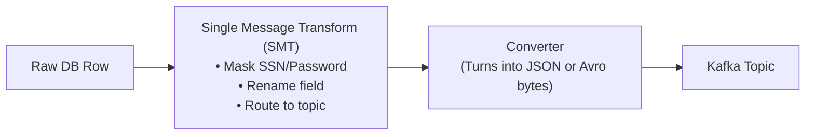

# 032: Kafka Connect and Data Integration

> [!abstract] Module 13: Kafka Ecosystem (Part 2)
> **Focus:** Eliminating custom integration code, Kafka Connect framework, Source Connectors vs. Sink Connectors, Standalone vs. Distributed runtime modes, Converters, Single Message Transforms (SMTs), and Debezium Change Data Capture (CDC).
> **Prerequisites:** Producer fundamentals (`013`), Consumer fundamentals (`016`), and Serialization (`019`, `021`).

---

## 1. The Problem with Custom Integration Code

In any modern company, data lives in dozens of different datastores: PostgreSQL, MySQL, MongoDB, Elasticsearch, Amazon S3, Snowflake, and Redis.



### Why Writing Custom Apps for Every System is a Disaster:
1. **Reinventing the Wheel:** Every custom app must write its own connection pooling, error handling, retries, offset commits, and batching.
2. **Maintenance Nightmare:** If 10 different teams write 10 custom sync scripts, you have 10 separate codebases to monitor, upgrade, and debug when connections drop.
3. **High Operational Failure Rate:** Handling schema changes, failover, and backpressure in custom scripts is difficult and error-prone.

---

## 2. What is Kafka Connect?

**Kafka Connect** is a free, open-source distributed integration framework bundled directly with Apache Kafka.

It allows you to stream data between Kafka and external systems **without writing any code**. You simply provide a declarative JSON configuration file to a REST API.



---

## 3. Source Connectors vs. Sink Connectors

Kafka Connect classifies all data flow into two categories:

### 1. Source Connectors (Pull IN to Kafka)
* **Direction:** External System $\longrightarrow$ Kafka Topic.
* **How it works:** Continuously monitors an external datastore for changes and produces messages into Kafka topics.
* **Popular Examples:**
  * **Debezium CDC (Change Data Capture):** Streams row-level inserts, updates, and deletes from PostgreSQL/MySQL into Kafka in real time.
  * **Kafka Connect JDBC Source:** Polls relational databases via SQL queries.
  * **S3 Source Connector:** Reads incoming log files from AWS S3 buckets into Kafka.

---

### 2. Sink Connectors (Push OUT from Kafka)
* **Direction:** Kafka Topic $\longrightarrow$ External System.
* **How it works:** Subscribes to one or more Kafka topics, batches incoming messages, and writes them into downstream storage.
* **Popular Examples:**
  * **Elasticsearch / OpenSearch Sink:** Automatically indexes Kafka events for full-text search.
  * **Snowflake / BigQuery Sink:** Streams data directly into analytical cloud data warehouses.
  * **Amazon S3 Sink:** Flushes messages as Parquet or JSON files into S3 buckets for long-term cold storage.
  * **MongoDB / JDBC Sink:** Writes events into operational databases.

---

## 4. Kafka Connect Architecture: Workers and Tasks

Kafka Connect runs as its own cluster of JVM processes called **Workers**.



### Core Components:
1. **Connector:** Defines *what* system to connect to, credentials, and how many tasks to create. (Does not perform data processing itself).
2. **Task:** The actual worker thread that copies data. Connectors break work down into parallel Tasks (e.g., 1 Task per database table or 1 Task per Kafka partition).
3. **Worker:** The physical server/container running the JVM process.

---

### Standalone Mode vs. Distributed Mode

| Feature | Standalone Mode | Distributed Mode (Production Standard) |
| :--- | :--- | :--- |
| **Processes** | Single JVM process on one machine | Clustered across multiple servers |
| **Fault Tolerance** | None. If the process dies, all data streaming stops. | **High Availability.** If Worker 1 crashes, its tasks automatically move to Worker 2! |
| **Scalability** | Limited to single machine CPU/RAM | Scale out horizontally by adding more worker containers. |
| **Configuration** | File-based properties | **Dynamic REST API** (`POST /connectors`). |
| **State Storage** | Local flat files | Dedicated internal Kafka topics (`connect-configs`, `connect-offsets`, `connect-status`). |

---

## 5. Converters and Single Message Transforms (SMTs)

Every message passing through Kafka Connect moves through two optional components:



### 1. Converters (Data Format Translators)
Kafka only stores bytes. A **Converter** tells Kafka Connect how to serialize data into Kafka and deserialize it back out.
* `org.apache.kafka.connect.json.JsonConverter`
* `io.confluent.connect.avro.AvroConverter` (Recommended for production schema governance).
* `org.apache.kafka.connect.storage.StringConverter`

---

### 2. Single Message Transforms (SMTs)
SMTs allow you to perform lightweight transformations on records **in-flight** without writing a separate stream processing application:
* **`MaskField`:** Masks sensitive fields (e.g., replaces credit card numbers or passwords with `***`).
* **`InsertField`:** Injects metadata (like timestamp or static cluster name) into each record.
* **`RegexRouter`:** Dynamically changes the destination topic name based on a regex pattern.

---

## 6. Real-World Example: Debezium PostgreSQL CDC Connector

Here is how simple it is to stream changes from a PostgreSQL database into Kafka. You submit this JSON payload to the Kafka Connect REST API:

```bash
curl -X POST http://kafka-connect:8083/connectors \
  -H "Content-Type: application/json" \
  -d '{
    "name": "postgres-order-source",
    "config": {
      "connector.class": "io.debezium.connector.postgresql.PostgresConnector",
      "tasks.max": "1",
      "plugin.name": "pgoutput",
      "database.hostname": "postgres.prod.internal",
      "database.port": "5432",
      "database.user": "postgres",
      "database.password": "secret123",
      "database.dbname": "shopdb",
      "database.server.name": "shop-db-server",
      "table.include.list": "public.orders",
      "key.converter": "org.apache.kafka.connect.json.JsonConverter",
      "value.converter": "org.apache.kafka.connect.json.JsonConverter",
      "key.converter.schemas.enable": "false",
      "value.converter.schemas.enable": "false"
    }
  }'
```

### What Happens Instantly:
1. Debezium connects to PostgreSQL's Write-Ahead Log (WAL).
2. The moment an application does `INSERT INTO orders VALUES (101, 'PENDING')`, Debezium publishes an event to Kafka topic: `shop-db-server.public.orders`.
3. If an `UPDATE` or `DELETE` occurs in PostgreSQL, Debezium streams the before-and-after values into Kafka automatically!

---

## 7. Key Architecture Summary

| Component | Role in the Ecosystem |
| :--- | :--- |
| **Kafka Connect** | Code-free integration runtime between Kafka and outside datastores. |
| **Source Connector** | Ingests data from databases/files/queues into Kafka topics. |
| **Sink Connector** | Exports data from Kafka topics into databases/search engines/data lakes. |
| **Distributed Mode** | Production cluster with self-healing task failover and REST management. |
| **SMTs** | Lightweight in-flight record modifications (field masking, renaming). |
| **Debezium** | The industry standard CDC source connector for MySQL, PostgreSQL, Oracle, and SQL Server. |
