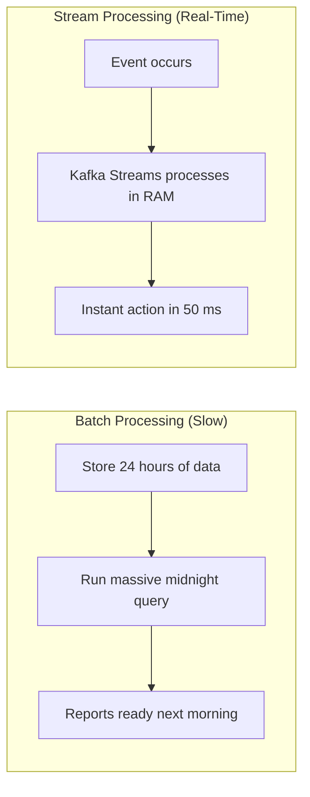
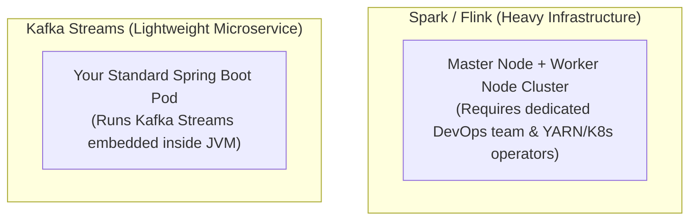
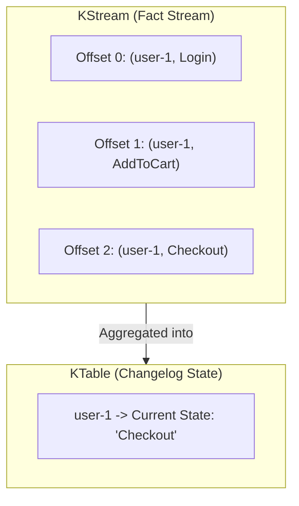
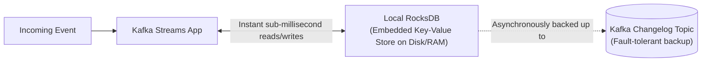
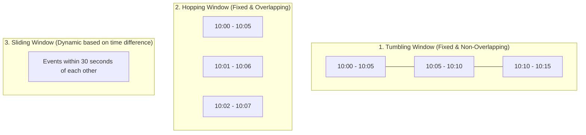

# 033: Kafka Streams and Real-Time Processing

> [!abstract] Module 13: Kafka Ecosystem (Part 3)
> **Focus:** Stream processing vs. Batch processing, the Kafka Streams client library, core abstractions (`KStream` vs. `KTable`), Stream-Table duality, local state stores (RocksDB), windowing operations, and real-time event aggregation.
> **Prerequisites:** Producer fundamentals (`013`), Consumer fundamentals (`016`), and Log Compaction (`027`).

---

## 1. What is Stream Processing?

Historically, companies processed data in **Batches**:
- Every night at 1:00 AM, a cron job woke up.
- It processed the last 24 hours of database rows to calculate fraud, generate reports, or aggregate sales.
- **The Problem:** Insights are 24 hours late! If a credit card was stolen at 9:00 AM, the fraud wasn't flagged until 1:00 AM the next day.

**Stream Processing** replaces batching with **continuous, real-time computation**:
- Events are processed **one by one, millisecond by millisecond, as they happen**.
- If a suspicious purchase occurs, fraud detection triggers in 50 milliseconds!



---

## 2. Why Choose Kafka Streams?

When developers think of stream processing, they often think of big data platforms like Apache Spark or Apache Flink. But Spark and Flink require deploying and managing massive, dedicated server clusters.

**Kafka Streams is fundamentally different:**
* It is **NOT a cluster or infrastructure**.
* It is a **lightweight Java client library** (a standard `.jar` dependency).
* It runs directly inside your standard **Spring Boot microservice**!



### Key Advantages:
1. **Zero Infrastructure Overhead:** No new clusters to manage; just deploy a standard Docker container or Kubernetes pod.
2. **Elastic Scaling:** Scales automatically using standard Kafka consumer group partitioning.
3. **Exactly-Once Semantics (EOS):** Native support for end-to-end exactly-once processing with transactional guarantees.

---

## 3. Core Abstractions: `KStream` vs. `KTable`

In Kafka Streams, all data is represented using two foundational building blocks:



### 1. `KStream` (The Event Stream)
* Represents a stream of **individual, immutable facts** that occurred in the world.
* Every incoming record is an **INSERT (Append)**.
* Examples: Credit card transactions, clickstream clicks, GPS coordinates, sensor readings.

---

### 2. `KTable` (The Materialized State Table)
* Represents the **current state of the world** at this exact moment.
* Incoming records for an existing key act as an **UPSERT (Update or Insert)**. A record with a `null` value acts as a **DELETE**.
* Examples: Current user account balance, latest user mailing address, active product inventory count.

---

### The Stream-Table Duality
Streams and Tables are two sides of the same coin:
* **Stream $\longrightarrow$ Table:** You can take a `KStream` of order transactions and continuously sum them into a `KTable` of total account balances.
* **Table $\longrightarrow$ Stream:** You can observe a `KTable` and stream out every state transition as a changelog `KStream`.

---

## 4. Stateful Processing & Embedded RocksDB

Stream operations fall into two categories:

### 1. Stateless Operations
The transformation only depends on the current single record (no memory of past records required).
* `filter()`, `map()`, `mapValues()`, `branch()`.
* Example: Filter out orders where `amount < 100`.

---

### 2. Stateful Operations
The transformation requires remembering past records (aggregations, counts, joins).
* `count()`, `reduce()`, `aggregate()`, `join()`.
* Example: *"Count the number of login attempts for user-42 in the last 5 minutes."*



### How Kafka Streams Manages State Safely:
1. **Embedded RocksDB:** Kafka Streams bundles an ultra-fast, local C++ key-value store called **RocksDB** directly on the local machine disk/RAM.
2. **Zero Network Latency for State:** Reading the current state takes microseconds because it queries local disk/RAM instead of an external database.
3. **Changelog Topic Backup:** Every state update made to RocksDB is automatically replicated to an internal Kafka **changelog topic**. If your container dies and restarts on a different Kubernetes node, it restores its local RocksDB store from the changelog topic automatically!

---

## 5. Windowing: Real-Time Time Analytics

In stream processing, asking *"What is the total sales amount?"* is meaningless because the stream never ends. You must ask: *"What is the total sales amount **over the last 5 minutes**?"*

Kafka Streams provides 4 types of **Windows**:



1. **Tumbling Window:** Fixed-duration, non-overlapping windows (e.g., 5-minute blocks). Good for summary dashboards.
2. **Hopping Window:** Fixed-duration, overlapping windows (e.g., a 5-minute window that recalculates every 1 minute). Good for moving averages.
3. **Sliding Window:** Bounded by the time difference between records (e.g., join two events if they occur within 30 seconds of each other).
4. **Session Window:** Groups events by periods of user activity separated by a configurable gap of inactivity (e.g., user website browsing session).

---

## 6. Code Example: Real-Time Order Aggregation

Here is a clean example of calculating total revenue per customer in real-time using the Kafka Streams DSL in Java:

```java
@Configuration
@EnableKafkaStreams
public class OrderStreamPipeline {

    @Bean
    public KStream<String, OrderEvent> kStream(StreamsBuilder builder) {
        // 1. Read input stream from 'orders' topic
        KStream<String, OrderEvent> orderStream = builder.stream(
                "orders", 
                Consumed.with(Serdes.String(), new JsonSerde<>(OrderEvent.class))
        );

        // 2. Filter, Group, and Aggregate in Real-Time
        orderStream
            .filter((key, order) -> order.getAmount() > 0)
            .groupBy((key, order) -> order.getCustomerId(), Grouped.with(Serdes.String(), new JsonSerde<>(OrderEvent.class)))
            // Tumbling 5-minute window
            .windowedBy(TimeWindows.ofSizeWithNoGrace(Duration.ofMinutes(5)))
            // Sum total order amounts
            .aggregate(
                () -> 0.0,
                (customerId, order, currentTotal) -> currentTotal + order.getAmount(),
                Materialized.with(Serdes.String(), Serdes.Double())
            )
            .toStream()
            // 3. Output aggregated totals into a new Kafka topic
            .map((windowedKey, total) -> new KeyValue<>(windowedKey.key(), total))
            .to("customer-5min-revenue", Produced.with(Serdes.String(), Serdes.Double()));

        return orderStream;
    }
}
```

---

## 7. Key Architecture Summary

| Concept | What It Does |
| :--- | :--- |
| **Kafka Streams** | Java client library for real-time stream computation inside your microservice. |
| **`KStream`** | Stream of individual fact records (Append-only). |
| **`KTable`** | Current state view of records keyed by ID (Upsert / Delete). |
| **RocksDB** | High-speed embedded local key-value store for stateful operations. |
| **Changelog Topic** | Internal Kafka topic backing up RocksDB state for fault-tolerant recovery. |
| **Tumbling Window** | Non-overlapping time windows for periodic metrics and aggregations. |
| **Stateless vs Stateful**| Stateless operates on single records (`map`, `filter`); stateful accumulates records (`aggregate`, `join`). |
