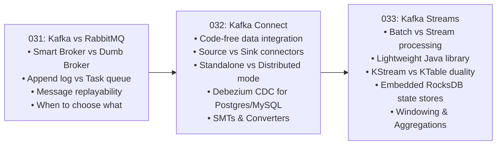

# Module 13: Kafka Ecosystem (Map of Content)

> [!abstract] Module Overview
> Apache Kafka is more than a message broker—it is a complete, distributed event streaming platform.
> This module explores the wider ecosystem: how Kafka compares fundamentally against traditional message queues like **RabbitMQ**, how **Kafka Connect** integrates external datastores without writing code, and how **Kafka Streams** enables real-time stream computation directly inside your Spring Boot microservices.

---

## Module Index & Reading Order



### [031: Kafka vs. Traditional Message Brokers](file:///c:/Users/siddhesh.pawar/Desktop/Workspace/Obsidian-Vault/Inbox/Kafka_Obsidian_Organized/13%20-%20Kafka%20Ecosystem/031-Kafka_vs_Traditional_Message_Brokers.md)
* **The Core Philosophy:** Smart Broker / Dumb Consumer (RabbitMQ) vs. Dumb Broker / Smart Consumer (Kafka).
* **Destructive vs. Non-Destructive Reads:** Why queues delete messages on ACK, while Kafka keeps an immutable append-only log on disk for replay.
* **Feature Comparison:** Detailed comparison across throughput, message routing, ordering, and scaling.
* **The Decision Matrix:** Clear criteria for when to select RabbitMQ/SQS vs. Apache Kafka.

### [032: Kafka Connect and Data Integration](file:///c:/Users/siddhesh.pawar/Desktop/Workspace/Obsidian-Vault/Inbox/Kafka_Obsidian_Organized/13%20-%20Kafka%20Ecosystem/032-Kafka_Connect_and_Data_Integration.md)
* **Eliminating Custom Glue Code:** Why writing custom producer/consumer sync apps for databases is an anti-pattern.
* **Source vs. Sink Connectors:** Ingesting from databases (Source) vs. exporting to Elasticsearch/S3/Snowflake (Sink).
* **Distributed Runtime:** Clustered, fault-tolerant worker nodes that auto-rebalance tasks upon node failure.
* **Single Message Transforms (SMTs):** Masking PII, dropping fields, and routing messages on-the-fly.
* **Debezium CDC:** Real-time Change Data Capture from PostgreSQL/MySQL transaction logs.

### [033: Kafka Streams and Real-Time Processing](file:///c:/Users/siddhesh.pawar/Desktop/Workspace/Obsidian-Vault/Inbox/Kafka_Obsidian_Organized/13%20-%20Kafka%20Ecosystem/033-Kafka_Streams_and_Real_Time_Processing.md)
* **Continuous Computation:** Replacing nightly 24-hour batch jobs with sub-50ms real-time event stream processing.
* **Zero Heavy Infrastructure:** Running stream processing as a lightweight Java library directly inside Spring Boot microservices (no Spark/Flink clusters).
* **Core Primitives:** `KStream` (immutable facts) vs. `KTable` (mutable changelog state) and the Stream-Table duality.
* **Stateful Processing:** Microsecond queries via embedded **RocksDB**, backed by Kafka internal changelog topics.
* **Windowing:** Real-time aggregations over Tumbling, Hopping, Sliding, and Session windows.

---

## The Kafka Ecosystem Tool Selection Guide

| Business Requirement | Best Tool in the Ecosystem | Why? |
| :--- | :--- | :--- |
| **Simple background task queue** (e.g., send emails, resize images with priority) | **RabbitMQ / Amazon SQS** | Dedicated task queuing with individual message ACKs and per-message priority. |
| **High-throughput event bus** (Millions of events, audit logs, financial ledger) | **Apache Kafka (Core)** | Append-only sequential log, multi-subscriber replayability, zero-copy performance. |
| **Syncing database tables into Kafka** (Postgres, MySQL, Oracle) | **Kafka Connect (Debezium CDC)** | No code required; reads database transaction logs in real-time with sub-millisecond latency. |
| **Exporting Kafka data to Data Lake / Search** (S3, Snowflake, Elasticsearch) | **Kafka Connect (Sink)** | Out-of-the-box fault tolerance, auto-rebalancing tasks, and schema conversion. |
| **Real-time analytics, filtering, or aggregations** (e.g., 5-min fraud count) | **Kafka Streams** | Embedded Java library running directly inside your microservice with local RocksDB state. |

---

## Production Spring Boot Kafka Streams Template (`application.yml`)

```yaml
spring:
  kafka:
    bootstrap-servers:
      - kafka-1.prod.internal:9092
      - kafka-2.prod.internal:9092
      - kafka-3.prod.internal:9092
    streams:
      application-id: order-analytics-app   # Forms the consumer group & state directory
      properties:
        default.key.serde: org.apache.kafka.common.serialization.Serdes$StringSerde
        default.value.serde: org.apache.kafka.common.serialization.Serdes$StringSerde
        # Enable Exactly-Once Processing in Kafka Streams
        processing.guarantee: exactly_once_v2
        commit.interval.ms: 100
        # Local RocksDB state store directory
        state.dir: /var/lib/kafka-streams/state
```

---

## Module 13 Syllabus Checklist

- [x] Kafka vs. RabbitMQ architectural comparison
- [x] When to choose Kafka vs. a traditional message broker
- [x] Kafka Connect framework architecture (Connectors, Tasks, Workers)
- [x] Source Connectors vs. Sink Connectors
- [x] Standalone mode vs. Distributed mode
- [x] Single Message Transforms (SMTs) and Converters
- [x] Debezium Change Data Capture (CDC) integration
- [x] Kafka Streams library architecture vs. Spark/Flink clusters
- [x] Core abstractions: `KStream` vs. `KTable` and Stream-Table duality
- [x] Stateful processing, local RocksDB, and changelog topics
- [x] Windowing types: Tumbling, Hopping, Sliding, and Session windows
- [x] Real-time event aggregation and fraud detection DSL code
