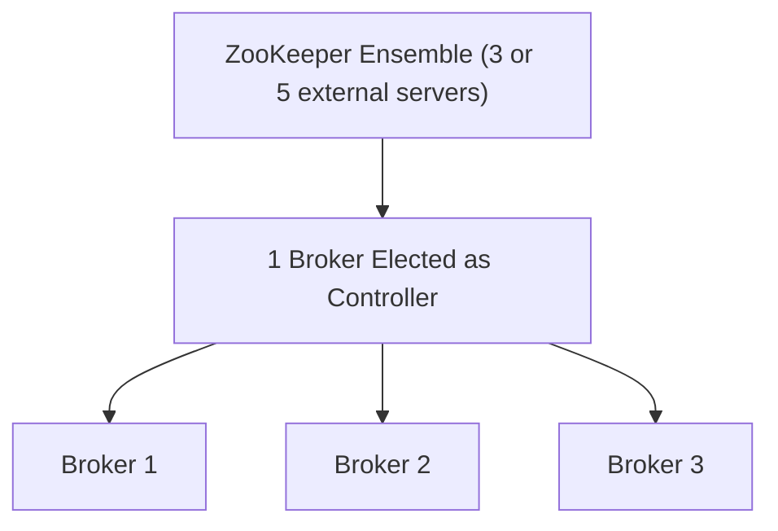
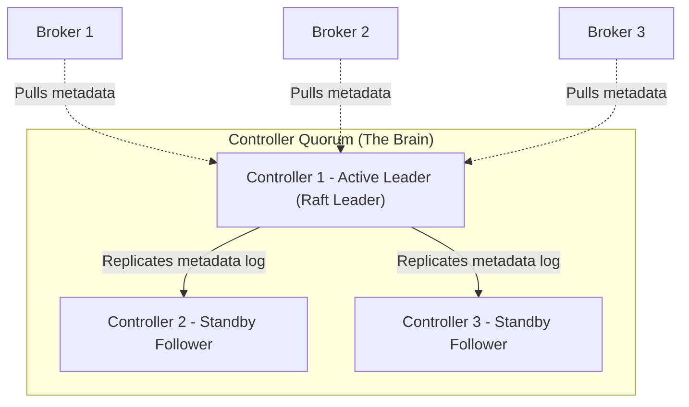
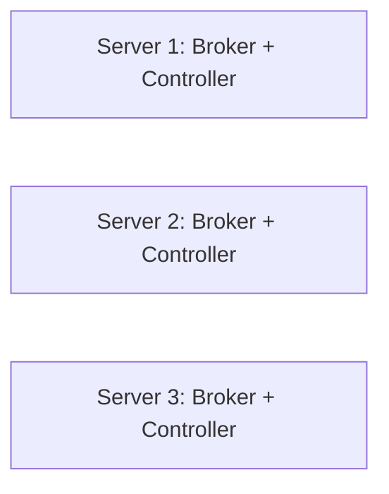

# 008. Kafka KRaft: Architecture, Consensus & Operations

> [!abstract] Summary
> **KRaft = Kafka + Raft.** Modern Kafka manages its own cluster metadata using the Raft consensus algorithm, completely eliminating the external ZooKeeper dependency.

---

## 🧭 Navigation
- **Previous Note:** [[007-Replication_and_Fault_Tolerance.md|← 007. Replication, High Availability & Fault Tolerance]]
- **Syllabus:** [[syllabus.md|Apache Kafka Structural Syllabus & Roadmap]]
- **Next Note:** [[009-End_to_End_Industrial_Example.md|009. End-to-End Industrial Example →]]

---

## 1. Basics: What Is Metadata?

A Kafka cluster must always maintain a source of truth for:
- Which topics exist and how many partitions they have.
- Which broker is currently the **Leader** of each partition.
- Which brokers are currently alive or offline.
- Topic configuration overrides, ACLs, and client quotas.

This information is called **Cluster Metadata**.

> [!example] Industrial Analogy
> A logistics company has 100 warehouses (Brokers). A central control room (Controller) keeps the master record of which warehouse handles which delivery route. If that master record is corrupted or desynchronized, deliveries get lost.

### Two Kinds of Data in Kafka:
| Data Type | Meaning | Stored By |
|---|---|---|
| **User Data** | Your business events, messages, and payloads | **Kafka Brokers** |
| **Metadata** | Internal cluster topology, partition leaders, configs | **Controllers (KRaft)** / *ZooKeeper (Old)* |

---

## 2. The Legacy Way: ZooKeeper

Historically, Kafka relied on a **separate external system: Apache ZooKeeper** to store metadata and elect the controller.



### Major Problems with ZooKeeper:
1. **Operational Double-Burden:** DevOps teams had to install, secure, monitor, tune, and upgrade two completely different distributed systems.
2. **Slow Controller Failover:** If the active controller died, the newly elected controller had to reload all metadata from ZooKeeper across the network before resuming operations.
3. **Partition Scalability Wall:** ZooKeeper struggled when clusters exceeded ~200,000 partitions due to watch triggers and memory footprint.
4. **Removed in Kafka 4.0:** ZooKeeper is deprecated and completely removed starting from Apache Kafka 4.0.

---

## 3. The Modern Way: KRaft (Kafka Raft)

- **Kafka Raft (KRaft):** Kafka manages its own metadata internally using the Raft consensus algorithm.
- Production-ready since **Kafka 3.3**.
- Standard and mandatory in **Kafka 4.0+**.

> [!tip] What Is Distributed Consensus?
> A mathematical algorithm that enables a cluster of distributed servers to **agree on a single truth**, even when network partitions occur or individual servers crash.

---

## 4. KRaft Architecture & Components



### Core Roles:
| Component | Architectural Role | Simple Meaning |
|---|---|---|
| **Controller Node** | Dedicated node running the KRaft controller quorum | The management board |
| **Active Controller** | The single Raft leader currently accepting metadata changes | Manager on duty |
| **Standby Controllers** | Raft followers keeping a synchronized copy of the metadata log | Backup managers |
| **Broker Node** | Handles user data, topics, and client requests | The warehouse workers |
| **`__cluster_metadata`** | Internal single-partition log containing all cluster state changes | The official company record book |

---

## 5. How KRaft Works Step-by-Step

### Step 1: Every Change Becomes an Event Record
When an administrator creates a topic or a broker registers, the Active Controller appends an event to the internal `__cluster_metadata` log:
```text
Offset 0: BrokerRegistered(broker=1)
Offset 1: TopicCreated(name=orders, partitions=3)
Offset 2: PartitionLeaderChanged(orders-0 -> broker=2)
```

### Step 2: Raft Replicates the Metadata Log
The Active Controller sends each record to standby controllers. A metadata record is **committed** only after a **strict majority** of controllers have stored it.

### Step 3: Brokers Pull Metadata
Brokers poll the Active Controller (just like a consumer pulls from a topic) and maintain an in-memory replica of cluster metadata. Metadata updates propagate in sub-milliseconds!

### Step 4: Instantaneous Leader Failover
1. Standby controllers monitor the active leader's heartbeat.
2. If the active leader fails, standby controllers detect the timeout and start a Raft election.
3. The candidate that gathers a **majority of votes** becomes the new Raft leader with an incremented **epoch** number.
4. **Because all controllers already have the synchronized metadata log in memory, failover takes milliseconds instead of minutes!**

### Step 5: Metadata Snapshots
Controllers periodically create point-in-time snapshots of metadata. This keeps the log size compact and enables newly restarted nodes to catch up instantly.

---

## 6. Quorum Math & Fault Tolerance

Raft consensus requires a **strict majority (Quorum)** to function:
$$\text{Majority Required} = \lfloor N / 2 \rfloor + 1$$

| Controller Nodes ($N$) | Majority Needed | Maximum Tolerated Failures |
|---|---|---|
| 1 | 1 | 0 (Dev/Learning only) |
| 3 | 2 | **1 Failure** |
| 5 | 3 | **2 Failures** |

> [!important] The Odd-Number Rule
> Never configure an even number of controllers!
> - 4 controllers require a majority of 3 ($\lfloor 4/2 \rfloor + 1 = 3$), so they can still only tolerate **1 failure**—the 4th controller adds zero extra resilience. Always use **3 or 5 controllers**.

---

## 7. Node Roles & Deployment Modes

In KRaft, a node's role is governed by the configuration property `process.roles`:

| Role Value | Behavior | Ideal Deployment Mode |
|---|---|---|
| `broker` | Only stores and serves topic data | Dedicated Production Mode |
| `controller` | Only participates in the Raft metadata quorum | Dedicated Production Mode |
| `broker,controller` | Single process executes both duties simultaneously | Combined Dev/Test Mode |

### 1. Combined Mode (Shared Machine)
One JVM process runs both the Broker engine and the Controller engine.


- **Ideal for:** Development, local testing, low-traffic environments.
- **Production Risk:** Heavy traffic spikes or disk I/O on a broker can starve the controller of CPU/disk resources, destabilizing the entire cluster.

### 2. Dedicated Mode (Isolated Roles - Recommended for Production)
Controller nodes and Broker nodes run on **separate physical servers / VMs**.

```mermaid
graph TD
    subgraph Controller Quorum Servers (Small, Fast CPU/Disk)
        C1[Server A: Controller 1]
        C2[Server B: Controller 2]
        C3[Server C: Controller 3]
    end
    subgraph Broker Servers (Large, Heavy RAM/Storage)
        B1[Server 1: Broker 1]
        B2[Server 2: Broker 2]
        B3[Server 3: Broker 3]
        B4[Server 4: Broker 4]
    end
```
- **Benefit:** Complete isolation. High-throughput message traffic on brokers never impacts metadata stability.

---

## 8. Server Sizing & Hardware Decisions

| Scenario | Mode | Controller Servers | Broker Servers | Total Physical Nodes | Fault Tolerance |
|---|---|---|---|---|---|
| **Laptop / Learning** | Combined | 0 | 1 | **1** | None |
| **Dev / Staging** | Combined | 0 (shared) | 3 | **3** | Can tolerate 1 node failure |
| **Small Production** | Combined | 0 (shared) | 3 | **3** | Can tolerate 1 node failure |
| **Enterprise Production** | Dedicated | 3 (lightweight) | 3 or more (heavyweight) | **6+** | Dedicated resilience |

> [!tip] Dedicated Controllers Are Lightweight
> Controllers do not store user message data! They only store metadata.
> - **Controller Nodes:** 2–4 vCPUs, 4–8 GB RAM, fast SSD (for low-latency Raft log writes).
> - **Broker Nodes:** 16–32 vCPUs, 64–128 GB RAM, large NVMe/HDD storage disks.

---

## 9. Network Ports & Communication

All KRaft cluster components communicate over TCP sockets:

| Communication Channel | Source $\rightarrow$ Destination | Typical Port | Purpose |
|---|---|---|---|
| **Inter-Controller** | Controller $\leftrightarrow$ Controller | `9093` | Raft quorum votes & metadata log replication |
| **Broker-to-Controller** | Broker $\rightarrow$ Controller | `9093` | Broker registration & metadata pulling |
| **Client-to-Broker** | Producer / Consumer $\rightarrow$ Broker | `9092` | Reading and writing topic user data |

> [!important] Security Isolation
> Client applications (Producers and Consumers) **never talk to controllers directly**. Only brokers communicate with controllers.

---

## 10. Configuration & Startup Commands

### Controller Configuration (`server.properties`):
```properties
process.roles=controller
node.id=1
controller.quorum.voters=1@ctrl1:9093,2@ctrl2:9093,3@ctrl3:9093
controller.listener.names=CONTROLLER
listeners=CONTROLLER://:9093
log.dirs=/var/lib/kafka/metadata
```

### Initializing a KRaft Cluster (CLI):
```bash
# 1. Generate a globally unique cluster ID
bin/kafka-storage.sh random-uuid
# Output: 4L622SOXRZ-haSD5nJ Tribe

# 2. Format the storage directory with the Cluster ID
bin/kafka-storage.sh format \
  -t 4L622SOXRZ-haSD5nJ \
  -c config/kraft/server.properties

# 3. Start the Kafka server
bin/kafka-server-start.sh config/kraft/server.properties
```

---

## 11. ZooKeeper vs KRaft Comparison

| Architectural Dimension | ZooKeeper Mode (Legacy) | KRaft Mode (Modern Standard) |
|---|---|---|
| **External Dependency** | Requires separate ZooKeeper ensemble | **Zero external dependencies** (Native Kafka) |
| **Metadata Location** | External ZooKeeper znodes | Stored in native `__cluster_metadata` log |
| **Controller Failover Time** | 30–120 seconds (Must reload full state) | **Sub-second** (Standbys already warm) |
| **Cluster Partition Limit** | ~200,000 partitions max | **Millions of partitions** |
| **Operational Simplicity** | 2 systems to monitor, patch, and secure | **1 system** to monitor and secure |
| **Status in Kafka 4.0** | Completely removed | The only supported metadata architecture |

---

## 12. Frequently Asked Doubts (FAQ)

> [!question]- Does KRaft run on the same server or different servers?
> Your choice! In **Combined Mode**, Broker and Controller share the same machine (good for dev). In **Dedicated Mode**, they run on separate machines (standard for production).

> [!question]- In Combined Mode, why do we need 3 servers if it's "same server"?
> "Same server" means the broker role and controller role share a machine. The cluster still requires **3 physical machines** so the Raft quorum has a majority ($2/3$) and can survive 1 machine failing!

> [!question]- To run 3 brokers in production, do I need 6 machines?
> Only in Dedicated Mode (3 controllers + 3 brokers). In Combined Mode, you only need 3 machines total.

---

## 🧭 Navigation
- **Previous Note:** [[007-Replication_and_Fault_Tolerance.md|← 007. Replication, High Availability & Fault Tolerance]]
- **Syllabus:** [[syllabus.md|Apache Kafka Structural Syllabus & Roadmap]]
- **Next Note:** [[009-End_to_End_Industrial_Example.md|009. End-to-End Industrial Example →]]

