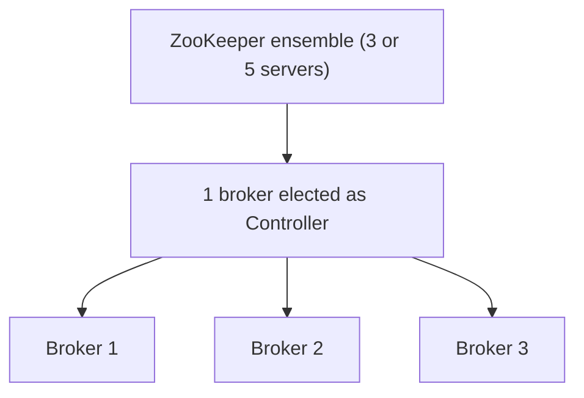
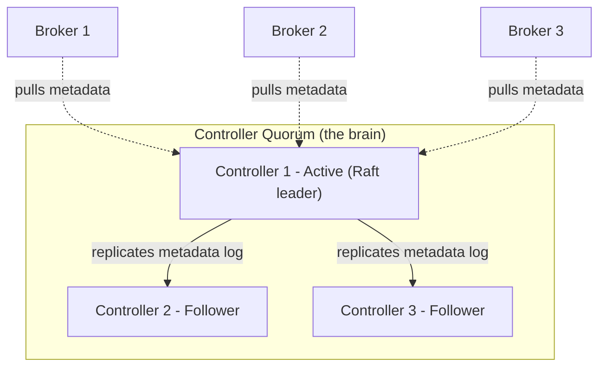
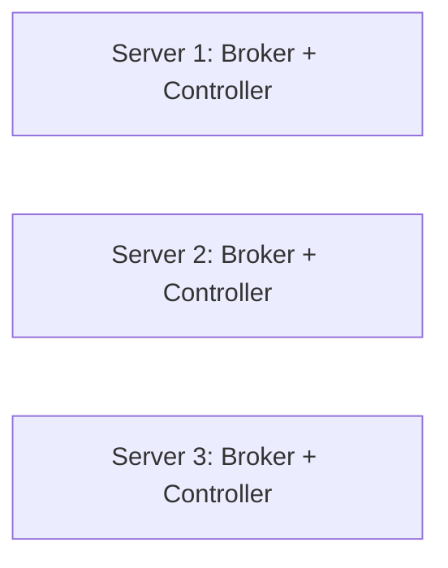
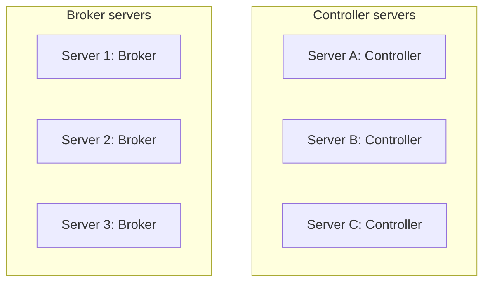

# Kafka KRaft: Complete Notes

> [!abstract] Summary
> **KRaft = Kafka + Raft.** Kafka stores its own metadata using the Raft algorithm, so the separate ZooKeeper system is no longer needed.

## Table of Contents
1. [[#1. Basics: What is metadata?]]
2. [[#2. The old way: ZooKeeper]]
3. [[#3. The new way: KRaft]]
4. [[#4. Architecture and components]]
5. [[#5. How KRaft works step by step]]
6. [[#6. Quorum and failure tolerance]]
7. [[#7. Node roles and deployment modes]]
8. [[#8. How many servers do I need?]]
9. [[#9. Network communication]]
10. [[#10. Configuration and startup]]
11. [[#11. ZooKeeper vs KRaft]]
12. [[#12. Best practices]]
13. [[#13. Doubts and answers]]

---

## 1. Basics: What is metadata?

A Kafka cluster must always know:
- Which topics exist
- Which broker is the **leader** of each partition
- Which brokers are alive
- Configs, ACLs, quotas

This is called **metadata**. Someone must store it and keep all brokers in agreement.

> [!example] Industrial example
> A logistics company has 100 warehouses (brokers). A central control room (controller) keeps the master record of which warehouse handles which route. If that record is wrong, deliveries get lost.

**Two kinds of data in Kafka:**

| Type | Meaning | Stored by |
|---|---|---|
| User data | Your messages and events | **Brokers** |
| Metadata | Info about the cluster | **ZooKeeper (old) / Controllers (KRaft)** |

---

## 2. The old way: ZooKeeper

Kafka used a **separate system, ZooKeeper**, to store metadata.



**Problems:**
- Two systems to install, secure, monitor and upgrade
- Slow controller failover (the new controller had to reload all metadata from ZooKeeper)
- Limit on the number of partitions

> [!warning] Common misunderstanding
> ZooKeeper did **not** run on one server in production. One server is a single point of failure, so production used an **ensemble of 3 or 5 servers** (it uses its own majority algorithm, ZAB).

---

## 3. The new way: KRaft

- Kafka manages metadata **by itself** using the **Raft consensus algorithm**.
- Production-ready from **Kafka 3.3**.
- **Kafka 4.0 removed ZooKeeper completely.** New clusters must use KRaft.

> [!tip] What is consensus?
> A way for many servers to **agree on one truth**, even when some servers fail.

---

## 4. Architecture and components



| Part | Role | Simple meaning |
|---|---|---|
| **Controller node** | Manages cluster metadata | The manager |
| **Active controller (Raft leader)** | The only one that accepts changes | Manager on duty |
| **Standby controllers (Raft followers)** | Keep a copy, ready to take over | Backup managers |
| **Broker** | Stores and serves topic data | The worker |
| **`__cluster_metadata`** | Internal log of all metadata changes | The official record book |

---

## 5. How KRaft works step by step

**Step 1: Every change becomes a log record.**
When you create a topic or a broker joins, the active controller writes an event to `__cluster_metadata`:

```text
offset 0: BrokerRegistered(broker=1)
offset 1: TopicCreated(orders, 3 partitions)
offset 2: PartitionLeaderChanged(orders-0 -> broker 2)
```

**Step 2: Raft replicates the log.**
The leader sends each record to the followers. A record is **committed** only when a **majority** has stored it.

**Step 3: Brokers pull metadata.**
Brokers fetch the log like a consumer reads a topic, and build their own view of the cluster.

> [!note] Push vs pull
> ZooKeeper mode: the controller **pushed** updates to brokers.
> KRaft mode: brokers **pull** updates. This is simpler and more reliable.

**Step 4: Leader failure and election.**
1. Followers notice the leader's heartbeat stopped.
2. A follower becomes a **candidate** and asks for votes.
3. The first to get a **majority** becomes the new leader, with a higher **epoch** number.
4. The new leader already has the full log, so failover takes **seconds or less**.

**Step 5: Snapshots.**
Controllers periodically save a **snapshot** of the full state. This keeps the log small and lets a restarted node catch up fast.

---

## 6. Quorum and failure tolerance

Raft needs a **majority** to work.

| Controllers | Majority needed | Failures tolerated |
|---|---|---|
| 1 | 1 | 0 (learning only) |
| 3 | 2 | **1** |
| 5 | 3 | **2** |

> [!important] Always use an odd number
> 4 controllers tolerate no more failures than 3, so the extra node is wasted.

> [!example] Industrial example
> A bank approval committee of 3 members needs 2 votes. If one is absent, work continues. If two are absent, everything stops, which is safer than approving without agreement.

---

## 7. Node roles and deployment modes

A **server** here means one **Kafka process (node)**. Each node has a role set by `process.roles`:

| Role | Meaning | Mode |
|---|---|---|
| `broker` | Only stores data | Dedicated |
| `controller` | Only manages metadata | Dedicated |
| `broker,controller` | Does both | Combined |

### Combined mode
One process does **both jobs**. Controller logic and broker logic stay separate inside the process; they only share the machine.



- **Good for:** learning, dev, test, small setups
- **Risk:** a heavily loaded broker (traffic spike, full disk) slows the controller on the same node

### Dedicated mode
Controllers and brokers run on **separate servers**.



- **Good for:** production
- **Why:** metadata management is isolated from heavy data traffic

> [!example] Factory comparison
> **Combined:** the manager also works on the assembly line. Fine for a small workshop, but if the line is busy, management suffers.
> **Dedicated:** the manager sits in a separate office. The line can be very busy and management still works.

---

## 8. How many servers do I need?

> [!warning] "Same server" does not mean "one server"
> In combined mode, "same server" means the **broker and controller roles share one machine**. The cluster still has **3 servers** so Raft has a majority and one server can fail.

### Combined mode: two cases

| Case | Servers | Fault tolerance | Use |
|---|---|---|---|
| A | 1 | None (crash = everything stops) | Laptop learning only |
| B | 3 | 1 server can fail | Small dev, test, low budget |

### Server count for 3 brokers

| Setup | Metadata servers | Broker servers | Total |
|---|---|---|---|
| ZooKeeper (production) | 3 ZooKeeper | 3 | **6** |
| KRaft dedicated | 3 controllers | 3 | **6** |
| KRaft combined | 0 extra (shared) | 3 | **3** |

> [!tip] Dedicated mode does not cost double
> Controllers only handle metadata, so they run on **small machines** (for example 2 vCPU, 4 GB RAM). Brokers get the big machines with large disks.

### Which one to pick?

| Situation | Choice |
|---|---|
| Laptop learning | Combined, 1 node |
| Dev or test | Combined, 3 nodes |
| Small production, limited budget | Combined, 3 nodes (some risk) |
| Large or critical production | Dedicated, 3 controllers (or 5 for very critical, across availability zones) plus brokers as needed |

> [!example] Industrial example
> **Startup, small traffic:** 3 combined servers, cheap and simple.
> **Large e-commerce:** 3 small controller servers plus 6 or more big broker servers. Metadata stays stable during traffic spikes.

---

## 9. Network communication

All communication happens **over the network**, in both modes.

| Who | Talks to | Port (example) | Purpose |
|---|---|---|---|
| Controller | Other controllers | `9093` | Raft voting and log replication |
| Broker | Controllers | `9093` | Pull metadata |
| Producer / Consumer | **Brokers only** | `9092` | Send and read data |

> [!important]
> Clients **never** talk to controllers directly.

---

## 10. Configuration and startup

**Dedicated controller (`server.properties`):**

```properties
process.roles=controller
node.id=1
controller.quorum.voters=1@ctrl1:9093,2@ctrl2:9093,3@ctrl3:9093
controller.listener.names=CONTROLLER
listeners=CONTROLLER://:9093
```

| Line | Meaning |
|---|---|
| `process.roles` | What this node does (`broker`, `controller` or both) |
| `node.id` | Unique ID of this node |
| `controller.quorum.voters` | All voting controllers as `id@host:port` |
| `controller.listener.names` | Name of the listener used for controller traffic |
| `listeners` | Host and port this node listens on |

**Start a cluster:**

```bash
# 1. Generate a cluster ID (once)
bin/kafka-storage.sh random-uuid

# 2. Format storage on every node with that ID
bin/kafka-storage.sh format -t <CLUSTER_ID> -c config/server.properties

# 3. Start Kafka
bin/kafka-server-start.sh config/server.properties
```

> [!note]
> Kafka 4.x also supports **dynamic quorum**: add or remove controllers without restarting the whole cluster.

---

## 11. ZooKeeper vs KRaft

| Feature | ZooKeeper mode | KRaft mode |
|---|---|---|
| Systems to run | Kafka + ZooKeeper | **Kafka only** |
| Metadata storage | In ZooKeeper | In Kafka's own log |
| Controller failover | Slow (reload metadata) | **Fast** (already in sync) |
| Partition scalability | Limited | **Millions of partitions** |
| Security and monitoring | Two setups | **One setup** |
| Team skills needed | Two | **One** |
| Status | Removed in Kafka 4.0 | **Standard** |

> [!important] The real benefit of KRaft
> It is **not** about fewer servers. It is **simpler operations, faster failover and better scalability**.

> [!example] Industrial example
> Before: DevOps patches Kafka and ZooKeeper separately, keeps two dashboards, handles two kinds of outages. After KRaft: one system to patch and monitor, even if the server count is the same.

---

## 12. Best practices

1. **Separate controllers from brokers** in production.
2. **Run 3 controllers** on different machines or availability zones (5 for very critical systems).
3. **Avoid combined mode** for critical production workloads.
4. **Use fast disks** for controllers, since they write the metadata log constantly.
5. **Monitor** the active controller count (must always be exactly 1) and metadata lag.
6. **Plan migration:** move ZooKeeper-based clusters to KRaft **before** upgrading to Kafka 4.x.

---

## 13. Doubts and answers

> [!question]- Does KRaft run on the same server or a different server?
> Your choice. Same machine = combined mode. Separate machines = dedicated mode. See [[#7. Node roles and deployment modes]].

> [!question]- Why does combined mode show Server 1, 2, 3 if it is "same server"?
> "Same server" means broker and controller share a machine. The cluster still has 3 machines for the Raft majority. See [[#8. How many servers do I need?]].

> [!question]- To run 3 brokers, do I need 6 servers?
> Only in dedicated mode. Combined mode needs just 3. See the server count table in [[#8. How many servers do I need?]].

> [!question]- Was ZooKeeper better because it used only one server?
> No. Production ZooKeeper needed 3 or 5 servers. KRaft needs the same or fewer. See [[#2. The old way: ZooKeeper]] and [[#11. ZooKeeper vs KRaft]].

---

## Quick recap

- Kafka needs **metadata**. KRaft stores it inside Kafka using **Raft**.
- Controllers form a **quorum**; one is the **leader**, brokers **pull** from the `__cluster_metadata` log.
- **Combined mode** (3 servers) for dev and small setups. **Dedicated mode** (3 small controllers plus brokers) for production.
- Use an **odd number** of controllers: 3 or 5.

## Next topics to study
- Partition leader election and ISR (for user data)
- Step-by-step ZooKeeper to KRaft migration
- Hands-on: 3-node KRaft cluster with docker-compose