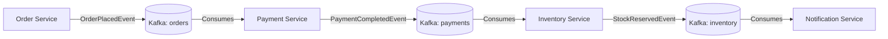

 # Apache Kafka — Structural Syllabus & Revision Roadmap

> [!abstract] Overview
> A structured, concept-driven syllabus from **zero → production level** designed for backend engineering and microservices. 
> Concepts are organized **structurally by architectural domains** (no arbitrary phases) so you can track what you have covered, revise systematically, and complete upcoming topics.

---

## 🧭 Vault Navigation & Sequential Revision Notes

| Note Number & Title | Key Concepts Covered | Status |
|---|---|---|
| **[[001-Introduction_and_Problem_Statement.md\|001. Introduction & Problem Statement]]** | Why Kafka exists, REST bottlenecks, decoupling, resilience | ✅ Covered |
| **[[002-Core_Terminologies.md\|002. Core Terminologies & Data Model]]** | Records, Keys, Values, Offsets, Topics, Partitions, Brokers | ✅ Covered |
| **[[003-Kafka_Architecture_and_Internals.md\|003. Kafka Architecture & Internal Mechanics]]** | Message flow, Pull vs Push, Sequential I/O, Page Cache, Zero-Copy | ✅ Covered |
| **[[004-Topics_and_Partitions.md\|004. Topics, Partitions & Storage Topologies]]** | Sharding, parallelism, broker storage, single vs multi-broker | ✅ Covered |
| **[[005-Producer_Partitioning_and_Ordering.md\|005. Producer Partitioning & Ordering]]** | Key hashing (Murmur2), Sticky partitioner, per-entity order | ✅ Covered |
| **[[006-Consumers_and_Consumer_Groups.md\|006. Consumers, Consumer Groups & Load Balancing]]** | 1-to-1 partition rule, scaling consumers, offset commits | ✅ Covered |
| **[[007-Replication_and_Fault_Tolerance.md\|007. Replication, High Availability & Fault Tolerance]]** | Leaders, Followers, Replication Factor, ISR, failover | ✅ Covered |
| **[[008-KRaft_and_Cluster_Consensus.md\|008. Kafka KRaft: Architecture, Consensus & Operations]]** | Raft consensus, Controller Quorum math, Combined vs Dedicated | ✅ Covered |
| **[[009-End_to_End_Industrial_Example.md\|009. End-to-End Industrial Example]]** | E-commerce order lifecycle, broker & consumer failover | ✅ Covered |
| **[[010-Kafka_CLI_Commands.md\|010. Essential Kafka CLI Operations]]** | Topic management, console producer/consumer with keys, storage CLI | ✅ Covered |
| **[[011-Quick_Revision_and_Interview_Guide.md\|011. Quick Revision & Interview Guide]]** | 18 High-yield Q&As, 5 critical confusions, interview checklist | ✅ Covered |

---

## 📊 Concept Progress Tracker

| Structural Domain | Key Concepts | Status | Notes Link |
|---|---|---|---|
| **1. Distributed Messaging Foundations** | Problem space, REST vs Kafka, Loose coupling, Internal mechanics | ✅ Covered | [[001-Introduction_and_Problem_Statement.md\|001]], [[002-Core_Terminologies.md\|002]], [[003-Kafka_Architecture_and_Internals.md\|003]] |
| **2. Storage Architecture & Cluster Topologies** | Topics, Partitions, Offsets, Records, Brokers, Clusters | ✅ Covered | [[004-Topics_and_Partitions.md\|004]], [[002-Core_Terminologies.md\|002]] |
| **3. Routing Mechanics & Consumer Groups** | Partition keys, Hashing, Sticky routing, Consumer Groups, Ordering | ✅ Covered | [[005-Producer_Partitioning_and_Ordering.md\|005]], [[006-Consumers_and_Consumer_Groups.md\|006]] |
| **4. High Availability & Consensus (KRaft)** | Replication factor, Leaders/Followers, ISR, ZooKeeper vs KRaft | ✅ Covered | [[007-Replication_and_Fault_Tolerance.md\|007]], [[008-KRaft_and_Cluster_Consensus.md\|008]] |
| **5. Event-Driven Design & Delivery Guarantees** | Sync vs Async events, At-least-once, At-most-once, Exactly-once, Idempotency | ⏳ To Cover | *Pending* |
| **6. Kafka with Java & Spring Boot** | `spring-kafka`, `KafkaTemplate`, `@KafkaListener`, Deserializers | ⏳ To Cover | *Pending* |
| **7. Resiliency, Error Handling & Transactions** | Retries, Dead Letter Topic (DLT), Kafka Transactions, DB Offset commits | ⏳ To Cover | *Pending* |
| **8. Performance Tuning & Observability** | Batch size, Compression, Consumer Lag, Prometheus & Grafana | ⏳ To Cover | *Pending* |
| **9. System Comparisons & Ecosystem** | Kafka vs RabbitMQ, Kafka Connect, Kafka Streams | ⏳ To Cover | *Pending* |

---

## Domain 1: Distributed Messaging Foundations & Core Problem Space

### 1.1 Why Kafka Exists (The Problem Statement)
- [x] **Status:** Covered in [[001-Introduction_and_Problem_Statement.md|001. Introduction & Problem Statement]]
- **Why REST calls are not enough in microservices:**
  - **Tight coupling:** Direct HTTP calls create synchronous dependencies across services.
  - **Cascading failures:** If downstream service is down, upstream request fails or loses data.
  - **Performance bottleneck:** Caller must block and wait for response before proceeding.
- **Real-World Contrast:**
  ```text
  Without Kafka:
  Order Service ---> (HTTP REST) ---> Inventory Service (DOWN!) ===> Order Fails!

  With Kafka:
  Order Service ---> Publishes OrderCreated Event ---> Kafka Broker (Durable Log)
                                                          |
                                      (Later when recovered)
                                                          v
                                                  Inventory Service
  ```

---

### 1.2 Core Architectural Terminologies
- [x] **Status:** Covered in [[002-Core_Terminologies.md|002. Core Terminologies & Data Model]]

| Term | Simple Meaning | Real-world Analogy |
|---|---|---|
| **Producer** | Application that creates and sends records | Sender / Publisher |
| **Consumer** | Application that reads and processes records | Worker / Receiver |
| **Topic** | Logical category or channel for events | Table name / Feed name |
| **Partition** | Ordered physical log slice within a topic | Ledger shard for concurrency |
| **Offset** | Sequential ID assigned to each message in a partition | Bookmark / Line number |
| **Broker** | A single Kafka server process | Warehouse / Post Office node |
| **Cluster** | Multiple Kafka brokers cooperating together | Postal network / Multi-node cluster |

---

### 1.3 How Kafka Works Internally
- [x] **Status:** Covered in [[003-Kafka_Architecture_and_Internals.md|003. Kafka Architecture & Internal Mechanics]]
- **Message Flow:** Producer → Broker (Partition Leader) → Follower Replicas (Sync) → Consumer (Fetch)
- **Pull Model:** Consumers actively pull data at their own pace (unlike push queues that can overwhelm slow consumers).
- **Why Kafka is Fast:**
  - **Sequential Disk I/O:** Appending to the end of a log file avoids random disk seeks (sequential disk access matches or exceeds random RAM access).
  - **OS Page Cache:** Utilizes operating system page cache heavily rather than JVM heap overhead.
  - **Zero-Copy Optimization:** Uses Linux `sendfile()` system call to transfer network packets directly from OS cache to NIC buffer without context switching.

---

## Domain 2: Storage Architecture & Cluster Topologies

### 2.1 Topics & Physical Partitions
- [x] **Status:** Covered in [[004-Topics_and_Partitions.md|004. Topics, Partitions & Storage Topologies]]
- **Why Partitions Exist:**
  - Break a single topic into multiple append-only logs for horizontal scalability.
  - **Parallelism unit:** Number of partitions determines the maximum concurrent consumers in a group.
  - Storage is distributed across different broker disks.
- **Limitation:** Ordering is strictly guaranteed **only within a single partition**, never across the entire topic globally.

---

### 2.2 Kafka Records & Offsets
- [x] **Status:** Covered in [[002-Core_Terminologies.md|002. Core Terminologies & Data Model]]
- **Record Structure:** Key (optional), Value (payload), Timestamp, Headers (metadata).
- **Offsets:**
  - Monotonically increasing numbers unique to each partition.
  - Partition 0 has offset 0, 1, 2... and Partition 1 also has offset 0, 1, 2...
  - Consumers track their reading progress by committing offsets.

---

### 2.3 Brokers, Clusters & Server Topologies
- [x] **Status:** Covered in [[004-Topics_and_Partitions.md|004. Topics, Partitions & Storage Topologies]]
- Single Broker vs Multi-Broker Deployments:
  - 3 partitions on 1 broker: Concurrency possible, but shared CPU/disk and **zero fault tolerance**.
  - 3 partitions on 3 brokers: Storage and network distributed across servers.
- **Rule of Thumb:** Partitioning divides data; Brokers host data; Replication copies data.

---

## Domain 3: Routing Mechanics, Consumer Groups & Message Ordering

### 3.1 Producer Partitioning Mechanics
- [x] **Status:** Covered in [[005-Producer_Partitioning_and_Ordering.md|005. Producer Partitioning & Ordering]]
- **Key-Based Hashing:**
  - Producer serializes key → computes Murmur2 hash → `hash % partitionCount`.
  - Same key (e.g., `userId` or `orderId`) always lands on the same partition $\implies$ ordering preserved per entity.
- **No-Key Routing (Sticky Partitioner):**
  - Batches records together for a partition until full/expired, then moves to the next partition.
- **Explicit Partition Selection:** Specifying target partition explicitly in code.

---

### 3.2 Consumer Groups & Load Balancing
- [x] **Status:** Covered in [[006-Consumers_and_Consumer_Groups.md|006. Consumers, Consumer Groups & Load Balancing]]
- **1-to-1 Partition Assignment Rule:**
  - Inside a single consumer group, each partition is consumed by **at most one** consumer instance at a time.
  - If partitions = 3, and consumers = 5: Consumer 4 and 5 sit idle (standby).
- **Multiple Consumer Groups:**
  - Different services (Inventory, Payment, Notification) have distinct `groupId`s and consume the same topic independently without affecting each other's offsets.

---

### 3.3 Message Ordering Guarantees
- [x] **Status:** Covered in [[005-Producer_Partitioning_and_Ordering.md|005. Producer Partitioning & Ordering]]
- **Entity-Level Ordering:**
  - Use `orderId` as key $\implies$ `OrderCreated`, `PaymentCompleted`, `OrderShipped` stay ordered.
  - Warning: If partition count changes later, hashing changes and entity distribution can shift.

---

## Domain 4: High Availability, Replication & Consensus Architecture (KRaft)

### 4.1 Partition Replication & ISR
- [x] **Status:** Covered in [[007-Replication_and_Fault_Tolerance.md|007. Replication, High Availability & Fault Tolerance]]
- **Roles:**
  - **Leader Replica:** Handles all producer writes and consumer reads (by default).
  - **Follower Replica:** Replicates data from leader; acts as passive standby.
- **Replication Factor (RF):**
  - Number of copies kept across distinct brokers (RF=3 recommended for production).
- **ISR (In-Sync Replicas):** Replicas caught up within `replica.lag.time.max.ms`. Only ISR members are eligible for zero-data-loss leader election.

---

### 4.2 Cluster Consensus & Metadata: ZooKeeper vs KRaft
- [x] **Status:** Covered in [[008-KRaft_and_Cluster_Consensus.md|008. Kafka KRaft: Architecture, Consensus & Operations]]
- **ZooKeeper (Legacy, removed in Kafka 4.0):** External consensus ensemble, slow failover, state synchronization bottleneck.
- **KRaft (Modern Kafka 3.3+ / 4.0):**
  - Integrated Raft consensus inside Kafka using `__cluster_metadata` topic.
  - **Controller Quorum:** Active Controller (Leader) + Standby Controllers (Followers).
  - Quorum majority requirement: $\lfloor N/2 \rfloor + 1$ (Always use odd numbers: 3 or 5).
  - **Deployment Modes:** Combined mode (Dev/Test, 3 nodes) vs Dedicated mode (Production, separate controller nodes).

---

### 4.3 Essential CLI Operations & Administration
- [x] **Status:** Covered in [[010-Kafka_CLI_Commands.md|010. Essential Kafka CLI Operations]]
- Creating topics, describing partitions/ISR, console producer/consumer, cluster ID generation (`kafka-storage.sh`).

---

## Domain 5: Event-Driven Microservices & Delivery Guarantees

> [!note] Status: Upcoming / To Cover
> You haven't covered these concepts yet. They are structured here for your upcoming study.

### 5.1 Event-Driven Architecture Fundamentals
- [ ] **Status:** Pending / To Cover
- **Concepts to master:**
  - Synchronous Request-Response vs Asynchronous Event Publishing
  - Event definition: *An immutable fact that occurred in the business domain*.
  - Events vs Commands:
    - *Command:* "ChargeCard" (expects specific handler, can fail).
    - *Event:* `OrderPlacedEvent` (broadcast to anyone interested, state already happened).
- **Event Lifecycle Examples:**
  ```text
  OrderPlacedEvent
  PaymentSuccessEvent / PaymentFailedEvent
  InventoryReservedEvent
  NotificationSentEvent
  ```

---

### 5.2 Delivery Guarantees & Idempotency
- [ ] **Status:** Pending / To Cover
- **The Three Delivery Semantics:**
  - **At-most-once:** Messages may be lost, but never duplicated (commit offset before processing).
  - **At-least-once:** Messages are never lost, but may be duplicated (commit offset after processing).
  - **Exactly-once (EOS):** End-to-end processing guarantees each message is processed effectively once.
- **Why Duplicates Occur:**
  - Network timeouts, consumer crash before committing offset, producer retries.
- **Idempotent Consumer Design:**
  - How to handle duplicates gracefully using unique idempotency keys, DB unique constraints, or Redis de-duplication stores.

---

### 5.3 Event Design, Schema Evolution & Serialization
- [ ] **Status:** Pending / To Cover
- **Concepts to master:**
  - Event payload design: Minimal events (IDs only) vs Full State Transfer (complete payload).
  - Schema Evolution rules: Adding fields, removing fields, backward and forward compatibility.
  - Serialization formats: JSON vs Apache Avro / Protobuf with Schema Registry.

---

## Domain 6: Application Development with Java & Spring Boot

> [!note] Status: Upcoming / To Cover
> You haven't covered these concepts yet. They are structured here for your upcoming study.

### 6.1 Spring Kafka Core Integration
- [ ] **Status:** Pending / To Cover
- **Dependencies & Tools:** `spring-kafka`, `spring-boot-starter`.
- **Producer Implementation (`KafkaTemplate`):**
  ```java
  @Service
  public class OrderProducer {
      private final KafkaTemplate<String, OrderEvent> kafkaTemplate;

      public OrderProducer(KafkaTemplate<String, OrderEvent> kafkaTemplate) {
          this.kafkaTemplate = kafkaTemplate;
      }

      public void publishOrder(String orderId, OrderEvent event) {
          kafkaTemplate.send("order-topic", orderId, event);
      }
  }
  ```
- **Consumer Implementation (`@KafkaListener`):**
  ```java
  @Service
  public class OrderConsumer {

      @KafkaListener(topics = "order-topic", groupId = "inventory-group")
      public void consume(OrderEvent event) {
          // Process event idempotently
          log.info("Processing order: {}", event.getOrderId());
      }
  }
  ```

---

### 6.2 Serialization & Producer/Consumer Configuration
- [ ] **Status:** Pending / To Cover
- Key & Value serializers: `StringSerializer`, `JsonSerializer`, `ErrorHandlingDeserializer`.
- Consumer properties: `enable.auto.commit=false`, `auto.offset.reset=earliest|latest`, `max.poll.records`.

---

## Domain 7: Resiliency, Error Handling Patterns & Distributed Transactions

> [!note] Status: Upcoming / To Cover
> You haven't covered these concepts yet. They are structured here for your upcoming study.

### 7.1 Consumer Error Handling & Dead Letter Topics (DLT)
- [ ] **Status:** Pending / To Cover
- **Failure Scenarios:** Transient network issue vs Poison pill (unparseable message).
- **Patterns:**
  - Retry templates with exponential backoff.
  - Non-blocking retry topics (`order-topic-retry-1`, `order-topic-retry-2`).
  - **Dead Letter Topic (DLT):** `order-topic-dlt` for human inspection or alerting after max retries exhausted.

---

### 7.2 Kafka Transactions & Exactly-Once Semantics (EOS)
- [ ] **Status:** Pending / To Cover
- **Transactional Producer:**
  - Atomic multi-topic writes (`beginTransaction`, `send`, `commitTransaction`).
- **Consume-Transform-Produce Atomic Boundary:**
  - Committing consumer offsets and producing result records in a single atomic transaction.
- **Outbox Pattern:**
  - Storing DB change + event in DB transaction, then publishing via CDC or worker.

---

## Domain 8: Performance Optimization & Production Observability

> [!note] Status: Upcoming / To Cover
> You haven't covered these concepts yet. They are structured here for your upcoming study.

### 8.1 Performance Tuning
- [ ] **Status:** Pending / To Cover
- **Producer Tuning:**
  - `batch.size` (e.g. 32KB, 64KB) & `linger.ms` (e.g. 5-20ms) for throughput.
  - `compression.type` (`snappy`, `lz4`, `zstd`) to reduce network & storage bandwidth.
  - `acks=all` with `min.insync.replicas=2` for maximum durability.
- **Consumer Tuning:**
  - `fetch.min.bytes`, `fetch.max.wait.ms`, `max.poll.interval.ms`.

---

### 8.2 Production Monitoring & Metrics
- [ ] **Status:** Pending / To Cover
- **Consumer Lag:** The difference between the latest partition offset and the consumer's current committed offset. #1 indicator of backpressure!
- **Key Metrics to Track:**
  - Broker: Under-replicated partitions, Active controller count, Disk usage, CPU/Network I/O.
  - Producer: Record error rate, request latency.
  - Consumer: Consumer lag per topic/partition.
- **Observability Stack:** Prometheus Kafka Exporter / JMX Exporter + Grafana dashboards.

---

## Domain 9: System Comparisons & Extended Ecosystem

> [!note] Status: Upcoming / To Cover
> You haven't covered these concepts yet. They are structured here for your upcoming study.

### 9.1 Kafka vs RabbitMQ
- [ ] **Status:** Pending / To Cover

| Dimension | Apache Kafka | RabbitMQ |
|---|---|---|
| **Core Architecture** | Distributed append-only commit log | Traditional smart broker / dumb consumer queue |
| **Data Retention** | Persisted on disk by retention policy (replayable) | Deleted immediately upon consumer ack |
| **Model** | Consumer Pulls | Broker Pushes (AMQP) |
| **Throughput** | Extreme (millions of msgs/sec) | High (tens of thousands of msgs/sec) |
| **Best For** | Event streaming, analytics, audit log, CDC | Complex routing, task queues, RPC patterns |

---

### 9.2 Kafka Connect & Kafka Streams
- [ ] **Status:** Pending / To Cover
- **Kafka Connect:**
  - Configuration-based framework to move data without custom code.
  - **Source Connectors:** RDBMS (Debezium CDC) → Kafka.
  - **Sink Connectors:** Kafka → Elasticsearch / S3 / Snowflake.
- **Kafka Streams:**
  - Client library for real-time stream processing within Java applications.
  - Stream-table duality (`KStream` vs `KTable`), tumbling/sliding time windows, stateful aggregations.

---

## 🛠️ Practical Microservices Practice Scenario

Use this e-commerce scenario to validate your architectural understanding (detailed walkthrough in [[009-End_to_End_Industrial_Example.md]]):



### Flow Breakdown:
1. **Order Service** creates order `ORD-101` and publishes `OrderPlacedEvent` to `orders` topic with key `ORD-101`.
2. **Payment Service** (`payment-group`) consumes the event, charges the customer, and publishes `PaymentCompletedEvent`.
3. **Inventory Service** (`inventory-group`) consumes the payment event, reserves physical stock, and publishes `StockReservedEvent`.
4. **Notification Service** (`notification-group`) consumes the inventory event and sends an SMS/Email to the user.
5. **Notice:** No service makes synchronous HTTP calls to any other service!

---

## 💡 The 3 Golden Questions for Any Kafka Flow

Whenever designing or troubleshooting a Kafka architecture, always ask:
1. **Which service is the Producer and which is the Consumer?** (Identifies data flow and boundaries).
2. **What happens if a Consumer service is down?** (Validates retention, consumer lag, and recovery).
3. **What is the Partition Key and how is ordering preserved?** (Ensures correct routing without concurrency race conditions).
